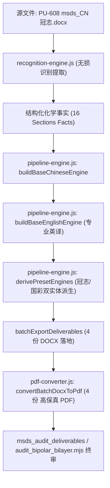

# Design: PU-608 标准 8 格式全量交付工程设计

## 1. 架构拓扑与调用链 (Architecture & Topology)

## 2. 关键设计考量与决策 (Key Design Decisions)

1. **唯一路由权威**：所有 DOCX 的装配、生成与 PDF 转换严格经由 `MSDS-Engine` 底座执行，绝对不写临时 ad-hoc 脚本；
2. **双实体隔离**：广州冠志与英德国彩的统一社会信用代码、地址、电话与传真通过 `ENTITY_MATRIX` 严格注入，防止跨企业数据串扰；
3. **英文专业翻译与修剪**：
   - 聚氨酯分散体 -> `Polyurethane dispersion` (CAS 9009-54-5)
   - 去离子水 -> `Deionized water` (CAS 7732-18-5)
   - N－甲基吡咯烷酮(NMP) -> `N-Methyl-2-pyrrolidone` (CAS 872-50-4)
   - 通过 `assertZeroChinese` 机械检测门禁；
4. **高质量无头 PDF 转换**：利用底层 LibreOffice / Word COM 无头高保真守护进程，确保 8 格式全交付。
