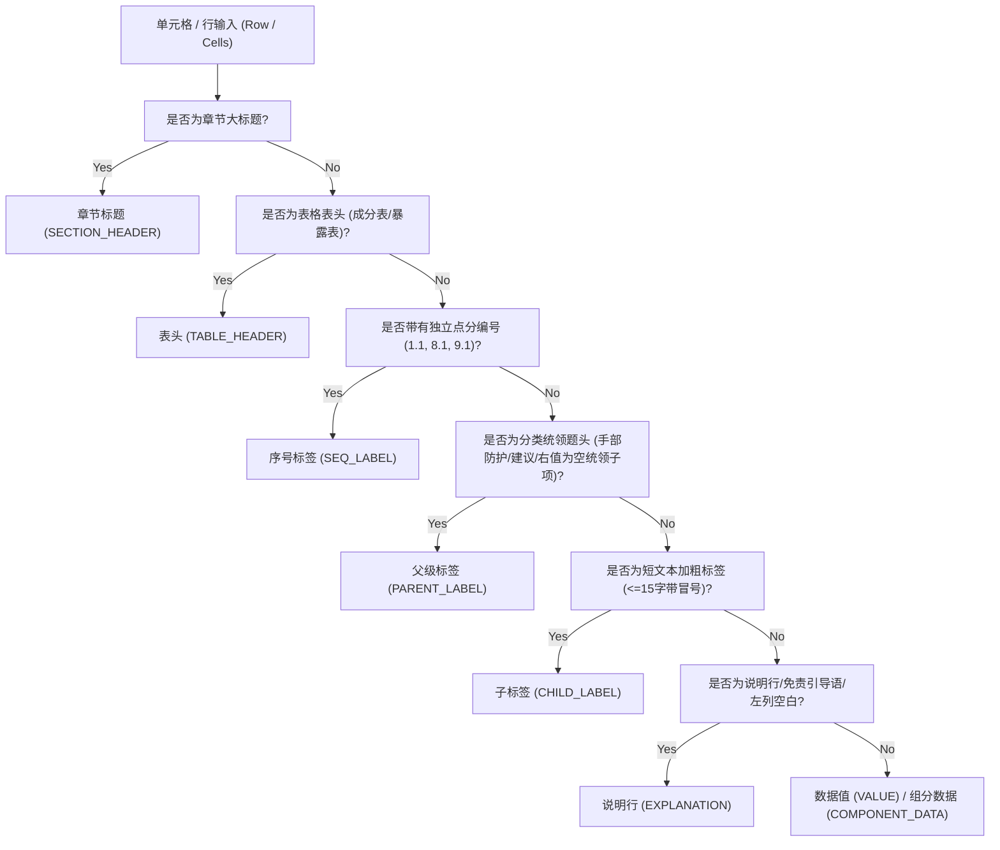

# Technical Design: Hierarchical Label Semantics and Project Knowledge Base

## 1. 架构总览与知识库拓扑

本设计在 `MSDS-Engine` 底座中确立两大核心支柱：
1. **静态持久化知识库 (`docs/knowledge-base/`)**：
   - 确立《MSDS 表格结构与语义层级定义规范手册》（`MSDS_TABLE_SEMANTICS_AND_LABEL_TAXONOMY.md`）；
   - 将 7 大分类与 6 大词法边界法则固化为代码级与人工审阅级的权威依据。
2. **动态语义识别引擎精细化 (`recognition-engine.js`)**：
   - 将原有粗粒度的 `标签` 彻底升级为 `父级标签` 与 `子标签`；
   - 构建基于词法特征、章节上下文与统领关系的分类状态机。

## 2. 标签层级二分算法详细设计

### 2.1 父级标签 (Parent Label)
- **定义**：在局部表格中起分类聚合、统领下属多行细分属性的题头，通常右侧值格为空（INV-PRUNE-01 留空白名单），或者为法定特例分类题头。
- **命中规则**：
  1. 命中白名单模式：`/(?:手部防护|建议|供应商信息|分类题头|分类标准|防护指南|通用要求)[：:]?$/`；
  2. 结构特征：在双列行中，左列包含简短标签，但右列为空（`!c1Text`），且并非末尾免责声明或段落引言；
  3. 特例：Section 8 的 `手部防护：` 与 `建议：` 强制判定为 `父级标签`。

### 2.2 子标签 (Child Label)
- **定义**：无独立数字编号、依附于小节或父级标签之下的具体细分参数标签。
- **命中规则**：
  1. 常见细分属性词：`/(?:中文名称|英文名称|化学品分类|产品类型|供应商名称|供应商地址|电话|传真|应急电话|GHS分类|GHS象形图|警示词|危险性说明|防范说明|呼吸系统防护|眼睛防护|身体防护|手套材料|手套厚度|渗透时间|处理方法|废弃处置)[：:]?$/`；
  2. 结构特征：在双列行中，左列简短（`c0Text.length <= 15`），末尾带冒号或包含加粗，右列具备明确数据值。

## 3. 产物与双向核销

在 PA-3612 Context 1 中，预期核销映射：
- Section 1:
  - `1.1产品名称：` -> `序号标签`
  - `中文名称：` -> `子标签`
  - `化学品分类：` -> `子标签`
  - `1.3供应商信息：` -> `序号标签` (或父级标签)
  - `供应商名称：`、`供应商地址：`、`电话：`、`传真：` -> `子标签`
- Section 2:
  - `2.危险性概述` -> `章节标题`
  - `物质或混合物分类` -> `说明行`
  - `GHS分类：` -> `子标签`
  - `GHS象形图：` -> `子标签`
- Section 8:
  - `8.1控制参数` -> `序号标签`
  - `8.2暴露控制` -> `序号标签`
  - `呼吸系统防护：` -> `子标签`
  - `手部防护：` -> `父级标签`
