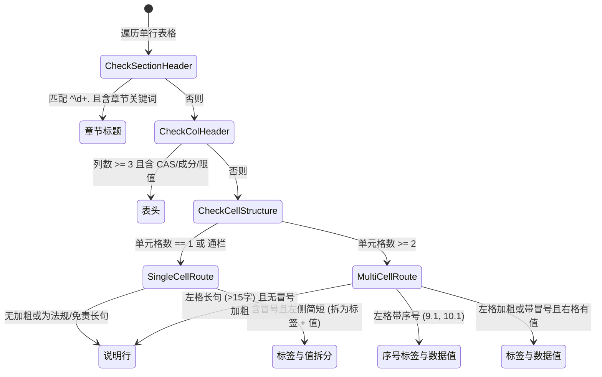

# Design: MSDS Source Recognition Optimization & Context 1 Semantic Typing

## 一、技术架构方案 (Technical Architecture)

```
┌────────────────────────────────────────────────────────────────────────┐
│ 统一调用入口: node web/scripts/run_source_recognition.mjs / MCP        │
└──────────────────────────────────┬─────────────────────────────────────┘
                                   │ 1. 加载源 DOCX 物理文件
┌──────────────────────────────────▼─────────────────────────────────────┐
│ 识别解析底座: recognition-engine.js (parseDocx & normalizeGrid)        │
└──────────────────────────────────┬─────────────────────────────────────┘
                                   │ 2. 抽取 16 章节 Raw Rows
┌──────────────────────────────────▼─────────────────────────────────────┐
│ 多维语义分类器: classifyRowSemanticType(row, secNum, engine)           │
│ • 特征 1: 文本加粗 (isBold)                                           │
│ • 特征 2: 冒号特征 (hasColon, colonIndex)                              │
│ • 特征 3: 序号模式 (seqPattern: ^\d+\.\d+)                             │
│ • 特征 4: 单元格列宽与跨度 (gridSpan, colCount)                        │
│ • 特征 5: 句式语义探查 (isNarrativeSentence, isTableColHeader)        │
└──────────────────────────────────┬─────────────────────────────────────┘
                                   │ 3. 产出结构化语义标记
┌──────────────────────────────────▼─────────────────────────────────────┐
│ 语义类型状态机: (章节标题 | 序号标签 | 标签 | 数据值 | 说明行 | 表头) │
└──────────────────────────────────┬─────────────────────────────────────┘
                                   │ 4. 原生 Markdown 序列化器
┌──────────────────────────────────▼─────────────────────────────────────┐
│ 产出 Context 1 Markdown: serializeFactsToMarkdown(facts)               │
│ • 4 列标准排版: | 行号 | 属性 | 标签/题头 | 数据值/内容 |             │
│ • 同步落盘 output/<model>/<model>_context1_recognition.md              │
└────────────────────────────────────────────────────────────────────────┘
```

---

## 二、语义状态机转移设计 (Semantic Classification State Machine)



---

## 三、因果拓扑与拟变角色分析 (Causal Topology & Roles)

1. **[Root Source] 语义分类器增强 (`web/src/recognition-engine.js`)**：
   - 根因：此前仅依据列位置硬套，导致单列长句说明被粗暴视为 Column 0 标签；
   - 改造：实现 `classifyCellSemanticType` 与 `classifyRowSemanticType`，为每个单元格打上确切的属性标签，并实现 `serializeFactsToMarkdown`。
2. **[State Transition] 统一 CLI 驱动入口 (`web/scripts/run_source_recognition.mjs`)**：
   - 根因：此前缺乏一键调用的独立脚本，导致每次都要手写临时 scratch 脚本；
   - 改造：创建标准化 CLI 命令行入口，接收 `--source` 与 `--output` 参数，秒级产出 JSON 与 Markdown 资产。
3. **[Sink] MCP 工具透出 (`web/src/mcp-server.js`)**：
   - 根因：MCP `msds_recognize_source` 仅返回 raw facts，未返回 Context 1 Markdown 文本；
   - 改造：直接在 MCP 返回 payload 中增加 `context1Markdown` 属性，供 Agent 直取。
