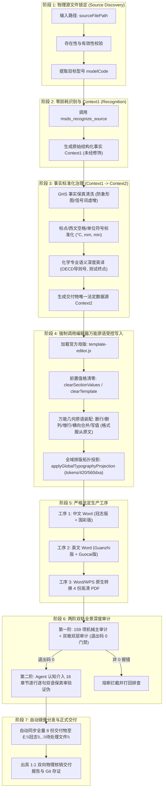

# Design: Agent MSDS-Studio 7 阶标准受控生产工作流架构设计

## 一、 系统架构与状态机流转拓扑

全系统生命周期严格遵循 7 阶单向不可逆状态机流转：

---

## 二、 关键模块与接口职责分工

1. **识别感知模块 (`recognition-engine.js` / `msds_recognize_source`)**：
   - 提取源文档 16 章节全部原始物理事实，生成原始 `Context1`。
2. **上下文治理器 (`context-governor.js` 或流水线内治理函数)**：
   - 将 `Context1` 转化为 `Context2`，落实 GHS 防虚增、西文符号纠正与 OECD 深度英译。
3. **编辑器核心与万能原语 (`template-editor.js` / `universal-editor-primitives.js` / `docx-engine.js`)**：
   - 提供 `clearTemplateValues`、`deleteRow`、`deleteColumn`、`mergeCells`、`insertRow`、`writeCellValue`、`applyGlobalTypographyProjection` 等标准能力。
   - 杜绝一切绕开编辑器的裸 XML 拼接与单型号 ad-hoc 脚本。
4. **统一生产调度总控 (`production-orchestrator.js` / CLI `produce_standard_deliverables.mjs`)**：
   - 顺序编排阶段 1 至阶段 7，包含原生 PDF 转换、目录镜像同步与双重审计串联。
5. **官方 MCP 协议服务端 (`mcp-server.js`) 与网关 (`msds_mcp_gateway.mjs`)**：
   - 将 `msds_batch_export_eight` 与 `msds_audit_deliverables` 对齐绑定至总控，作为 Agent 唯一标准操作通路。
6. **全局技能宪法 (`skills/msds-studio/SKILL.md`)**：
   - 永久固化 7 阶 SOP，作为所有跨线程 Agent 必须严格遵循的最高作业指南。
