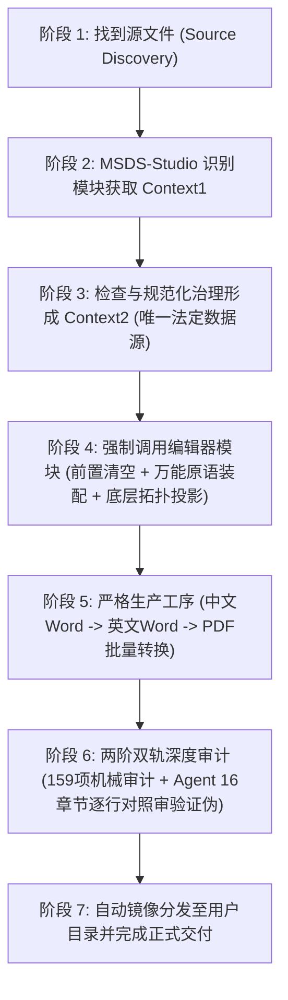

# Proposal: Agent MSDS-Studio 7 阶标准受控生产工作流立法规范

## 一、 背景与根因剖析 (Why)
在以往的 MSDS 生产交互中，由于缺乏一条具有强制性的标准调用路径，生产 Agent 经常出现以下几种违背系统架构的病态行为：
1. **脱离编辑器直改底模/私写 ad-hoc 脚本**：不调用 MSDS Studio 已具有标准化排版输出与剪枝能力的编辑器模块，而是私自编写长达数百行的临时 Node/Python 脚本直接解包修改 OOXML，造成型号特判代码膨胀且极其脆弱；
2. **死板硬套模板固定网格**：当源文档为 8 行毒理或 4 行成分时，死板保留模板原有的 12 行，或者生硬套用假端点，违背了“格式服从于原文”的最高公理；
3. **未做前置清空导致底模脏数据残留**：底模内自带的历史残留示范数据（如示范 CAS、浓度）未清空即混入产出物；
4. **源事实缺乏治理直接填入**：从源文件提取的事实未经过规范化治理（标点符号、度数符号 °C、GHS 象形图虚增判定等）即行输出，导致多次主审计被拦截；
5. **工序混乱与审计形式主义**：未遵循严格的“中文 Word $\rightarrow$ 英文 Word $\rightarrow$ PDF”生产工序，且仅做机械测试打勾，缺少 Agent 对 16 章节双语逐行保真度的深度介入审计。

为彻底根治上述顽疾，本提案将 MSDS-Studio 的工作流路径强制收敛并立法为不可动摇的 **7 阶标准受控作业流水线**。

---

## 二、 变更目标与 7 阶工作流全景设计 (What Changes)

---

## 三、 1:1 需求物理对账矩阵 (RTM)

| 阶段编号 | 用户原始输入条目 | 需求拆解与系统法定契约 | 对应 Specs 条目 | 对应原子任务 |
| :--- | :--- | :--- | :--- | :--- |
| **STAGE-01** | `1. 找到源文件` | 物理源文件定位与存在性校验，提取目标型号 (Model Code) 并冻结输入指纹 | `specs/msds-studio-workflow/spec.md#stage-1-source-discovery` | `tasks.md#task-1` |
| **STAGE-02** | `2. 调用MSDS-Stuido 识别模块并导入源文件进行识别获取源文件内容Context1` | 调用 `msds_recognize_source` 模块零损耗提取源文档 16 章节原始化学事实，形成 `Context1` | `specs/msds-studio-workflow/spec.md#stage-2-recognition-context1` | `tasks.md#task-2` |
| **STAGE-03** | `3. 对源文件内容进行检查，并按照全局规范与局部规范要求/审计要求等 对源文件内容进行标准化处理，形成Context2` | 对 `Context1` 进行全局/局部规范治理（标点、符号、非危化品防虚增、双语专业语义地道英译），形成高质量 `Context2` | `specs/msds-studio-workflow/spec.md#stage-3-standardization-context2` | `tasks.md#task-3` |
| **STAGE-04** | `4. 调用编辑器模块，写入Context2 的内容并产出...必须使用编辑器...先清空内容...内容必须来源于源文件...格式服从原文...能力调用` | 强制调用编辑器模块：前置清空底模残留数据，利用编辑器万能原语（增行、删行、删列、合并、剪枝、写入）将 `Context2` 写入，自动继承 Design Tokens 与自适应标尺 | `specs/msds-studio-workflow/spec.md#stage-4-universal-editor-execution` | `tasks.md#task-4` |
| **STAGE-05** | `5. 先做中文，再做英文，先做word，再做pdf` | 严格执行线性工序：① 中文 Word (冠志+国彩) $\rightarrow$ ② 英文 Word (Guanzhi+Guocai) $\rightarrow$ ③ 原生转换 4 份高清 PDF | `specs/msds-studio-workflow/spec.md#stage-5-strict-production-order` | `tasks.md#task-5` |
| **STAGE-06** | `6. 对产出结果进行审计（使用机械审计+Agent使用全局与局部规范以及各项审计要求进行16section介入审计，并逐行对照翻译情况` | 两阶双轨深度审计：① 机械主审计（159项，退出码0）+ 双极双层审计；② Agent 逐章节介入 16 Section 并逐行逐句对照翻译与数值保真 | `specs/msds-studio-workflow/spec.md#stage-6-two-step-deep-audit` | `tasks.md#task-6` |
| **STAGE-07** | `7. 交付` | 自动同步 8 份正式交付物至用户工作目录 `E:\冠志\TDS MSDS (2)\待处理文件\<modelCode>\`，输出对账报告并正式交付 | `specs/msds-studio-workflow/spec.md#stage-7-delivery-and-synchronization` | `tasks.md#task-7` |
