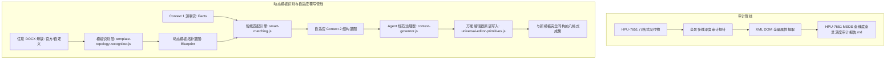

# Design: 全景多维深度审计与模板识别层解耦架构方案

## 1. 架构目标与定位
本设计响应用户对于“全要素多维深度审计”以及“拓扑层与母版硬编码解耦”的核心需求：
1. **全要素全景多维深度审计**：构建全景审计探针，穿透 DOCX 内部 XML DOM，对页眉页脚及 16 章节的文字内容、字号字阶、排版位置、表格几何、悬挂缩进、激光制表对齐、历史残留与中英差异开展拉网式核查，生成详尽的 Markdown 报告；
2. **构建独立模板识别层 (Template Recognition Layer)**：将“模板结构认知”沉淀为前置解析器，从母版文件中动态提炼几何拓扑与语义角色，使匹配引擎与覆写引擎彻底摆脱对特定母版的硬编码依赖。

## 2. 拓扑解耦与动态流动拓扑架构

## 3. 核心机制设计

### 3.1 全要素全景多维深度审计机制
- **页眉页脚**：提取公司名称、修订日期、产品型号、分页码规范；
- **16 章节网格与文字全景**：
  - 提取每个单元格的文本、字号（`w:sz`）、字体（`w:rFonts`）、对齐（`w:jc`）、粗体（`w:b`）；
  - 提取悬挂缩进（`w:ind` 的 `w:left` 与 `w:hanging`）是否为 420/560 dxa；
  - 提取边框（`w:tblBorders` 的 top/bottom/insideH/insideV 是否符合外实内虚 4/8 pt）；
  - 提取英文文档中文字符与历史死数据残留。

### 3.2 模板识别层 (Template Recognition Layer) 机制
- **函数签名**: `recognizeTemplateTopology(docxBuffer, options)`
- **输出结构**:
  - `templateKey`: 模板标识（如 `CN_Guanzhi`）；
  - `headerFooterTopology`: 页眉页脚几何与占位符；
  - `sections`: 16 章节数组，每项包含：
    - `sectionNumber`: 1~16；
    - `tableIndex`: 在文档中的表格序数；
    - `layoutType`: `FULL_WIDTH` | `TWO_COLUMN` | `MULTI_COLUMN`；
    - `rowsCount`: 默认行数；
    - `columnWidths`: 各列初始 twips 宽度；
    - `slots`: 单元格语义识别清单（`role: HEADER | LABEL | VALUE | EXPLANATION`, `label`, `cellIndex`, `rowIndex`, `editable`）。
- **自适应公理**: 当母版调整（如增减列、修改列宽、调整表头行数）时，模板识别层自动输出新拓扑，后续匹配流程自动按新拓扑填充，实现“母版更换，拓扑随动”。
