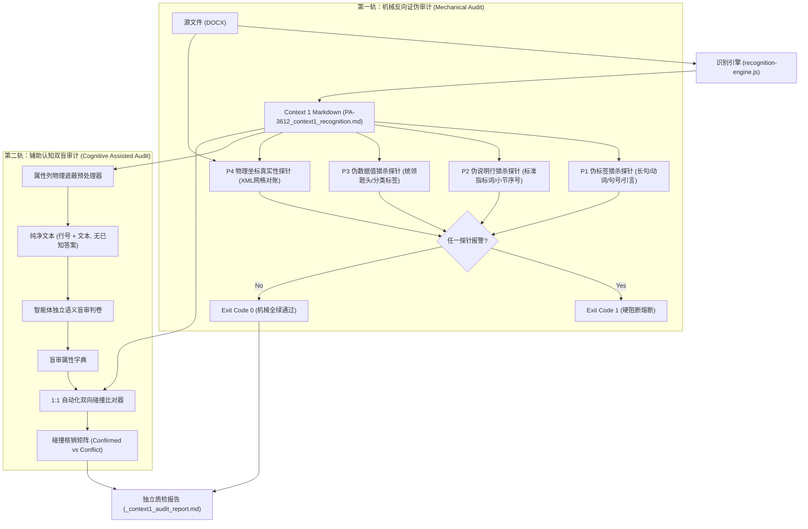

# Technical Design: Context 1 Dual-Track Adversarial Audit

## 1. 架构总览与物理隔离原则

为彻底杜绝“先射箭再画靶”，本设计确立**裁执分离公理**：
1. **生成器 (`recognition-engine.js`)**：负责提取源文档并依据多维特征进行正向预测；
2. **机械审计器 (`audit_context1_mechanical.mjs`)**：纯独立代码，**绝对不引用生成器的任何分类函数**。它只加载语言学反向证伪词库与 DOCX 物理网格事实，对 Context 1 Markdown 发动否定性猎杀断言；
3. **辅助认知审计器 (`audit_context1_cognitive.mjs`)**：执行物理遮蔽属性列的双盲认知判卷，再通过碰撞比对矩阵定位语义分歧。

## 2. 机械反向证伪探针（P1~P4）算法设计

### 探针 P1：伪标签猎杀探针 (Probe P1 - False Label Probe)
- **目标**：严查将叙述性说明行或长值误判为标签。
- **违章判据**：对于任何 `row.semanticType` 为 `标签` / `父级标签` / `子标签` 的行：
  - 若 `label` 包含行为操作动词：`/就医|催吐|冲洗|佩戴|穿着|排入|遵守|倒空|离开|洗手/`；
  - 若 `label` 包含叙述连词：`/在.*情况下|如果|若|由于|为了|就我们所掌握/`；
  - 若 `label` 末尾包含中文句号：`/。$/`；
  - 若 `label` 命中引言词：`/类似产品|评估数据|法规要求|法律法规|其他规定|其它的规定|适用范围/`；
  - 若 `label` 长度 $> 15$ 字（中文）且末尾无冒号。
  - **触发动作**：立即抛出 `[P1_FALSE_LABEL_VIOLATION]`，记录行号与违规文本，标记审计失败。

### 探针 P2：伪说明行猎杀探针 (Probe P2 - False Explanation Probe)
- **目标**：严查将标准属性标签误归为说明行。
- **违章判据**：对于任何 `row.semanticType` 为 `说明行` 的行：
  - 若文本完全等同于常见理化或毒理标准指标：`/^(?:pH值|外观|嗅觉|初沸点|闪点|蒸发速率|可燃性|相对蒸气密度|密度|水溶性|辛醇|自燃温度|动力粘度|固体含量|急性毒性|主要皮肤刺激性|主要粘膜刺激性|致敏性|致突变性)[：:]?$/`；
  - 若文本以点分编号起始（如 `/^\d+\.\d+[^0-9]/`）且右侧有实际数值。
  - **触发动作**：立即抛出 `[P2_FALSE_EXPLANATION_VIOLATION]`，记录行号与违规文本，标记审计失败。

### 探针 P3：伪数据值猎杀探针 (Probe P3 - False Value Probe)
- **目标**：严查将分类题头误填入数据值。
- **违章判据**：对于任何 `row.semanticType` 为 `数据值` 的行：
  - 若其 `value` 命中分类统领题头：`/^(?:手部防护|建议|供应商信息|分类题头)[：:]?$/`；
  - 若其 `value` 为纯法规引言说明句且右侧无条目。
  - **触发动作**：立即抛出 `[P3_FALSE_VALUE_VIOLATION]`，记录行号与违规文本，标记审计失败。

### 探针 P4：源文档物理坐标真实性探针 (Probe P4 - Physical Grounding Probe)
- **目标**：穿透 DOCX 底层 XML 单元格网格，核验物理布局与提取结果的保真度。
- **违章判据**：
  - 检查源文档中该行第 0 列物理单元格：若源文档物理单元格内容为空字符串（`""`），但在 Context 1 中却提取出了非空标签，判定为物理错位伪造；
  - 检查 Section 3 网格列数：若源文档为 3 列以上表格，Context 1 却未提取出组分数据，判定为降维失真。

## 3. 双盲碰撞辅助认知审计器算法设计

1. **遮蔽输入构造 (`maskAttributes`)**：
   - 读取 Context 1 Markdown，通过正则匹配表格行 `| 行号 | 属性 | 标签/题头 | 数据值/内容 |`；
   - 输出盲审文本格式：`[Line {index}] Text: {label} | Value: {value}`（彻底剥离 `属性` 列）。
2. **盲审规则与独立知识库注入**：
   - 注入 `docs/knowledge-base/MSDS_TABLE_SEMANTICS_AND_LABEL_TAXONOMY.md` 的法定定义标准，智能体在零先入为主的状态下独立评定属性。
3. **碰撞比对与报告生成 (`generateCollisionMatrix`)**：
   - 比较 `Actual Attribute` 与 `Blind Inferred Attribute`；
   - 若属性完全匹配，记录 `Status: CONFIRMED`；
   - 若属性不一致（如 Actual 是 `子标签`，Blind 判定为 `说明行`），记录 `Status: CRITICAL_CONFLICT`，附带两方推断依据，并在报告中输出高危警报表。
