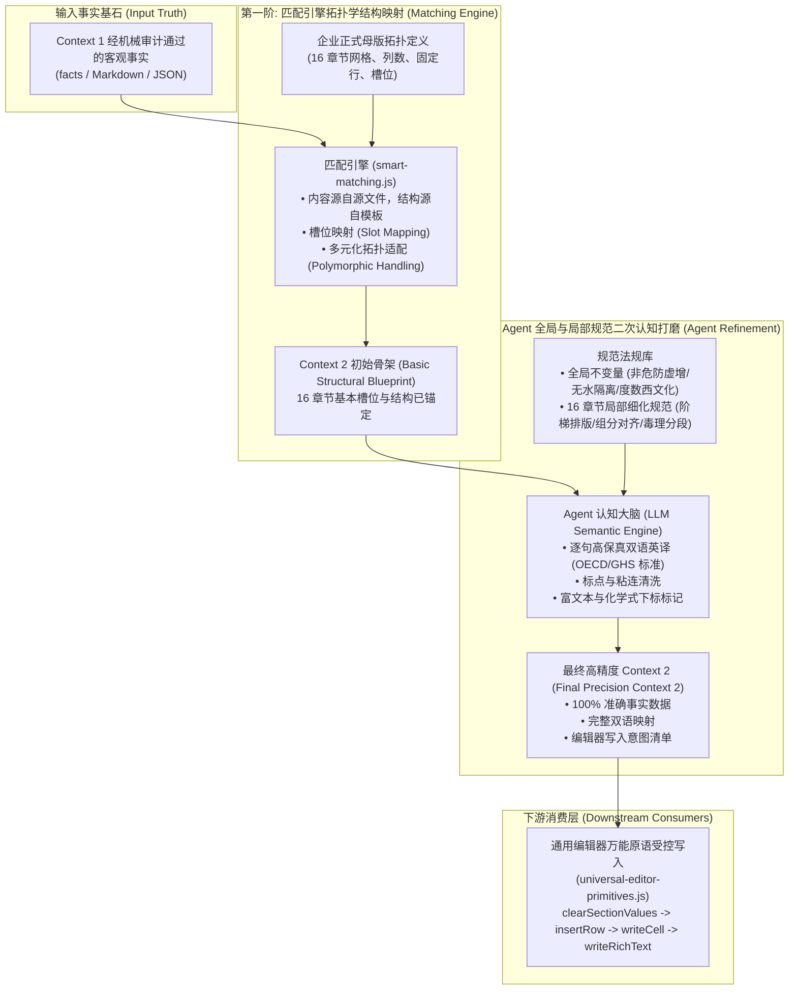
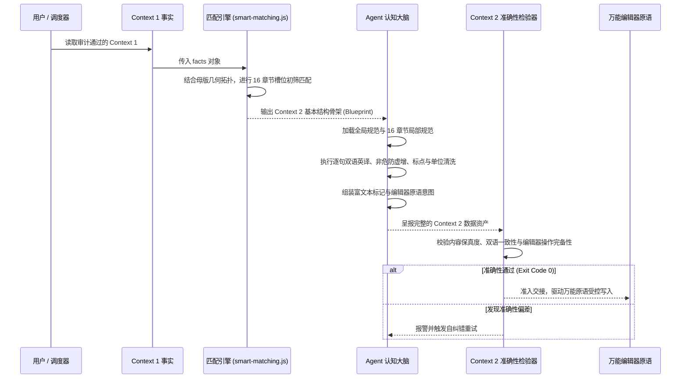

# Design Document: Context 2 匹配引擎结构拓扑映射与 Agent 规范打磨架构方案

## 一、 架构总览与两阶流水线拓扑

Context 2 生产流程彻底告别旧有 pipeline 的黑盒模式，重构为 **“匹配引擎拓扑初筛（确定基本结构） + Agent 规范二次打磨（精细语义治理）”** 的两阶确定性流水线：

---

## 二、 核心机制与不变量防护

### 1. 结构与内容的绝对分立公理 (INV-CONTENT-SOURCE-STRUCTURE-TEMPLATE)
- **内容 100% 源自原文**：匹配引擎向槽位填入的原始文本，必须严格源自 Context 1，严禁引入母版历史脏数据或保底示例数据；
- **结构 100% 源自母版拓扑**：表格列宽、行结构、表头布局必须依循正式模板的物理定义，杜绝格式随意破坏。

### 2. 匹配引擎吸收 Pipeline 职能 (Pipeline-to-Matcher Convergence)
- 废除原 `pipeline-engine.js` 中复杂的四阶段调用，将“中英文槽位初始化”、“非危品象形图分支判定”、“Section 9 冒号格式化”、“Section 11 毒理学分段”核心逻辑收敛至 `smart-matching.js` 的纯函数映射链中；
- 暴露统一纯净的执行入口：
  `matchContext1ToTemplateTopology(facts, templateVariant)` $\rightarrow$ 返回规整的结构初筛蓝图。

### 3. Agent 二次认知打磨治理项清单
- **G-01 非危品防虚增**：检测到 `isHazardous === false` 时，强制从 Section 2 中剔除象形图行与信号词行，杜绝外生“无”字；
- **G-02 专业逐句双语英译**：品名、组分、外观、气味及毒理测试终点（如 `LD50 经口 (大鼠)` $\rightarrow$ `Oral LD50 (Rat)`），由 Agent 大脑逐句精翻，不使用僵化正则替换；
- **G-03 标点与单位标准化**：清理行末悬挂冒号，中文度数符号替换为西文 `°C`；
- **L-01~L-16 章节专属打磨**：
  - Section 3：CAS 号与浓度范围格式化；
  - Section 8：手部防护说明行与子标签分类对齐；
  - Section 9：参数名与值之间冒号激光垂直对齐准备；
  - Section 11：急性毒性/皮肤腐蚀等多研究说明行空行隔离。

---

## 三、 数据流与时序设计 (Sequence Flow)

