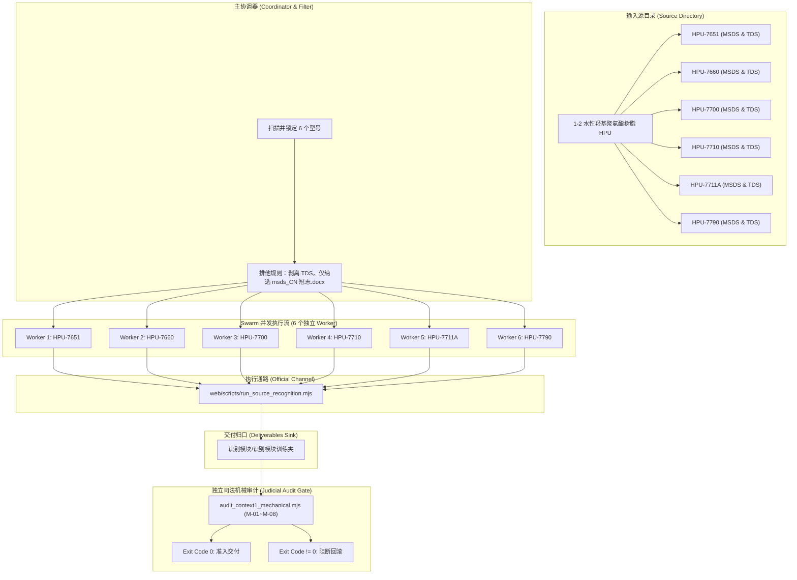
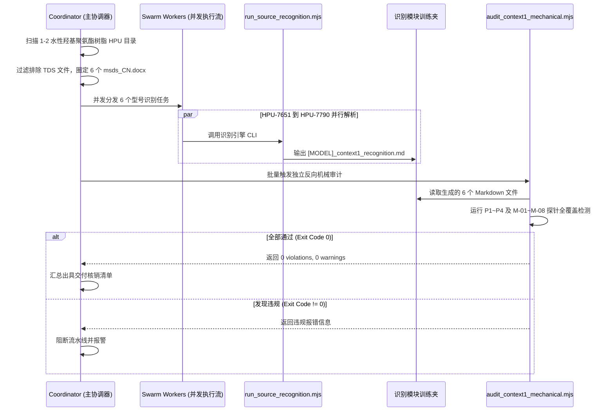

# Design Document: HPU 系列 MSDS 源文件批量 Swarm 识别与机械审计架构方案

## 一、 架构总览与拓扑图

本系统采用 **主协调器 (Coordinator) + 并发执行流 (Worker Flow) + 独立法官 (Judicial Auditor)** 的三层闭环架构。主协调器负责全量源文件的模式发现与排他过滤，将 6 个独立的 MSDS 文件分发至并发处理流中，直接通过官方受控命令行执行通道生成 Context 1 Markdown，最终由独立反向机械审计器进行一票否决式闭环验证。

---

## 二、 核心技术策略与不变量防护

### 1. 裁判与执行物理隔离 (Judicial & Executive Isolation)
- 严禁在生成脚本内部“自测自通”。
- 抽取由 `run_source_recognition.mjs` 完成，写入目标目录。
- 审计由独立脚本 `audit_context1_mechanical.mjs` 从外部读取生成的 Markdown 进行逆向证伪检测。两个脚本之间无共享全局状态。

### 2. 管道符号转义与物理网格保护 (INV-PRUNE-02)
- MSDS 表格中含有的 `|`（例如 Section 3 成分表中的 `CAS: — | 浓度: —`）在提取并渲染为 Markdown 表格时，必须被强制替换为 `\|`，避免 Markdown 解析器将单行单元格错误分裂为 5~6 列（M-04 探针检测项）。

### 3. 父子标签解耦与说明行保护 (INV-PRUNE-01)
- 识别引擎中已建立的 8 大语义类型（`PARENT_LABEL`, `CHILD_LABEL`, `VALUE`, `EXPLANATION`, `TITLE`, `SUBSECTION_HEADER`, `HEADER`, `UNKNOWN`）严格按知识库手册映射，杜绝说明行篡改与标签混淆。

---

## 三、 数据流与时序设计 (Sequence Flow)

