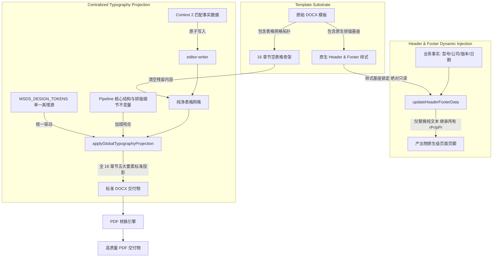

# Design: 模板原生页眉页脚样式继承与全16章节统一排版架构设计

## 1. 架构总览 (Architecture Overview)

本设计的核心目标在于：
1. **解耦页眉页脚与外部粗暴投影**：将模板自带的页眉页脚视为只读样式基座，上层只负责动态文本插槽求值，彻底保护模板原生的 22pt 加粗居中标题、型号框灰底与页脚字阶；
2. **全 16 章节统一 Design Tokens 集中投影**：在 `MSDS_DESIGN_TOKENS` 单一真理源下，建立标题、序号、标签、说明行、值的语义要素映射，在写入与拓扑层一键调控，彻底消除模板单元格历史样式的残留污染；
3. **Pipeline 核心规范与排版细节无损咬合**：将 `pipeline-engine.js` 中长期沉淀的 Section 2 两行通栏、Section 3 表头加粗与克隆、Section 8 子表头、Section 9 激光垂线、Section 13 左对齐、Section 14 合规文本、420/560 dxa 悬挂缩进和标点清洗等法定不变量，与通用编辑器原语形成无缝流水线。

---

## 2. 关键组件与因果拓扑 (Components & Causal Topology)

### 2.1 拓扑层页眉页脚保护机制 (`REQ-TOPO-HF-INHERIT-01`)
- **移除侵入式清洗**：从 `universal-editor-primitives.js:applyGlobalTypographyProjection` 中彻底移除对 `word/header*.xml` 和 `word/footer*.xml` 的字号清洗和粗体剥离循环；
- **纯净文本替换契约**：在 `docx-engine.js:updateHeaderFooterData` 中，定位对应 XML 占位符后，仅更新 `<w:t>` 节点的字符内容，绝不删除、重置或篡改母版原有的 `<w:rPr>`（包含 `<w:sz>`, `<w:b>`, `<w:rFonts>`, `<w:shd>` 等）；
- **动态域免损**：保留 `<w:fldSimple w:instr="PAGE"/>` 和 `<w:fldSimple w:instr="NUMPAGES"/>`，确保页码动态计算正常。

### 2.2 全 16 章节 Design Tokens 语义分类与集中投影 (`REQ-TYPO-UNIFIED-TOKENS-02`)
- **单一真理源**：在 `universal-editor-primitives.js` 中定义 `MSDS_DESIGN_TOKENS`：
  - **中文版 (CN)**：
    - `SECTION_HEADER`: 12pt (`sz="24"`), 宋体/Times New Roman, 加粗
    - `SUBHEADER`: 12pt (`sz="24"`), 宋体/Times New Roman, 加粗
    - `LABEL_BOLD`: 12pt (`sz="24"`), 宋体/Times New Roman, 加粗
    - `LABEL_SEQ`: 10.5pt (`sz="21"`), Times New Roman, 加粗
    - `LABEL_SEQ_TIER_B`: 9.5pt (`sz="19"`), Times New Roman, 加粗
    - `TABLE_VALUE`: 12pt (`sz="24"`), 宋体/Times New Roman, 常规体
    - `PREAMBLE`: 12pt (`sz="24"`), 宋体/Times New Roman, 常规体
  - **英文版 (EN)**：
    - `SECTION_HEADER`: 11pt (`sz="22"`), Arial, 加粗
    - `SUBHEADER`: 9.5pt (`sz="19"`), Arial, 加粗
    - `LABEL_BOLD`: 9.5pt (`sz="19"`), Arial, 加粗
    - `LABEL_SEQ`: 9.5pt (`sz="19"`), Arial, 加粗
    - `LABEL_SEQ_TIER_B`: 9.5pt (`sz="19"`), Arial, 加粗
    - `TABLE_VALUE`: 9.5pt (`sz="19"`), Arial, 常规体
    - `PREAMBLE`: 9.5pt (`sz="19"`), Arial, 常规体
- **遍历投影机制**：
  - 自动识别单元格的语义角色（Section Header / Subheader / Label / Value / Preamble）；
  - 严格根据 Design Tokens 构造或更新 `<w:rPr>`，消除任何历史残留样式；
  - 提供全局参数集中入口，未来修改 Tokens 即可一键联动改变整篇文档。

### 2.3 既有细节与不变量流水线集成 (`REQ-PIPELINE-INVARIANTS-PRESERVE-03`)
- 在 `editor-writer.js` 导出链路中，规范调用顺序：
  1. 写入业务事实数据（保留网格完整性与必要行克隆）；
  2. 调用 `enforceStructuralTypographyInvariants`（加固 Section 2、Section 3、Section 8、Section 15 细节）；
  3. 调用 `applyGlobalTypographyProjection`（应用全篇 16 章节五大语义要素统一投影与缩进/标点规整）；
  4. 最终封包并验证。

---

## 3. 依赖权衡与爆炸半径分析 (Dependencies & Blast Radius)

1. **模板文件绝对安全**：`web/public/templates/` 目录中的 DOCX 模板文件仅作为只读输入，绝对不被修改或覆盖；
2. **算法识别引擎安全**：`web/src/recognition-engine.js` 享有 `@ANTIGRAVITY_INVARIANT_LOCK` 源码级封印，完全不触碰；
3. **变更收敛范围**：
   - `web/src/universal-editor-primitives.js`: 剥离页眉页脚侵入，完善 Design Tokens 与全 16 章节投影逻辑；
   - `web/src/editor-writer.js`: 确保调用流水线顺序与细节不变量无缝集成；
   - `web/src/docx-engine.js`: 确保 `updateHeaderFooterData` 仅替换纯文本而保持样式基座完好。
