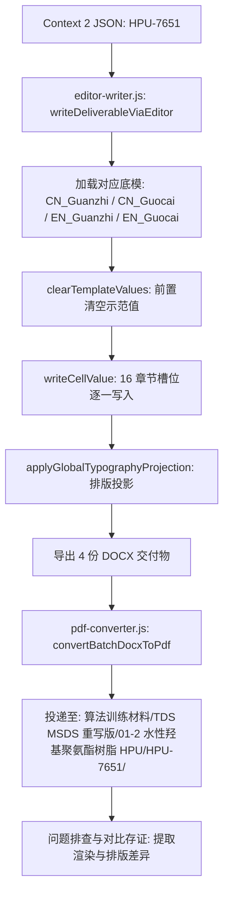

# Design: Context 2 编辑器写入与八格式导出架构方案

## 1. 架构目标与定位
本设计的核心目标在于：**严格对照并直接复用现有编辑器的写入与导出能力**，将前序生成的 Context 2（中英双轨）写入官方底模，并导出 8 份标准交付物至指定重写版目录，同时通过前置与后置观察如实提取排版与渲染问题，供用户进行后续决策。

## 2. 数据与控制流向

## 3. 核心机制保障
1. **直接对照现有编辑器功能**：
   - 遵照用户指示，不预先修改或发明复杂的全新中间件；
   - 直接复用 `web/src/editor-writer.js` 现有的 `writeDeliverableViaEditor` 函数及其依赖的 `template-editor.js` 与 `docx-engine.js` 原语。
2. **八格式导出完整性**：
   - 冠志中文 DOCX + PDF
   - 国彩中文 DOCX + PDF
   - Guanzhi 英文 DOCX + PDF
   - Guocai 英文 DOCX + PDF
3. **物理投递与留痕**：
   - 目标目录：`F:\App Location\Guanzhi Tong\Skill\MSDS-Engine\算法训练材料\TDS MSDS 重写版\01-2 水性羟基聚氨酯树脂 HPU\HPU-7651\`；
   - 写入完成后，运行检查脚本核对文件尺寸，并通过自动化/人工审阅方式列举排版格式存在的问题。
