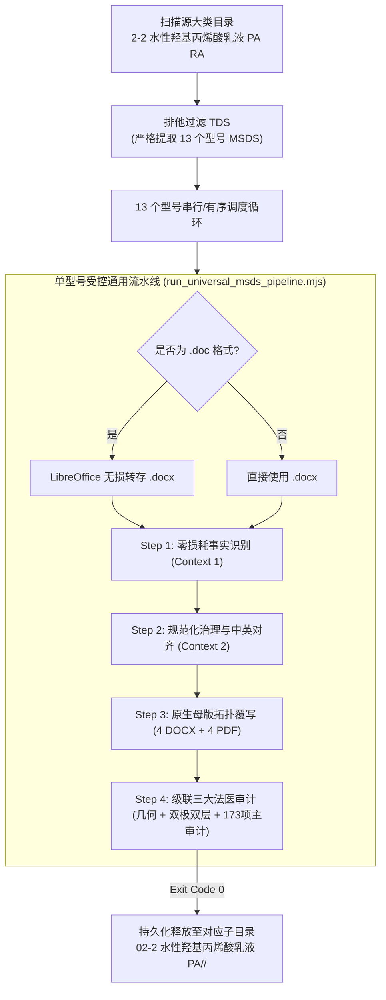

# 技术架构方案与因果拓扑设计 (Design: 02-2 13-Model Batch Production)

## 一、 系统架构与执行数据流 (Architecture & Batch Pipeline)

---

## 二、 核心技术权衡与鲁棒性保障机制

1. **显式 `--targetDir` 注入保证路径绝对隔离**：
   - 避免路径推断因包含 `/PA/` 而误判至 `02-1`，全量调用统一显式指定：
     `--targetDir="F:\App Location\Guanzhi Tong\Skill\MSDS-Engine\算法训练材料\TDS MSDS 重写版\02-2 水性羟基丙烯酸乳液 PA\<ModelCode>"`；
   - 确保产物精确落入对应的 13 个子文件夹。

2. **Word 97-2003 `.doc` 二进制自动转存机制**：
   - PA-4000、PA-4006、PA-4771、PA-4778、PA-4807、PA-4808、PA-4812、PA-4817、PA-4819 等 9 个型号源文件为 `.doc`；
   - 流水线底层通过 `resolveDocxFile` 调用无头 LibreOffice 自动转存为 `.docx` 实体后再进行 OOXML 解析，保证 100% 格式兼容与事实无损。

3. **双主体信息与排版几何硬锁全局继承**：
   - 13 个型号统一装配广州冠志与英德国彩企业预设；
   - 统一锁死单制表符 `<w:tab/>`、420/560 dxa 自适应标尺、Section 9 80.28pt 激光垂线及值单元格清除缩进顶格对齐。
