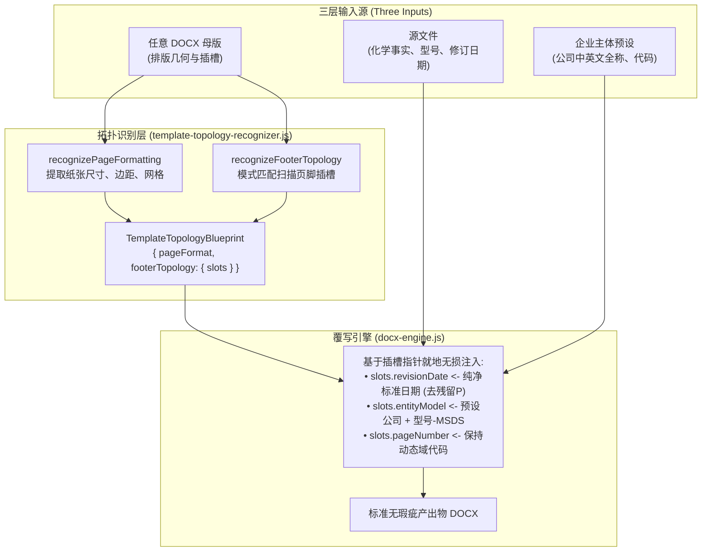

# Design: 通用页面格式与页脚拓扑强化识别及产出物页脚统一治理

## 1. 架构目标与正交解耦原则 (Architectural Goals)

本设计落实“**模板只提供格式、内容源于源文件、主体依靠预设**”三层正交解耦公理：
1. **模板层 (Template)**：纯排版几何容器，提供页面格式（`w:sectPr`）与页脚插槽布局（`w:tbl` / `w:p`），不携带硬编码业务真理；
2. **拓扑识别层 (Topology Recognition Layer)**：通过自适应模式探测任意母版，提取结构化元数据蓝图，将物理 XML 坐标抽象为逻辑插槽（`slots.revisionDate`, `slots.entityModel`, `slots.pageNumber`）；
3. **内容装配与覆写层 (Assembly & Overwrite Layer)**：依据拓扑蓝图中的插槽指针，将源文件提取的真实日期/型号与预设的主体企业名称就地注入，继承模板的原生样式（字号、颜色、字体、对齐）。

## 2. 详细技术实现方案 (Technical Specifications)

### 2.1 通用页面格式识别 (`recognizePageFormatting`)
- 从 `word/document.xml` 的所有 `<w:sectPr>`（取生效的最后一个节或每个节）中提取：
  - `pageSize`: `{ widthDxa, heightDxa, orientation, widthMm, heightMm }`
  - `margins`: `{ topDxa, bottomDxa, leftDxa, rightDxa, headerDxa, footerDxa, gutterDxa }`
  - `docGrid`: `{ linePitchDxa, charSpaceDxa, type }`
  - `cols`: `{ num, spaceDxa }`

### 2.2 通用页脚拓扑识别 (`recognizeFooterTopology`)
1. 解析 `word/_rels/document.xml.rels`，映射所有 `Relationship` ID 到目标部件；
2. 查找 `<w:sectPr>` 中的 `<w:footerReference>`，获取 `default`（主正文）、`first`（首页）及 `even`（偶数页）页脚；
3. 读取 `default` 页脚 XML（若无则探测已有 footer 文件），解析其 DOM 结构：
   - 检查是否存在表格容器 (`<w:tbl>`)：
     - 若存在，遍历每行每格，记录行号、列号、格宽、段落排版属性 (`w:jc`)，分析其文本模式；
   - 检查根段落 (`<w:p>`)：
     - 若为纯段落，记录段落索引与对齐方式；
4. 语义插槽自适应模式探测：
   - **`revisionDate` 插槽**：
     - 规则：文本满足 `/(?:修订日期|生效日期|编制日期|发布日期|Revision\s*Date|Date)/i` 或包含日期数字 `/\d{4}[年\-\/.]\d{1,2}[月\-\/.]\d{1,2}/`；
     - 捕获属性：容器类型 (`table` 或 `paragraph`)、坐标 (`tableIndex`, `rowIndex`, `cellIndex`, `pIndex`)、文本样式 (`fontSizePt`, `color`, `fontFamily`, `alignment`)、原始匹配模式；
   - **`entityModel` 插槽**：
     - 规则：文本满足 `/(?:-MSDS|有限公司|Company|Technology|Co\.,\s*Ltd)/i`；
     - 捕获属性：容器类型、坐标、文本样式；
   - **`pageNumber` 插槽**：
     - 规则：单元格或段落包含 `<w:instrText>` 为 `PAGE` / `NUMPAGES`，或 `<w:fldSimple>` 包含 `PAGE`；
     - 捕获属性：容器类型、坐标、样式。

### 2.3 产出物页脚统一治理与缺陷治愈
- 针对产出物页脚普遍存在的异形字符缺陷（如母版带有的 `"P修订日期：2026年08月05日  "`，导致产出物出现 `"P修订日期"` 或多余窄空格）：
  - 提取纯净日期字符，严格剔除首部非标准字符与异形空格；
  - 根据目标语言统一输出：
    - 中文模式：`修订日期：YYYY年MM月DD日`
    - 英文模式：`Revision Date: YYYY-MM-DD`（或保持源文件格式）
  - 样式完全继承母版该插槽探测出的原生字号（如 9pt）、原生颜色（如 #7F7F7F）与对齐方式（靠右），不进行主观篡改。

## 3. 依赖权衡与非功能特性 (Trade-offs & Constraints)
- **通用性优先**：若用户传入一个不含表格的单段落页脚，识别算法亦能降级为段落级插槽定位；
- **兜底安全性**：若模板完全不含页脚，识别器标记 `found: false`，覆写引擎平滑跳过页脚覆写，严禁抛出致命未捕获异常。
