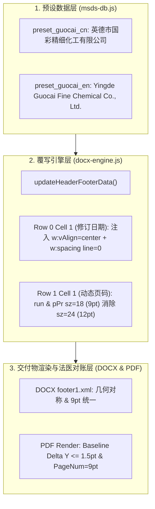

# Technical Design: Footer Layout and Entity Unification

## Architecture Overview & Causal Topology

## Root Cause Analysis & Solutions

### 1. 国彩预设分歧根因与修复 (REQ-01)
- **根因**：`msds-db.js` 中的种子数据中，`company` 字段登记为“英德市国彩新材料有限公司”，英文预设登记为“New Material”。
- **解决方案**：在 `msds-db.js` 中将中文版 `company` 与 `supplier_name` 统一为 `英德市国彩精细化工有限公司`，英文版统一为 `Yingde Guocai Fine Chemical Co., Ltd.`。

### 2. 修订日期 Y 轴位置悬浮偏高根因与修复 (REQ-02)
- **根因**：页脚表格第 0 行高为 566 dxa。左列（Cell 0）包含 `<w:vAlign w:val="center"/>` 垂直居中，而右列（Cell 1）缺失 `vAlign` 属性（默认顶端对齐），导致右列文本比左列高约 7.2 pt。
- **解决方案**：在 `docx-engine.js` 覆写修订日期时，确保其单元格 `tcPr` 注入 `<w:vAlign w:val="center"/>`，段落 `pPr` 补充 `<w:spacing w:line="0" w:lineRule="atLeast"/>`，实现两列垂直几何绝对对称，基线偏差 $\le 1.5\text{ pt}$。

### 3. 页码字号被放大至 12pt 根因与修复 (REQ-03)
- **根因**：`docx-engine.js` 第 1296 行硬编码调用 `setRunProps(doc, r, { fontSize: 24, bold: false })`，强制改为了小四号 12pt。
- **解决方案**：将硬编码的 `fontSize: 24` 修复为 `fontSize: 18`（9pt 小五号），与母版 Style ID 2 (`footer`) 及修订日期的 9pt 规范完全对齐。同时清理 `pPr/rPr` 中的 `sz=24`。
