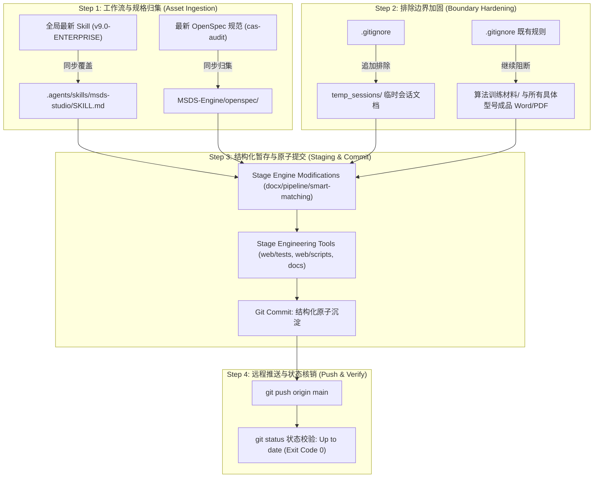

# 设计架构: MSDS-Engine 全量工程资产与工作流推送设计方案
## Design: Complete MSDS-Engine Assets & Workflow Synchronization and Remote Push

> **Change ID**: `2026-11-18-complete-msds-engine-repo-sync-and-push`  
> **Status**: In Review  

---

## 1. 架构目标与因果拓扑 (Goals & Cause-Effect Topology)

---

## 2. 核心技术权衡 (Technical Trade-offs)

### 2.1 产出物与工程资产的严格边界隔离
- **问题**：用户明确要求“除产出物外”，同时根目录下存在 `算法训练材料/`（包含各型号原始与重写成品）、`temp_sessions/`（编辑器运行时临时生成的 session docx 文件）。
- **权衡**：
  - `算法训练材料/` 已被 `.gitignore` 完整忽略；
  - `temp_sessions/` 此前未在 `.gitignore` 中声明，导致大量 `session_*.docx` 出现在 untracked 列表中；
  - **决策**：在 `.gitignore` 中显式添加 `temp_sessions/`，彻底阻断运行时缓存进入版本库，确保推送到远程仓库的代码和文件 100% 纯净。

### 2.2 工作流与技能版本同步
- **事实**：`C:\Users\Administrator\.gemini\config\skills\msds-studio\SKILL.md`（v9.0-ENTERPRISE）是目前最新且经过实战考验的完整工业级规范，而 `.agents/skills/msds-studio/SKILL.md` 滞后了多个版本。
- **决策**：将全局最新的 `msds-studio` 技能 1:1 复制同步至 `.agents/skills/msds-studio/SKILL.md`，确保代码仓库自身自带最完整的 SOP 工作流规范。

### 2.3 核心排版引擎未暂存修改纳管
- **事实**：`web/src/docx-engine.js`、`web/src/pipeline-engine.js`、`web/src/smart-matching.js` 包含了关于段落解析安全容灾、Section 9 表头回退及 Section 2 多记录整合的生产级优化。
- **决策**：作为核心引擎的组成部分一并纳管提交，确保远程仓库拥有最健壮的底层运行能力。

---

## 3. 风险评估与防御措施 (Risks & Mitigations)
1. **网络超时或凭据失效风险**：
   - GitHub 远程推送可能偶发网络延迟；通过设置合理的超时与代理保证连通性，若遇网络抖动重试一次；
2. **大文件超限风险**：
   - GitHub 单文件限制 100MB。通过严格的 `.gitignore` 规则，排除了所有音视频、模型包与具体型号交付物，所有拟提交文件均为文本与纯源码，单文件均远低于限制。
