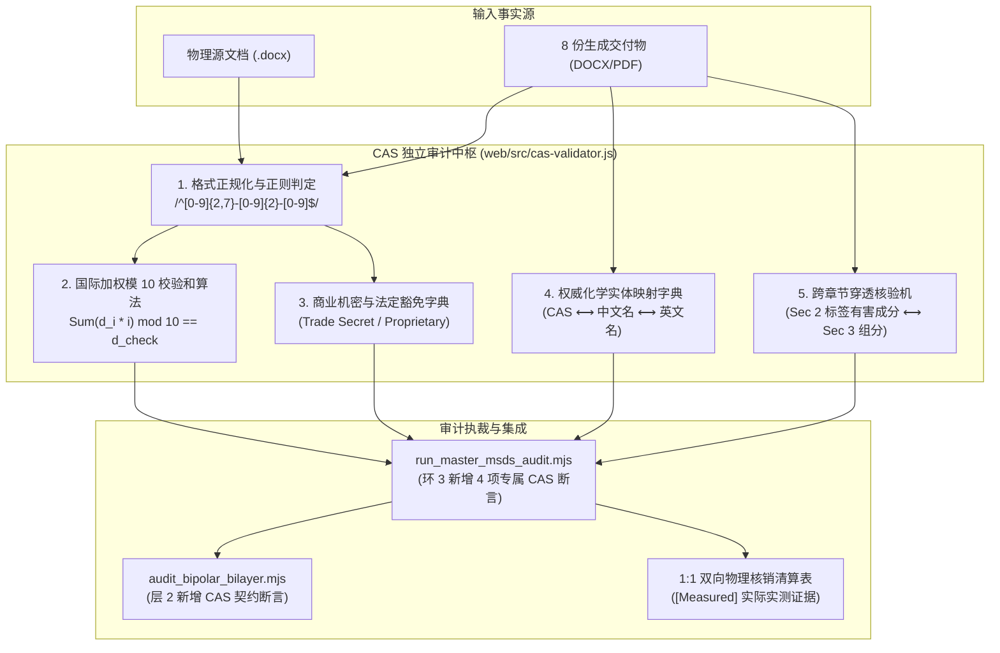

# Design: MSDS CAS 正确性全景核查与跨章节穿透审计系统设计

## 1. 架构总览与分层设计 (Architecture Overview)

本方案遵循 **Ps-openspec 工业级闭环** 与 **Layer 2 编译器硬阻断门禁** 原则，将 CAS 核查设计为一个纯数据驱动、与生成逻辑解耦的独立验证器，并挂载于集中式中央主审计套件中：

## 2. 数学公式与校验和算法规范 (Mathematical Invariant)

国际 CAS 编号格式为 $R - S - C$，其中：
- $R$ 为 2 至 7 位阿拉伯数字序列 $r_m r_{m-1} \dots r_1$；
- $S$ 为固定 2 位阿拉伯数字序列 $s_2 s_1$；
- $C$ 为固定 1 位校验码数字 $c$。

将除校验码外的所有数字拼接为连续序列：
$$D = [d_N, d_{N-1}, \dots, d_2, d_1] = [r_m, \dots, r_1, s_2, s_1]$$
其中 $d_1 = s_1$（倒数第二位，权重为 1），$d_2 = s_2$（权重为 2），以此类推直至最高位 $d_N$（权重为 $N$）。

加权校验和公式为：
$$S = \sum_{i=1}^{N} (d_i \times i)$$
校验断言方程：
$$S \pmod{10} = c$$

### 计算范例：
对于丙二醇甲醚 CAS `107-98-2`：
- 数字序列：$d_5=1, d_4=0, d_3=7, d_2=9, d_1=8$
- 加权求和：$8\times 1 + 9\times 2 + 7\times 3 + 0\times 4 + 1\times 5 = 8 + 18 + 21 + 0 + 5 = 52$
- 模 10 校验码：$52 \pmod{10} = 2$，与声明校验码 `2` 严格一致，通过！

## 3. 依赖权衡与爆炸半径控制 (Blast Radius Control)

1. **零外部网络依赖 (Air-Gapped & Offline)**：
   - 绝不引入外部 HTTP 接口查询，纯本地纯数学计算与高频通用化学品本地静态映射库；
   - 保证流水线在离线、断网或沙箱环境下毫秒级执行完毕（全文档 CAS 校验耗时 $< 5\text{ ms}$）。
2. **生成平面与验证平面物理隔离 (Verifier Isolation)**：
   - CAS 校验函数作为独立工具模块引入，不与生产引擎的赋值逻辑交织，保持只读纯函数契约；
   - 任何 CAS 判定失败，仅触发审计报告告警与进程退出码 1，绝不私自覆写或篡改用户文档内容。
3. **商业机密与特种聚合物兼容性**：
   - 对化工行业普遍存在的树脂聚合物保密需求，提供显式白名单豁免通道，杜绝误报阻断。
