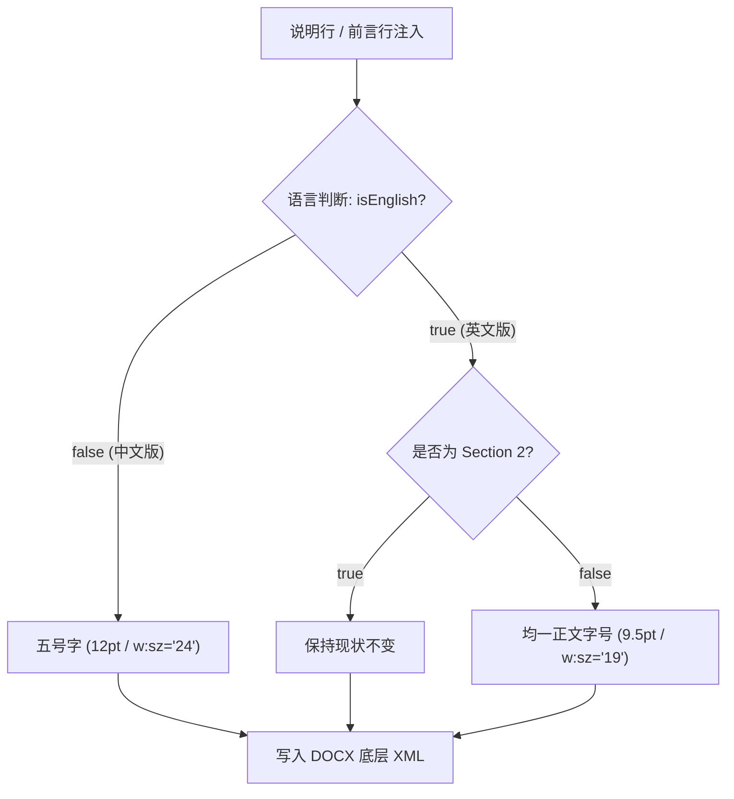

# Design: 英文版说明行 9.5pt 正文字号统一方案

## 1. 架构拓扑与动态字号派发

## 2. 修改落点与防御机制
1. `web/src/docx-engine.js`:
   - 重构 `formatSection11PreambleRow(row, text, isEnglish)`，根据 `isEnglish` 动态设置 `targetSz = isEnglish ? '19' : '24'`；
   - 导出通用英文说明行格式化工具 `formatEnglishPreambleCell(cell, text)`，确保应用 `w:sz="19"`。
2. `web/src/pipeline-engine.js`:
   - 英文版 Section 11 Row 1（产品免责行）和 Row 2（前言行）统一渲染为 9.5pt；
   - 英文版 Section 12 说明行统一渲染为 9.5pt；
   - 英文版 Section 13 说明行统一渲染为 9.5pt；
   - 英文版 Section 2 保持现状。
3. `web/scripts/audit_bipolar_bilayer.mjs`:
   - 将原断言 `enRow2Sz === '24'` 升级为 `enRow2Sz === '19'`；
   - 新增英文版说明行字号严格等于 `"19"` 的物理硬断言。
