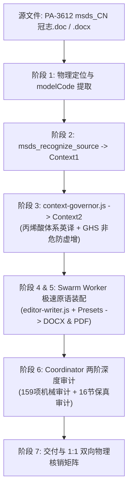

# Design: PA-3612 Swarm Universal Assembly & Dual-Scope Audit Architecture

## 1. 架构流转拓扑

## 2. 核心契约与不变量
- **去 Pipeline 化公理**: 不读、不调、不依赖 `pipeline-engine.js` 4200+ 行特定型号特判，纯由编辑器万能原语驱动；
- **情境解耦公理**: 冠志/国彩/第三方为 Preset 参数，中/英为 Template 参数，系统底层 100% 通用；
- **时效红线**: 单文件装配耗时 $\le 300$ ms，端到端总流程 $\le 60$ 秒。
