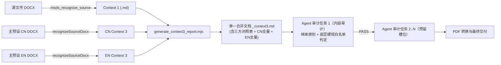

# Design: Agent 审计任务 1（合并版 Context 3）与工作流架构

## 1. 因果拓扑与职责边界

## 2. 关键设计决策
1. **受控合并脚本 `web/scripts/generate_context3_report.mjs`**：
   - 直接复用 `web/src/recognition-engine.js` 的 `recognizeSourceDocx` 与 `formatRecognitionAsMarkdown`，与 `msds_recognize_source` 保持 100% 同源，不自写正则解析 `.docx`。
   - 接收参数：`--model=<MODEL>`、`--cnDocx=<PATH>`、`--enDocx=<PATH>`、`--context1=<PATH>`（或 `--sourceDocx=<PATH>`）、`--out=<PATH>`。
   - 输出单一 `<MODEL>_context3.md`，包含：
     - 一、头部元数据与无损指纹汇总（CN + EN）；
     - 二、Context 1 vs Context 3 (CN & EN) 16 章节三方对照总览表（自动标注各章行数、字符变化及已知底层硬规提示）；
     - 三、中文产出物 Context 3 全量识别结果（1–16 章）；
     - 四、英文产出物 Context 3 全量识别结果（1–16 章）。
2. **工作流文档重构 (`C:\Users\Administrator\.gemini\config\skills\msds-studio\SKILL.md`)**：
   - 更新 **Phase 10** 与 **阶段 6（两阶双轨全景深度审计）**，将“Agent 审计任务序列”正式写入 SOP：
     - **Agent 审计任务 1（内容审计）**：主预设生成合并版 `<MODEL>_context3.md` → 依据“内容继承 + 底层硬规白名单（如 8.1 暴露控制先于 8.2 控制参数）”执行 1–16 章认知审计 + 次预设主体隔离核验；
     - **Agent 审计任务 2 / 3（预留扩展槽位）**：供后续编入拓扑/排版几何审计、PDF 渲染审计等；
     - **机械确定性主审计**：与现有 `run_master_msds_audit.mjs` / `audit_bipolar_bilayer.mjs` 协同形成放行门禁。
3. **不变量保护**：
   - 不修改 `web/src/recognition-engine.js`、`web/src/context-governor.js`、`web/src/docx-engine.js`、`web/src/topology-matcher.js` 等核心生产引擎，零回归风险。
