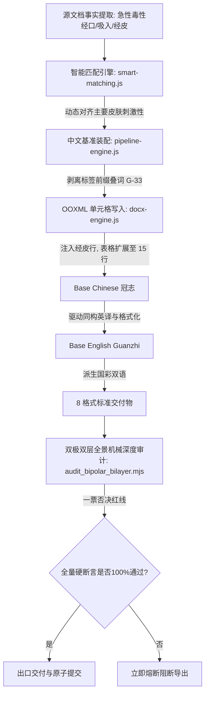

# Technical Design: Section 11 端点同构装配与反叠词中枢设计

## 一、 系统拓扑与数据流向

## 二、 核心组件改造点

1. **规范文档固化 (`docs/MSDS_SPECIFICATIONS_COMPLETE_GUIDE.md`)**：
   - 全局规范篇：追加 G-33 反前缀叠词公理与 G-34 实测端点零损耗公理；
   - 局部规范篇：升级 Section 11 局部规范（L-S11），明确定格经口、吸入、经皮三槽位。
2. **审计套件下沉 (`web/scripts/audit_bipolar_bilayer.mjs`)**：
   - 增加 PU-202A 经皮毒性与 4h 吸入数据物理存在性断言；
   - 增加 Section 11 全行值列首部零标签叠词物理扫描断言；
   - 增加 11.2 “主要皮肤刺激性”标签文本断言。
3. **匹配与清洗引擎 (`web/src/smart-matching.js` & `pipeline-engine.js`)**：
   - 动态保留并恢复底模 Row 5 的“经皮：”行（单组分危险品下为 15 行）；
   - 在注入单元格前，执行通用清洗：剥离 `^11\.\d+\s*` 与 `^(?:吸入|致癌性|特异性靶器官系统毒性(?:（一次接触[\/／]反复接触）)?)[：:]\s*`；
   - 英文版同步装配 `Dermal:` 行与完整吸入测试值。
