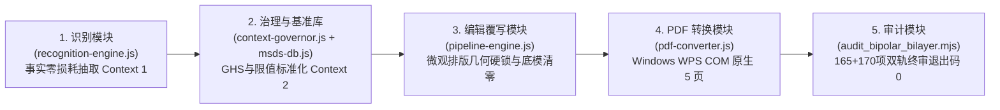

# 🧪 MSDS-Studio 外部测试 Agent 生产任务与质量契约白皮书 (v9.0-ENTERPRISE)

> **任务代号**：MSDS-Studio Overwrite Stability & Accuracy Benchmark  
> **面向对象**：外部测试 Agent（Codex、Claude Code、Cursor、Gemini 或其他独立测试沙箱）  
> **核心使命**：基于提供的受控输入材料与标准七步流水线 (7-Phase Pipeline)，以黑盒方式独立执行 MSDS 覆写生产，输出工业级高精度的 8 格式标准交付物矩阵（4 DOCX + 4 PDF），并回传给宿主审计系统进行 165+170 项两阶双轨法医主审计。

---

## 🚨【最高法定红线与系统只读高压线】(Supreme Redline)

> [!CAUTION]
> ### 绝对严禁：执行覆写任务时遇到非标问题就去修改底座源码！
> 1. **`web/src/*` 底层引擎源码享有最高只读豁免，严禁因单个产品的源文件非标或个别字段缺失，就去底座引擎中定位修改源码或添加局部硬编码特判（如 `if (model === 'xxx')`）！**
> 2. **任何擅自修改 `web/src/*` 的行为，会直接破坏全库 92 个已有产品的通用性，引入严重回归，一经发现直接熔断！**
> 3. **正确做法**：如果源文件格式非标、缺少字段或表述特殊，**必须且仅能在上游数据平面**（通过 `--facts=facts.json` 覆盖参数）进行事实注入，底层执行引擎保持 100% 封闭稳定。
> 4. **严禁使用 `python-docx` 剥离段落样式，严禁调用 `soffice.com --headless` 进行暴力硬转！**

> [!IMPORTANT]
> ### 🚨【核心生产策略调整：内容来源于源文件 + 受控剪枝准则】
> 1. **严禁对基准数据库产生过度依赖**：**绝不是所有情况都要向 PA-3654 一样用基准库做数据补充！** 核心生产原则始终是**“内容来源于源文件 (Source-Grounded Priority)”**！
> 2. **受控剪枝准则 (Controlled Pruning)**：官方底模是包含最大插槽的通用容器，绝非必答卷。源文件没有某项内容时（如 Section 11 无毒理终点只有免责、Section 8 无接触限值、Section 9 较少理化项、Section 15 仅 4 部法规），**核心动作是“把底模未用行剪枝删除”，绝不是盲目去基准库搬运同品类假数据来“填满表格”！**
> 3. **基准库使用红线**：基准库严格限制于官方主体预设元数据（公司名称、地址、电话）与国际标准格式代码，绝对严禁越权补充任何化学事实或毒理理化参数！

---

## 一、 输入资产清单 (Input Assets)

测试套件已在当前目录下为您准备就绪以下受控资产（**物理只读，严禁篡改**）：

| 资产路径 | 资产角色 | 规范要求与说明 |
| :--- | :--- | :--- |
| `source/PA-3655 msds_CN 冠志.docx` | **基准真实源文件** | 包含 16 章节原始化学事实（水性丙烯酸乳液），作为全篇事实提取与翻译的唯一法定事实源。 |
| `templates/正式模板_MSDS_CN_冠志(1).docx` | **官方中文正式底模** | 包含 16 章节标准表格网格、边框拓扑及中文表头样式。 |
| `templates/正式模板_MSDS_EN_冠志(1).docx` | **官方英文正式底模** | 包含 16 章节英文标准表格网格、边框拓扑及英文表头样式。 |
| `presets/company_presets.json` | **企业双主体预设** | 包含广州冠志与英德国彩的中英双语企业名称、简称、注册地址、电话及传真元数据。 |
| `facts_override_sample.json` | **事实覆盖标准模板** | 针对非标源文档补充事实的标准 JSON 模板，杜绝修改源码。 |
| `run_standard_production.mjs` | **唯一法定受控 Runner** | **[绝对强制]** 必须且仅能通过此脚手架执行标准七步覆写生产。 |
| `skill/SKILL.md` | **工业级生产治理规范** | 详述标准七步流水线、排版几何硬锁公理及底层四大模块标准映射。 |

---

## 二、 唯一法定覆写产出调用规程 (Standard Execution Modes)

### 模式 A：CLI 命令行执行（推荐，开箱即用）

在 Test Kit 根目录下直接运行官方 Runner：

```powershell
# 1. 标准默认执行（自动识别 ./source/ 下源文件并输出至 ./output/<型号>/）
node run_standard_production.mjs

# 2. 指定源文件与型号执行
node run_standard_production.mjs --source="./source/PA-3655 msds_CN 冠志.docx" --model=PA-3655

# 3. 遇到非标源文件时：通过 --facts 注入事实覆盖（严禁动源码！）
node run_standard_production.mjs --source="./source/PA-3655 msds_CN 冠志.docx" --model=PA-3655 --facts="./facts_override_sample.json"

# 4. 指定外部交付目标目录
node run_standard_production.mjs --source="<源文件路径>" --targetDir="<目标交付目录>"
```

#### CLI 参数完整说明表：
| 参数名 | 类型 | 是否必填 | 默认值 | 作用与规范 |
| :--- | :---: | :---: | :---: | :--- |
| `--source=<路径>` | string | 否 | `./source/` 下第一个 docx | 物理源文件绝对或相对路径。 |
| `--model=<型号>` | string | 否 | 自动从源文件名推导 | 产品型号代码（如 `PA-3655`）。 |
| `--targetDir=<路径>` | string | 否 | `./output/<型号>/` | 8 格式交付物生成目录。 |
| `--facts=<路径|JSON>` | string | 否 | `null` | **非标源文件事实覆盖入口**（支持文件路径或内联 JSON 字符串）。 |
| `--skipAudit` | flag | 否 | `false` | 是否跳过终审（**严禁在正式生产中使用，仅供开发调试**）。 |

---

### 模式 B：Node.js 编程式 API 调用（流水线集成）

如果您需要将生产流程集成至自己的自动化脚本中，请按以下官方规范通过 ES Module 导入执行：

```javascript
import fs from 'node:fs';
import path from 'node:path';
import { executeEightDeliverablesPipeline } from '../../web/src/pipeline-engine.js';
import { runBipolarBilayerAudit } from '../../web/scripts/audit_bipolar_bilayer.mjs';

const modelCode = 'PA-3655';
const sourcePath = path.resolve('./source/PA-3655 msds_CN 冠志.docx');
const targetDir = path.resolve('./output', modelCode);

// 1. 调用官方底座唯一法定覆写引擎
const result = await executeEightDeliverablesPipeline({
  modelCode,
  cnGroundTruthPath: sourcePath,
  cnGroundTruthBuffer: fs.readFileSync(sourcePath),
  targetDir,
  // 针对非标源文档传入事实覆盖（严禁修改底座源码！）
  facts: {
    modelCode,
    productName: '水性丙烯酸乳液',
    productNameEn: 'Water-based acrylic emulsion',
    isHazardous: false, // 联动基准库
    section9Overrides: {
      '外观': '微黄色透明液体',
      'pH值': '7.0-9.0'
    }
  }
});

console.log(`已成功生成 ${result.deliverables.length} 份交付物！`);

// 2. 执行双极双层法医级终审
const audit = await runBipolarBilayerAudit(targetDir, modelCode);
if (!audit.success) {
  throw new Error(`审计未通过，存在 ${audit.failCount} 项违章！`);
}
```

---

## 三、 目标交付物矩阵 (Deliverable Matrix: 4 DOCX + 4 PDF)

无论采用哪种调用方式，流水线必须在目标目录下精确产出以下 **8 份标准交付物**：

```text
output/<MODEL>/
├── <MODEL> msds_CN 冠志.docx       # 广州冠志 中文版 Word
├── <MODEL> msds_CN 冠志.pdf        # 广州冠志 中文版 高清矢量 PDF (严格 5 页)
├── <MODEL> msds_CN 国彩.docx       # 英德国彩 中文版 Word
├── <MODEL> msds_CN 国彩.pdf        # 英德国彩 中文版 高清矢量 PDF (严格 5 页)
├── <MODEL> msds_EN Guanzhi.docx    # 广州冠志 英文版 Word
├── <MODEL> msds_EN Guanzhi.pdf     # 广州冠志 英文版 高清矢量 PDF (严格 5 页)
├── <MODEL> msds_EN Guocai.docx     # 英德国彩 英文版 Word
└── <MODEL> msds_EN Guocai.pdf      # 英德国彩 英文版 高清矢量 PDF (严格 5 页)
```

---

## 四、 底层四大模块对应关系与执行分工

Runner 内部原汁原味调用系统四大底层模块，严禁擅自脱轨：



---

## 五、 十大不可逾越的工业级法定排版与事实硬指标

在产出这 8 份文件时，您的生成结果必须 100% 满足以下刚性检验，任何一项违背将在终审中触发一票否决：

### 1. Section 1 产品名称与中文名称槽位法定硬不变量 (`INV-S1-SLOT-MAPPING`)
- **Row 1 (`1.1 产品名称：` / `1.1 Product identifier:`)**：严格填写纯型号代号（如 `PA-3655`），严禁与第二行混淆或倒置；
- **Row 2 (`中文名称：` / `Chemical name:`)**：中文版严格填写产品中文名称+型号（如 `水性丙烯酸乳液 PA-3655`），严格对齐模板指示 `"此处填写产品中文名称+型号"`，**绝对严禁留空**！

### 2. Section 2 零外生虚增公理 (`INV-ZERO-EXOGENOUS`)
- **红线规定**：检查源文件，若属于非危险化学品或原文未提及象形图/信号词，产出物**绝对严禁**凭空添加 `GHS象形图：无` 与 `信号词：无`（英文版亦严禁添加 `GHS pictograms: None` 与 `Signal word: None`）；
- “没有”就是“没有”，不展示任何象形图与信号词标签行才是唯一合规表现。

### 3. Section 2 纯净大通栏与阶梯排版几何公理 (`INV-S2-TYPOGRAPHY-HIERARCHY`)
- **纯净单单元格通栏**：重构为 `gridSpan="2"` 的单单元格，上下 160 dxa 呼吸内边距；
- **阶梯几何缩进**：
  - 中文版：分类标题首行缩进 480 twips (24pt)，正文危害说明顶格 840 twips (42pt)；
  - 英文版：分类标题首行缩进 317 twips，正文说明缩进 677 twips；
  - 分类标题（如“易燃液体 类别3”）绝对保持普通字重（**严禁加粗**），正文首字严格垂直左对齐；
- **消灭分割线**：首行数据行 `top=single, bottom=none`，中间数据行 `top=none, bottom=none`，**绝对禁止在中间数据行出现内部横向虚线分割线**！

### 4. Section 8 个人防护标准值与基准库动态回填公理 (`INV-S8-BENCHMARK-HARMONIZATION`)
- **严禁连续空行**：手套参数行（合适的材料、FKM、IIR、NBR、建议等）严禁连续 6 行留空；
- **同品类基准库补充**：当源文档缺失手套细分测试数据时，智能匹配引擎自动联动同品类基准库补充通用标准值（如 `EN 374-3`、FKM 厚度 $\ge 0.4\text{ mm}$ 穿透时间 $\ge 480\text{ min}$ 等），根治非标源文档的短命剪枝与留空；
- **工程控制对齐**：英文版工程控制（`Engineering controls`）必须与中文母版通风事实严格同步英译，严禁留空。

### 5. Section 11 纯产品单体毒理指标与多组分通栏二分状态机 (`INV-S11-TWO-COLUMN-PARADIGM`)
- **单体/纯产品毒理指标**：强制使用 `PARADIGM_2_STANDARD_SLOTS`（双栏表格：标签列 2800 dxa + 值列 6981 dxa），**绝对严禁凭空捏造免责行**（如“该产品无可用的毒理学研究。下面是这些成分的毒理学数据。”）；
- **真实多组分复合豁免**：仅当源文档明确载明多个独立组分毒理数据时，方可使用通栏三层合并行。

### 6. Section 13 废弃处置总则与方法清晰分流 (`INV-S13-DISPOSAL-SPLIT`)
- **法规总则与具体方法解耦**：Row 1 承载国标与地方危废法规总则，Row 2 承载欧盟 EWC 废弃物法规；
- **方法行置顶标签**：Row 3 必须以 `处理方法：` 标签为首，清晰承载容器倒空、回收与严禁排入废水规定，杜绝幽灵空行。

### 7. Section 14 运输信息源文事实 100% 完整保留公理 (`INV-S14-TRANSPORT-GROUNDING`)
- **非危与温控全面保真**：100% 保留源文载明的公路运输规范、IMDG CODE 准则、IATA 危险品规则及温度储存边界（如 `避免高于50℃及低于-5℃，远离食物与酸碱`）；
- 英文版采用复合条款（Multi-clause）精准英译，确保温度极值（$\le +50^\circ\text{C}, \ge -5^\circ\text{C}$）与禁忌物（food, acids, bases）完整传递。

### 8. Section 15 法规清单结构化与未引用标准剪枝 (`INV-S15-REGULATION-LIST`)
- 严格按序号列表呈现化学品安全法规，非危险品中源文未引用的外生标准（如 `GB 15258`）在语义剪枝中剥离，保持法规事实纯度。

### 9. 单制表符与自适应悬挂标尺公理 (`INV-SEQ-TAB-ALIGN` & `INV-LABEL-CONTINUATION-ALIGN`)
- 序号与标签之间使用**单个 `<w:tab/>` 节点**，严禁在序号后添加空格；
- 依据章节内最大序号数字位数（$D_{max}$）动态自适应标尺：$D_{max} \le 3$ 为 420 dxa，$D_{max} \ge 4$ 升级为 560 dxa；
- 折行第二行首字在 420/560 dxa 垂线垂直对齐（实测偏差 $\le 1\text{px}$）；
- 未编号标签注入同基线 `w:left="420"`（无 hanging），首字与带序号标签 100% 齐平，消除锯齿。

### 10. 多列顶格与单列通栏大纲树状层级二分公理 (`INV-VALUE-INDENT-DICHOTOMY`)
- 多列表格（`cells.length > 1`）：填写值单元格清除 `w:ind`，注入 `jc="left"`，紧贴 108 dxa 单元格左边距顶格对齐，杜绝二次缩进；
- 单列通栏表格（`cells.length === 1`，如 Section 2）：保留大纲树状层级缩进。
