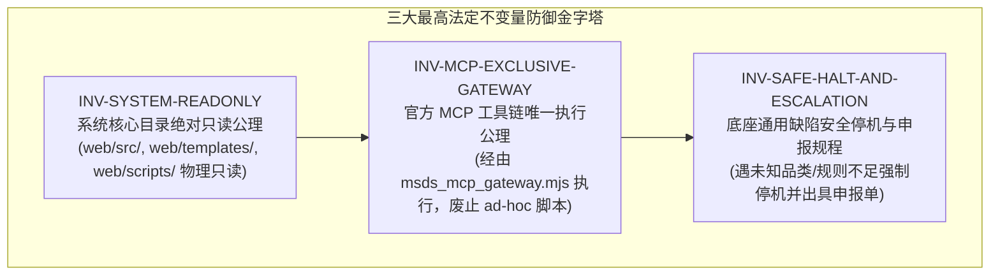
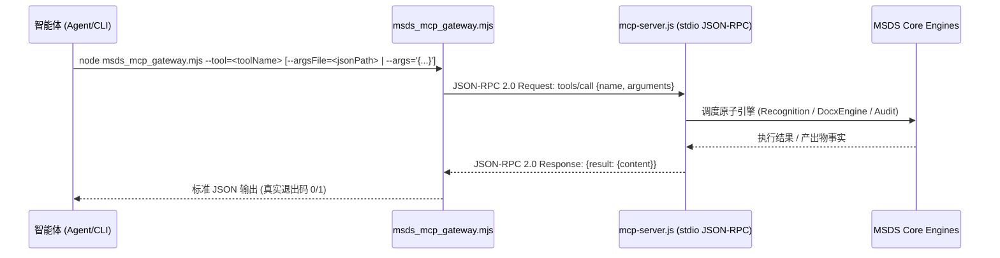
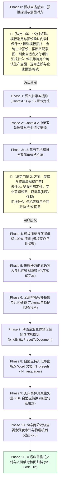

# MSDS Studio 受控工作流体系与 Agent 生产治理规范 (v8.0-ENTERPRISE)

> **版本**：v9.0-ENTERPRISE (三层正交解耦与自适应多格式交付闭环版)  
> **制定时间**：2026-11-16  
> **适用范围**：MSDS-Engine 文档处理工作台、`msds-studio` 技能生态、Antigravity 跨线程协作、MSDS 生产与审计智能体。  
> **核心使命**：为智能体确立**三层正交解耦最高公理**（模板 = 排版格式与拓扑骨架；源文件 = 唯一化学技术事实；预设 = 企业个体元数据），彻底剥离底层代码与拓扑结构中任何写死特定企业（如冠志/国彩）或硬编码 8 格式的僵化逻辑。赋予智能体精确感官（自省探测模板拓扑与企业预设）与稳健手脚（编辑器万能原语：清空值格/单节恢复/动态预设绑定/增删行/删列/横向合并/富文本化学式/激光对齐），遵循“格式服从于原文”公理、“模板即拓扑边框样式基座”、“前置值格全量清零”机制，确立“哪一步、做什么、汇报什么”端到端 12 阶 SOP，支持按需动态产出笛卡尔积自适应交付矩阵（$N_{\text{presets}} \times N_{\text{languages}} \times N_{\text{formats}}$），依托底层排版几何硬锁与两阶双轨全要素深度审计，打造 100% 工业级通用文档工作台。

---

## 一、 顶层架构与三大最高法定不变量 (Supreme Invariants)

> [!CAUTION]
> **生产/测试 Agent 运行期铁律**：
> 1. **严禁修改源码**：工作流调用期间禁止为了达成任务而修改源码，若不修改源码无法完成**必须直接报错退出（Exit Code ≠ 0）**；
> 2. **严禁产出临时脚本**：禁止生成任何调用 `MSDS-Engine` 的临时脚本（`.mjs`/`.js`/`.py`）；
> 3. **Agent 唯二职责**：① **调用工作流，完成内容填写（JSON），提交产出**；② **介入审计（非机械语义/人工级审计）**。

全系统生命周期内，任何 Agent、开发者与协同流程**必须无条件遵循**以下三大最高法定不变量与工程公理：



### 1.1 核心架构三元归正：【识别感知 + 通用编辑器原语 + Agent 语义大脑】
- **彻底废止对机械黑盒匹配脚本（如 `smart-matching.js`）的强依赖与过度包装**；
- **确立工作流主干**：`msds_recognize_source` 零损耗化学事实感知 $\rightarrow$ Agent 语义大脑决策 $\rightarrow$ 直接调用 MSDS Studio 编辑器万能原语受控操纵；
- **熟练运用编辑器全景能力**：预设编辑 (`applyPreset`)、恢复本节 (`restoreSection`)、清空本节值 (`clearSectionValues`)、清空全模板值 (`clearTemplate`)、删列 (`deleteColumn`)、克隆增行 (`insertRow`)、删行 (`deleteRow`)、合并通栏 (`mergeCells`)、富文本与化学式下标 (`writeRichText`) 及激光垂线对齐 (`formatLaserTabs`)。

### 1.2 系统核心目录绝对只读公理 (`INV-SYSTEM-READONLY`)
- **受控系统只读目录**：`web/src/`（核心引擎代码）、`web/templates/`（官方模板）、`web/scripts/`（核心审计与导出脚本）；
- **生产 Agent 权限边界**：执行生产与覆写任务时，生产 Agent 对受控系统目录具有**绝对物理只读约束**；仅对分配的工作区（如 `算法训练材料/TDS MSDS 重写版/...`）拥有写权限；
- **权限红线**：未经用户显式、指名道姓的书面授权，严禁任何 Agent 擅自修改、创建或删除系统目录下的任何文件。任何对系统文件的写操作将被立即拦截。

### 1.3 官方 MCP 工具链唯一执行通道公理 (`INV-MCP-EXCLUSIVE-GATEWAY`)
- **唯一合法通道**：官方 10 大原子 MCP 工具（注册于 `web/src/mcp-server.js`，通过 `web/scripts/msds_mcp_gateway.mjs` 调度）是执行源文档识别、模式探查、几何编辑、批量导出与审计核销的**唯一法定通道**；
- **废止 ad-hoc 临时脚本**：严禁私自编写针对单一型号的一次性 Node/Python 脚本直接篡改 Word OOXML、拼接底层 XML 或修改模板。一切编辑操作必须封装为标准 MCP 原语经由网关执行。

### 1.4 底座通用缺陷安全停机与申报升级规程 (`INV-SAFE-HALT-AND-ESCALATION`)
- **严禁就地特判**：生产 Agent 遇到未知化工分类（如无水环氧、固化剂复合体）、英译缺失、正则表达式失配或版式不兼容时，**绝对严禁**为了应付单个型号而就地打硬编码补丁（如 `if (model === 'xxx')`）；
- **安全停机机制**：Agent 必须立即挂起停机，冻结现场，并按照第六节标准格式出具《系统底座通用缺陷申报单》，提请架构治理层或用户在平台通用层进行升级。

### 1.5 版式与物理事实守恒公理
1. **内容来源于源文件与受控剪枝公理 (Source-Grounded Priority & Controlled Pruning Axiom - 内容第一公理)**：
   - **内容源于源文件**：源文件是化学技术事实的唯一法定真理源，绝不是所有情况都要向 PA-3654 一样使用基准库补充！严禁对基准库产生过度依赖或跨产品搬运同品类数据；
   - **受控剪枝优先准则**：基于模板的格式与基于源文件的内容做匹配，格式服从于原文；官方底模是包含最大插槽的通用容器，绝非必答卷。源文件未载明的数据一律**坚决剪枝删除（Pruning & Truncation）**，严禁留空行，更严禁从外部基准库强塞假数据！
   - 若源文件某节仅有叙述性说明行（如 Section 11 仅单行免责声明“该产品无可用的毒理学研究。”），必须坚决剪枝为 2 行极简拓扑，彻底清除底模残留插槽；
   - 若源文件包含细分结构化端点（如 LC50/LD50），则对应填入结构化值格插槽。绝不凭空捏造端点，绝不强行破坏模板几何规范。
2. **基准库受限准入围栏 (Benchmark DB Access Boundary)**：
   - 基准数据库严格降级为企业主体预设元数据与国际标准代码格式化，绝对严禁越权补充或推测化学技术、理化指标或毒理数据。
3. **英文官方底模“历史脏数据”法定清零机制 (Pre-write Value Clearing Invariant)**：
   - 官方底模（尤其英文模板）内可能存在历史残留数据（如二乙二醇单丁醚、1306 mg/kg 等示范数据）；
   - 写入前必须调用编辑器的 `clearSectionValues` 或 `clearTemplate`，先将待编辑章节的所有值格彻底清空，确保处于 100% 纯净空白插槽状态，再由 Agent 写入真实数据。
3. **Agent 大模型逐句专业语义英译与词典辅助校验 (LLM Contextual Translation Invariant)**：
   - 严禁依赖脆弱的数百行机械正则字符串替换；
   - 充分发挥 Agent 化学和毒理学专业语义理解优势，对源文档内容进行逐句专业英译，确保行文地道、术语符合 GHS/OECD 国际标准；
   - 标准双语映射库专职作为一致性辅助校验字典，形成“大模型语义翻译 + 规则字典校验”双重保障。
4. **Section 2 零外生虚增最高公理 (`INV-ZERO-EXOGENOUS`)**：
   - 源文档未提及 GHS 象形图或信号词时，交付物**绝对严禁**凭空添加 `GHS象形图：无` 与 `信号词：无`（英文版亦严禁添加 `GHS pictograms: None` 与 `Signal word: None`）；
   - “没有”就是“没有”，不展示任何象形图与信号词标签行才是唯一合法表现。
5. **Section 2 阶梯排版几何公理 (`INV-S2-TYPOGRAPHY-HIERARCHY`)**：
   - 中文版：分类标题首行缩进 480 twips (24pt)，正文危害说明顶格 840 twips (42pt)；
   - 英文版：分类标题首行缩进 317 twips，正文说明缩进 677 twips；
   - 分类标题（如“易燃液体 类别3”）绝对保持普通字重（严禁加粗），正文首字严格垂直左对齐。
6. **无水环氧品名解耦与排版标点自愈 (`INV-PRODUCER-ISOLATION-AND-FACT-FIDELITY`)**：
   - 遇无水/非水/无溶剂环氧树脂，英文品名与化学品分类严格输出为 `Anhydrous epoxy resin`，彻底阻断向 `Waterborne` 或 `emulsion` 串流；
   - 写入层自动清洗全角/半角空格（`\s\u3000`），自愈标点后西文空格（`([.!?\)])([A-Za-z])` $\rightarrow$ `$1 $2`）。
7. **母版页眉页脚样式原生继承公理 (`INV-TOPO-HF-INHERIT`)**：
   - 确立“模板即页眉页脚样式基座”公理：无论母版如何变化，默认 100% 完整继承母版原生的页眉页脚样式、字号、字体、粗细与底纹；
   - 外部全局投影绝不侵入或重写 `header/footer`，仅在原生插槽内填充动态文字并保留原有 `rPr`。
8. **序号与标签间隔单制表符公理 (`INV-SEQ-TAB-ALIGN`)**：
   - 序号与标签之间使用单个 `<w:tab/>` 节点，严禁序号后添加多余空格；
   - 依据章节内最大序号数字位数（$D_{max}$）动态自适应标尺（$D_{max} \le 3$ 为 420 dxa，$D_{max} \ge 4$ 自动升级为 560 dxa），消除硬编码特判。
9. **标签对齐与多行折行垂直悬挂公理 (`INV-LABEL-CONTINUATION-ALIGN`)**：
   - 固化悬挂缩进 `<w:ind w:left="420" w:hanging="420"/>`（或 560），折行第二行首字在 420/560 dxa 垂线垂直对齐（实测偏差 $\le 1\text{px}$）；
   - 未编号标签注入同基线 `w:left="420"`（无 hanging），首字与带序号标签 100% 齐平，消除锯齿；
   - 物理级清除 `w:firstLine`、`leftChars` 与 `w:numPr` 污染。
10. **多列顶格与单列通栏大纲树状层级二分公理 (`INV-VALUE-INDENT-DICHOTOMY`)**：
    - 多列表格（`cells.length > 1`）：填写值单元格清除 `w:ind`，注入 `jc="left"`，紧贴 108 dxa 单元格左边距顶格对齐，杜绝二次缩进；3+ 列数据网格统一按 `TABLE_VALUE` 常规体处理；
    - 单列通栏表格（`cells.length === 1`，如 Section 2）：保留大纲树状层级缩进，防范措施条款向右缩进 `s2SubValueIndent`。

---

## 二、 10 大标准原子 MCP 工具完整语义契约 (Official MCP Toolset)

MSDS-Engine 官方注册全量 10 项原子工具，其接口参数与规范语义如下：

### 1. `msds_recognize_source`
- **业务定位**：多模态物理源事实零损耗感知与 16 章节结构化事实提取。
- **参数规范**：
  - `sourceFilePath` (string, 必需)：待识别解析的 MSDS Word 源文件完整绝对路径。
- **返回数据**：包含 16 个章节完整原始化学事实、GHS 分类、CAS 组分明细、理化及毒理数据对象。

### 2. `msds_extract_section_facts`
- **业务定位**：针对源 DOCX 文件的特定章节（1~16）进行细粒度下钻提取。
- **参数规范**：
  - `sourceFilePath` (string, 必需)：源 DOCX 文件绝对路径；
  - `sectionNumber` (number, 必需)：章节编号 (1~16)。
- **返回数据**：该章节专属事实对象、结构形态（`TWO_COLUMN` / `FULL_WIDTH` / `MULTI_COLUMN`）与排版样式。

### 3. `msds_compare_source_with_output`
- **业务定位**：源文档与产出文档 1:1 事实物理对账，逐章节比对字符保全度与形变。
- **参数规范**：
  - `sourceFilePath` (string, 必需)：原始输入源 DOCX 绝对路径；
  - `outputFilePath` (string, 必需)：产出物 DOCX 绝对路径。
- **返回数据**：字符留存率、缺失项列表、结构变形警告及物理对账清算状态。

### 4. `msds_register_template`
- **业务定位**：动态注册新的自定义 MSDS Word 模板，解析 16 章节分布与网格拓扑 (`tblGrid`)。
- **参数规范**：
  - `templateFilePath` (string, 必需)：模板 DOCX 绝对路径；
  - `templateKey` (string, 必需)：模板唯一标识键；
  - `language` (string, 必需)：语言类型 (`zh` 或 `en`)；
  - `company` (string, 可选)：所属主体公司（如 `guanzhi`, `guocai`）。
- **返回数据**：注册成功状态、章节插槽映射及网格骨架哈希。

### 5. `msds_get_template_schema`
- **业务定位**：获取指定模板的 16 章节拓扑架构 Schema。
- **参数规范**：
  - `templateKey` (string, 必需)：模板标识符（支持官方母版或已注册 key）。
- **返回数据**：16 章节表格行列数、列宽坐标（`tblGrid`）、单元格角色及预设插槽分布。

### 6. `msds_peek_cell_or_row`
- **业务定位**：视觉透视指定模板在特定章节和行列的单元格物理属性。
- **参数规范**：
  - `templateKey` (string, 必需)：模板唯一标识；
  - `sectionNumber` (number, 必需)：章节编号 (1~16)；
  - `rowIndex` (number, 必需)：行索引（从 0 开始）；
  - `cellIndex` (number, 可选)：单元格列索引（从 0 开始；省略时返回整行透视）。
- **返回数据**：单元格文本内容、加粗状态、字体字号、跨列数 (`gridSpan`) 及物理宽度 (`dxa`)。

### 7. `msds_plan_audit_targets`
- **业务定位**：动工前执行设计期审计规划 (ADD)，依据全局规范（G-01~G-40）生成终审目标契约。
- **参数规范**：
  - `modelCode` (string, 必需)：产品型号编码（如 `EP-1404`, `PU-218A`）；
  - `sourceFacts` (object, 可选)：由 `msds_recognize_source` 提取的事实对象。
- **返回数据**：不可篡改的终审审计目标清单、必检断言矩阵及预期容差界限。

### 8. `msds_execute_editor_ops`
- **业务定位**：万能几何手术台，批量执行受控原子编辑操作并导出合规 DOCX。自带事务检查点与失败自愈。
- **参数规范**：
  - `templateKey` (string, 必需)：母版标识符；
  - `outputPath` (string, 必需)：目标 DOCX 完整绝对路径；
  - `operations` (array, 必需)：有序原子操作列表，每个操作支持：
    - `op`: `clearTemplate`, `clearSectionValues`, `restoreSection`, `applyPreset`, `writeCell`, `writeRichText`, `writeFullWidth`, `formatLaserTabs`, `deleteRow`, `deleteColumn`, `mergeCells`, `insertRow`, `checkpoint`, `rollback`；
    - 针对具体操作挂载：`sectionNumber`, `rowIndex`, `cellIndex`, `colIndex`, `colStart`, `colSpan`, `targetRowIndex`, `cloneFromRowIndex`, `text`, `content`, `chemicalFormula`, `runs`, `presetKey` 等。
- **返回数据**：执行成功状态、各操作受影响行列计数及最终产出物文件指纹。

### 9. `msds_batch_export_eight`
- **业务定位**：驱动标准批处理流水线，原子生成双主体 × 双语标准 8 格式交付物（4 DOCX + 4 PDF）。
- **参数规范**：
  - `modelCode` (string, 必需)：产品型号编码；
  - `sourceFilePath` (string, 必需)：源文件绝对路径；
  - `targetDir` (string, 必需)：交付物输出目录绝对路径。
- **返回数据**：生成的 8 份文件绝对路径清单、转换耗时及文件哈希记录。

### 10. `msds_audit_deliverables`
- **业务定位**：交付物集中式双极双层全景主审计，覆盖 150 项机械与事实保真硬断言。
- **参数规范**：
  - `targetDir` (string, 必需)：交付目录绝对路径；
  - `modelCode` (string, 必需)：产品型号编码。
- **返回数据**：总检验项数、通过项数、缺陷清单及最终判定状态（`AUDIT_PASSED` / `FAILED`，退出码 0 为充要条件）。

---

## 三、 唯一执行通道：标准 MCP 网关驱动器调用指南 (`msds_mcp_gateway.mjs`)

为根除散落脚本与环境差异，全系统统一通过位于 `web/scripts/msds_mcp_gateway.mjs` 的标准网关驱动器与 MCP 核心底座通信。



### 3.1 命令行直接调用范式
适用于简短参数调用：
```powershell
# 1. 探查母版模式定义
node web/scripts/msds_mcp_gateway.mjs --tool=msds_get_template_schema --args='{\"templateKey\":\"正式模板_MSDS_CN_冠志\"}'

# 2. 列出全量可用工具清单
node web/scripts/msds_mcp_gateway.mjs --list-tools
```

### 3.2 参数文件载荷调用范式 (`--argsFile`，企业推荐模式)
针对包含长路径、复杂 JSON 数组或化学事实的调用，**强制推荐使用 `--argsFile` 模式**，彻底免除 PowerShell/CMD 转义困扰：
```powershell
# 1. 将参数写入临时文件 args.json
# 内容: {"sourceFilePath": "F:/App Location/Guanzhi Tong/Skill/MSDS-Engine/源文件/EP-1404.docx"}

# 2. 通过 --argsFile 安全执行
node web/scripts/msds_mcp_gateway.mjs --tool=msds_recognize_source --argsFile=args.json
```

---

## 四、 12 阶标准作业规程 SOP 体系与人机双门禁 (Mandatory 12-Phase SOP Pipeline)

任何 Agent 执行 MSDS 文档生产与识别任务时，**SHALL** 强制将工作流路线收敛并锁定为以下不可动摇的法定受控 12 阶作业流水线（清晰规范“哪一步、做什么、汇报什么”），严禁任何跳步或私写 ad-hoc 脚本：



### 4.1 端到端 12 阶标准作业规程详细执行矩阵

| 阶段编码与名称 | 核心执行动作 (做什么 - Mechanics & Primitives) | 实时状态播报与汇报内容 (汇报什么 - What It Reports) | 准出条件与硬阻断红线 (Exit Criteria) |
| :--- | :--- | :--- | :--- |
| **Phase 0<br/>模板自省、预设感知与意图对齐** | 1. 扫描可用模板列表（支持 `/api/msds/templates` 及 16 章节拓扑自省）；<br/>2. 查询企业预设库（`/api/msds/presets`，探测冠志、国彩及自定义企业主体，标定默认主体）；<br/>3. 解析输入源文件路径与目标产品型号；<br/>4. 依据三层正交解耦公理（模板=排版拓扑，源文件=化学事实，预设=主体元数据），根据用户任务指令智能推断最匹配的模板、主体预设与输出格式（Word/PDF/中/英）。 | **【法定门禁 1 呈报】**：<br/>• 探测到的可用模板及其 16 章节拓扑概况；<br/>• 当前可用企业预设清单与系统默认主体；<br/>• 检测到的目标产品型号与源文件化学事实概况；<br/>• **自适应交付矩阵建议**（如：仅单主体英文 Word、单主体中英双语双格式 4 份、或完整矩阵）；<br/>• **提请用户确认/选择**：选用何种模板、何种企业预设、何种语言及何种文件格式（可直接使用推荐默认）。 | 🛑 **【门禁 1 停机点】**：<br/>绝对禁止 Agent 主观硬编码固定 8 格式或死锁冠志/国彩！必须停机等待用户明确确认意图！ |
| **Phase 1<br/>源文件事实感知 (Context 1)** | 1. 调用 `recognizeSourceDocx` 提取全局化学事实；<br/>2. 提取产品名称、CAS、分类、理化数值、毒理结论；<br/>3. 触觉透视 16 章节形态（纯说明行/2列结构/数据网格/通栏）。 | **实时播报**：<br/>`🔍 [事实感知] 正在调用识别引擎提取源文件核心化学事实...`<br/>**中间汇报**：<br/>呈报 Context 1 核心事实摘要（品名、是否危化品、组分数、16 章节结构定性表）。 | 事实指纹 100% 冻结，严禁截断或私自丢弃关键字段。 |
| **Phase 2<br/>Context 2 治理与专业英译** | 1. 调用 `governContext` 进行中英双轨治理；<br/>2. 驱动大模型执行逐句地道英译（术语符合 GHS/OECD 标准）；<br/>3. 使用内置双语映射库对英译结果进行辅助对账；<br/>4. 执行 `assertZeroChinese` 预检。 | **实时播报**：<br/>`🌐 [双轨治理] 正在组装 Context 2 模型并驱动专业语义英译...`<br/>**中间汇报**：<br/>呈报关键专业英译对照预览（GHS分类、主要警示说明、推荐用途英文）。 | 英文模型中中文字符数严格为 0，术语与法规标准一致。 |
| **Phase 3<br/>方案编排与双清单立法** | 1. 制定 16 章节手术策略（Recipe A~G 映射）；<br/>2. 确定说明行优先匹配还是结构化值格填入；<br/>3. 编排【双清单】（拟变范围清单 + 保持现状承诺清单）。 | **【法定门禁 2 呈报】**：<br/>• 16 章节格式服从原文策略与手术配方方案；<br/>• 核心专业英译对照全景卡片；<br/>• 法定双清单（标注 [Root Source] 与保护现状范围）；<br/>• 提请用户明确回复“执行/同意”。 | 🛑 **【门禁 2 停机点】**：<br/>未获得用户“执行/同意”明确授权前，严禁动笔修改任何文档！ |
| **Phase 4<br/>模板加载与前置值格清零** | 1. 加载选定的标准官方模板会话；<br/>2. 确立“模板即拓扑与样式骨架”公理；<br/>3. 调用 `clearTemplateValues` 100% 清空 16 个章节所有值格历史示范数据（保留标签、列宽、边框与页眉页脚样式）。 | **实时播报**：<br/>`📋 [模板纯化] 已成功加载官方底模，全篇 16 章节历史样例值格已 100% 清空，拓扑插槽纯净就绪。` | 模板历史示范数据（如旧产品参数、二乙二醇等）清零率 100%。 |
| **Phase 5<br/>编辑器原语写入与几何重塑** | 1. 调用 `universal-editor-primitives.js` 原语写入 Context 2；<br/>2. Section 2 通栏大纲树状层级渲染；<br/>3. Section 3 成分表克隆与数据网格渲染；<br/>4. Section 8 暴露限值表与个人防护标签写入；<br/>5. Section 9 理化特性写入与微观富文本渲染（化学式下标）。 | **实时播报**：<br/>`✍️ [格式装配] 中文/英文正式文档写入完毕，各章节结构与化学式微观渲染完成。` | 格式服从原文，纯叙述性说明行不塞虚假端点，结构化端点对号入座。 |
| **Phase 6<br/>全局排版拓扑投影与几何硬锁** | 1. 调用 `applyGlobalTypographyProjection`；<br/>2. 注入 `MSDS_DESIGN_TOKENS`（全篇 16 章节字阶统一）；<br/>3. 序号后装配单个 `<w:tab/>`，无多余空格；<br/>4. 动态探测 $D_{max}$ 注入 420/560 dxa 悬挂缩进；<br/>5. 未编号标签注入同基线 `w:left="420"`（无 hanging）；<br/>6. 多列表格值单元格清除 `w:ind`，紧贴 108 dxa 左边距顶格对齐；<br/>7. 母版页眉页脚样式原生继承（只读保护）。 | **实时播报**：<br/>`📐 [排版投影] 全局 16 章节排版拓扑投影完毕，字阶统一、制表激光对齐与多列顶格已物理锁死。` | 1. 多行折行第 2 行首字垂线偏差 $\le 1\text{px}$；<br/>2. 未编号标签首字基线绝对齐平；<br/>3. 多列值单元格零二次缩进。 |
| **Phase 7<br/>动态企业预设装配与信息绑定** | 1. 应用用户或 Gate 1 所选企业预设（通过 `universal-editor-primitives.js:bindEntityPresetToDocument`）；<br/>2. 动态注入法定企业全称、简称、社会信用代码、注册地址、应急/技术咨询电话与传真；<br/>3. 更新页眉型号、页脚公司名称与修订日期，彻底剥离代码中写死主体。 | **实时播报**：<br/>`🏢 [实体绑定] 所选企业预设已成功装配至文档，主体信息物理隔离防混淆。` | 企业元数据准确对应预设定义，信用代码、地址、电话无跨主体串号。 |
| **Phase 8<br/>自适应多格式 Word 文档导出** | 1. 依据 Gate 1 确认的 Presets × Languages 维度；<br/>2. 调用 `pipeline-engine.js:executeAdaptiveDeliverablesPipeline` 导出对应 Word 文档；<br/>• 若选单主体单语言：精准输出 1 份 DOCX；<br/>• 若选中英双语双主体：输出 4 份 DOCX。 | **实时播报**：<br/>`📄 [DOCX 导出] 自适应 Word 正式文档已成功落盘 (共 ${N} 份)。`<br/>**阶段汇报**：<br/>呈报各 DOCX 文件大小、路径与落盘时间戳。 | 所选 DOCX 全部写入成功，底层 XML 格式校验无损。 |
| **Phase 9<br/>无头高保真原生 PDF 自适应转换** | 1. 若用户选择交付 PDF，调用本地无头转换通道（支持 WPS COM 与 LibreOffice 守护降级）；<br/>2. 转换为对应数量的原生高清矢量 PDF；<br/>3. 执行版面预检（导言 9.5pt、理化垂线对齐、字体嵌入）。 | **实时播报**：<br/>`🖨️ [PDF 转换] 原生高清 PDF 全部转换完成，版面预检合格 (共 ${M} 份)。`<br/>**阶段汇报**：<br/>呈报所生成 PDF 大小与版面预检通过状态。 | 所选 PDF 转换退出码 0，无字体缺失乱码，无豆腐块。 |
| **Phase 10<br/>两阶双轨全要素深度审计与对账** | **Agent 审计任务序列（先内容、后扩展）**：<br/>• **Agent 审计任务 1（内容审计）**：调用 `web/scripts/generate_context3_report.mjs` 对**主预设（如冠志 CN + Guanzhi EN）**产出物执行 `msds_recognize_source` 无损识别，将 **16 章节三方对照总览表 + 中文 Context 3 + 英文 Context 3** 合并写入**同一篇 `<MODEL>_context3.md`**；按“内容来源于源文件、源文件内容继承”并兼顾**底层硬性规定白名单**（`8.1 暴露控制 -> 8.2 控制参数`、预设主体更新、非危品去重、拆行/符号规范）逐章核销；次预设（如国彩）执行主体信息隔离抽检；<br/>• **Agent 审计任务 2（拓扑结构审计）**：以默认质疑态度逐项核查全部产出物（含主/次预设 Word + PDF）的 7 大拓扑维度：1) 模板选型、示范数据 100% 清零与页眉页脚继承；2) 企业预设绑定与双主体零串号隔离；3) 16 章节表格网格/总宽守恒及“格式服从原文”（通栏/2列/S3多列/S8层级/S14拆行/**S11 双范式：单物质端点必须 2 列分列，同一测试条件涉及 ≥2 种物质方可使用通栏**）；4) 表格边框、底纹、多列值格顶格左对齐、未编号标签同基线齐平，以及居中网格（如 S3 组分表/S8 OEL 表）表头与第 1..N 行 `jc="center"` 零 `w:ind` 缩进干扰；5) Design Tokens 字阶统一、单个 `<w:tab/>` 与 420/560 dxa 悬挂缩进标尺、Section 11 分层加粗与段前距、富文本下标与标点纯净度；6) 英文版零中文残留与中英文结构对称；7) 官方 `pdf-converter.js`（WPS/Word COM）PDF 转换通道与渲染版面；并输出 `<MODEL>_topology_audit_report.md`；<br/>• **Agent 审计任务 3..N（预留扩展槽位）**：预留后续专项审计任务接入位；<br/>**机械确定性主审计**：<br/>运行 `test_editor_indent_and_alignment_invariants.mjs` 与 `audit_bipolar_bilayer.mjs`（传入 `expectedDeliverables` 动态矩阵）。 | **阶段汇报**：<br/>呈报《Agent 审计任务 1（内容审计）合并报告》与《全要素多维深度审计探针报告》：<br/>• 单文件 `<MODEL>_context3.md`（CN/EN 均为 16/16 无损）；<br/>• 1–16 章继承与硬规白名单对账结论；<br/>• 自动化测试套件通过数与退出码；<br/>• 英文版中文残留数统计（恒为 0）；<br/>• 交付物清算表（动态 $N$ 份）1:1 事实物理对账。 | Context 3 CN/EN 识别无损 `missingParagraphCount === 0`；<br/>Agent 审计任务 1 通过（无非硬规内容丢失/错乱）；<br/>机械审计退出码恒为 0；<br/>英文版中文残留数 $= 0$；<br/>交付物数量与选定矩阵 100% 守恒。 |
| **Phase 11<br/>最终交付与人机触觉检阅归档** | 1. 汇总结算自适应多格式全量交付清单（$N_{\text{presets}} \times N_{\text{languages}} \times N_{\text{formats}}$）；<br/>2. 挂载 VS Code 原生检阅通道（`vscode-review`）；<br/>3. 记录遇到问题与解法，同步沉淀至 `CHANGELOG.md`；<br/>4. 执行 git commit 原子归档。 | **【最终交付报告】**：<br/>• 自适应全部产出物文件绝对路径与大小卡片；<br/>• 1:1 需求物理对账清算表；<br/>• 遇到的核心技术难点与解法沉淀；<br/>• 提示用户在 VS Code 中完成最终检阅。 | 交付文件全部完好可读，用户拥有终审掌控权。 |

---

---

### 🚀 新 Agent 极速上手指南卡片 (Quick Start Card for Any New Agent)

> 💡 **任何全新入驻的 Agent，请在接到 MSDS 处理任务后，直接执行以下三步模板！严禁通读 `web/src/` 底层引擎源码浪费时间，直接理解需求、调用受控命令产出并校验 Context 1 即可！**

```markdown
### 🚀 MSDS 处理新 Agent 极速上手指南（三步开篇法）

1. 【第一步：找到源文件】
   定位目标型号的中文 MSDS 源文件（严格排除 TDS）：
   $sourceFile = "算法训练材料/源文件材料/.../<MODEL>/<MODEL> msds_CN 冠志.docx"

2. 【第二步：Context 2 先中文治理、后逐句英译 + 映射库沉淀】（耗时 < 1 秒，严禁另写临时脚本）：
   ```powershell
   # 2.1 产出 Context 1 (无损物理事实 + 自检指纹)
   node web/scripts/msds_mcp_gateway.mjs --tool=msds_recognize_source --source="$sourceFile" --format=md --out="<OUTPUT_DIR>/<MODEL>_context1.md"
   # 2.2 Stage 3A: 先完成中文分类与标准化表格治理，并自动导出未命中 TM 的待译模板 <MODEL>_untranslated.json
   node web/scripts/msds_mcp_gateway.mjs --tool=msds_govern_context2 --source="$sourceFile" --format=md --out="<OUTPUT_DIR>/<MODEL>_context2.md"
   ```
   **Stage 3B（Agent 逐句翻译 + 映射库自动沉淀）**：若 `validation.untranslatedCount > 0`，Agent 直接填满自动导出的 `<OUTPUT_DIR>/<MODEL>_untranslated.json` 中的空值后，带 `--translations="<OUTPUT_DIR>/<MODEL>_untranslated.json"` 复跑 `msds_govern_context2`；校验通过 **0 中文残留 + 数字/CAS 守恒** 后，译文将自动沉淀入 `web/src/translation-memory.json`！

3. 【第三步：独立机械反向审计】
   运行独立司法机械审计器进行一票否决式严查：
   node web/scripts/audit_context1_mechanical.mjs --target="<OUTPUT_DIR>/<MODEL>_context1_recognition.md" --strict
   
   【通关判断】：
   - 检查控制台：必须显示 "0 violations, 0 warnings" 且进程退出码为 0！
   - 若通过：恭喜！Context 1 物理事实已成功锁定，向用户呈报并进入 Context 2！
   - 若失败：立即停机并上报具体的报错探针编号，严禁擅自修改审计脚本！
```

---

### 【开篇三部曲核心规约】Context 1 职责与审计边界公理
1. **Context 1 的审计核心**：确保源文件和识别结果准确与分类准确（标签/值/说明行的归类判断准确性，物理网格忠实映射）。
2. **Context 1 绝对零修改公理**：在此阶段**绝对严禁**进行任何中英翻译、词汇替换、语序调整、数据推测补全或预设注水。
3. **内容治理收敛至 Context 2**：真正要对源文件内容进行的标准化治理、高保真专业双语翻译、理化指标格式清洗、GHS 象形图对齐及企业底模几何适配，**统一且必须在 Context 2 及后续阶段完成**。

---

### 步骤 1：接受任务并找到源文件 (Source Discovery & Verification)
1. 定位输入的源 DOCX 文件绝对路径，校验文件物理存在且字节数 $> 0$；
2. 提取或确认产品目标型号（`modelCode`，如 `HPU-7651`），冻结输入事实指纹；
3. **排他过滤铁律**：严格纳选 `*msds_CN*.docx`，坚决过滤排除包含 `tds`、`TDS`、`技术说明书` 的文件。

### 步骤 2：通过导入受控识别器识别 (Recognizer Ingestion & Extraction)
1. 统一调用官方受控执行通路：
   ```bash
   node web/scripts/run_source_recognition.mjs --source="<SOURCE_DOCX>" --output="<OUTPUT_DIR>" --format=md
   ```
2. 零损耗提取源文档 16 章节原始化学事实、GHS 危害分类、CAS 组分明细、理化指标与毒理学数据；
3. 单元格内容若含管道符 `|`，底层引擎自动转义为 `\|`，杜绝破坏 Markdown 表格列数；
4. 生成客观未经修饰的原始数据资产 `Context 1`（标准 4 列 Markdown，包含序号、标签、事实值、语义类型），严禁夹带任何底模预设。

### 步骤 3：获取 Context 1 并进行独立反向审计 (Context 1 Acquisition & Audit)
1. 严禁识别脚本内部自测自通，强制调用独立的外部反向反欺诈机械审计器：
   ```bash
   node web/scripts/audit_context1_mechanical.mjs --target="<OUTPUT_DIR>/<MODEL>_context1_recognition.md" --strict
   ```
2. 严格核验 M-01~M-08 格式规范及 P1~P4 探针（P1 伪标签猎杀、P2 伪说明行猎杀、P3 伪参数值猎杀、P4 物理网格真实性）；
3. **一票否决通关门禁**：真实进程退出码必须为 `0`，且 `CRITICAL: 0`，`WARNING: 0`；通过后方可推进至 Context 2。

### 阶段 4：源文件检查与规范化治理形成 Context 2 (Content Governance)
1. 依据系统最高全局规范、16 章节局部规范与主审计契约，对 `Context1` 执行深度清洗与结构化治理；
2. **事实保真与防外生虚增契约**：源文件载明为非危险化学品或未提及象形图/信号词时，严格标注 `isHazardous = false`，**绝对严禁**生成“象形图：无”或“信号词：无”虚增项；
3. **标点与度数符号纠偏**：度数符号统一标准化为西文 `°C`（如 `100 °C`），去除粘连标点与行末悬挂冒号；
4. **大模型地道双语英译**：对组分名、外观、气味及毒理测试终点执行专业语义深度英译，严格遵照 OECD/GHS 国际化学品标准；
5. **内容必须来源于源文件**：除专业英文翻译外，所有数据与标签 100% 来源于源文件事实，形成唯一法定交付数据源 `Context2`。

### 阶段 4：强制调用编辑器模块受控写入 (Universal Editor Primitives Execution)
1. **必须调用编辑器模块**：编辑器（`universal-editor-primitives.js`、`template-editor.js`、`docx-engine.js`）已内置标准化输出能力（固定 Design Tokens、自适应对齐标尺、表格边框、剪枝能力）；
2. **前置清空机制**：写入前必须清空底模历史残留示范数据（如示范 CAS、浓度），使值格处于纯净空白插槽状态；
3. **格式服从原文公理**：不能死板硬套模板结构，而是通过调用编辑器的万能原语能力（增行、删行、删列、通栏合并、写入富文本、更新页眉页脚）动态重构表格网格，使“格式服从于原文”；
4. **排版拓扑自动投影**：写入完毕自动投影标准字阶（中文小四12pt/五号10.5pt，英文五号9.5pt/小四11pt）与自适应 420/560 dxa 悬挂缩进标尺。

### 阶段 5：严格法定生产工序 (Strict Order of Production)
1. **严格线性编排**，绝对严禁工序颠倒：
   - **工序 1**：先做中文 Word（冠志版 `CN 冠志.docx` + 国彩版 `CN 国彩.docx`）；
   - **工序 2**：再做英文 Word（Guanzhi版 `EN Guanzhi.docx` + Guocai版 `EN Guocai.docx`）；
   - **工序 3**：最后由原生 Word/WPS 引擎批量导出对应的 4 份高清 PDF；
2. 全流程受控运行，总耗时稳定控制在 60 秒以内（基准实测 $\sim 45$ 秒）。

### 阶段 6：两阶双轨全景深度审计 (Two-Step Deep Audit & Agent Audit Task Sequence)
> 🚨 **【Agent 审计工作流刚性铁律（禁止一笔带过）】**：
> 1. **默认质疑与强制触发公理**：产出物生成后，**无论机械审计是否已运行、无论机械审计结果是 PASS 还是 FAIL**，负责该产出任务的 Agent **必须默认对产出结果保持质疑**，并**强制触发完整的 Agent 审计工作流**，严禁以“机械审计已通过”为由跳过或“一笔带过”！
> 2. **Agent 审计任务 1 核心宗旨**：**Agent 审计任务 1 = 内容审计**，核心宗旨在于**识别内容是否有缺漏、是否有非法新增内容（外生捏造/虚增），严格遵循“内容来源于源文件、继承源文件内容”的核心准则**（仅允许底层硬性规定白名单内的合规调整），并必须逐章（Section 1–16）出具详实可核验的内容审计报告 `.md`（禁止口水化敷衍）。

1. **Agent 审计任务序列（Task Sequence，按序执行并预留扩展槽位）**：
   - **Agent 审计任务 1（内容审计 — 原生源文 + 识别源文 + 产出物三层对照与源文继承核销）**：
     1. **三层独立对照（禁止仅靠识别模块自审源文）**：全量覆盖全部预设（`冠志 CN/EN` 与 `国彩 CN/EN`，**严禁抽检**）。对每个型号同时获取三层基准写入 **`<MODEL>_context3.md`**：
        - **第一层（原生源文件内容）**：**不使用识别模块**，直接读取源 `.docx` 原始 XML/文本段落作为绝对事实基线；
        - **第二层（源文件识别内容 Context 1）**：识别模块对源文件的抽取结果；
        - **第三层（产出物内容 Context 3）**：允许使用识别模块（如 `generate_context3_report.mjs`）对 CN/EN 交付物识别，要求 CN/EN 均达到 `16/16` 覆盖且 `missingParagraphCount === 0`。
     2. **缺漏与非法新增逐章核查（禁止一笔带过）**：Agent 依据**“内容来源于源文件、继承源文件内容”**核心准则，对三层内容执行 1–16 章逐章逐项对照（同时核查中文继承与英文逐行翻译一致性），**严查内容缺漏与非法新增**，并结合**局部限制白名单/硬性规定**（避免将系统规定的硬事项误判为错误）输出独立的 `<MODEL>_content_audit_report.md`：
        - **Section 标题继承模板（拓扑层规定 > 源文件层规定）**：识别到模板第 0 行存在章节标题时，固定使用模板标题，不受“内容来源于源文件”监管；
        - **Section 1 硬性规定**：中文 `中文名称：` 拼接型号；企业名称、注册地址、电话/传真随主体预设动态更新；英文按预设合并产品名；
        - **Section 2 硬性规定**：非危品忠实保留源文 `2.2` 的 `GHS-象形图` 及其值，并剔除冗余重复非危声明；
        - **Section 8 规范顺序**：底层强制 `8.1 暴露控制 / Exposure controls` 先于 `8.2 控制参数 / Control parameters`（无 OEL 多列表时 `8.2` 合并说明行形成 2 列）；
        - **Section 11 规范**：删除 `11.1 毒理学效应` 干扰行；多子项父概念转 `父（子）：`，`亚急性，亚慢性和延迟毒性` 不加冒号；
        - **结构与符号规范化**：Section 3 / Section 14 合并行拆行，`°C` / `≥` 等标准符号规范化。
     3. **独立产出与综合考量铁律**：`<MODEL>_content_audit_report.md` 的单项结论**不等于最终可靠裁决**（内容审计可能因忽略底层硬性规定而将用户期望效果误判为错误）；最终结论必须结合 **任务 1（内容 `.md`）+ 任务 2（拓扑 `.md`）+ 任务 3（终审 `.md`）+ 全局规范 + 局部规范** 综合考量后呈报用户裁决。
   - **Agent 审计任务 2（拓扑结构审计 — 7 大维度载体与版式核销）**：
     1. **默认质疑、逐项实测**：无论机械审计是否通过，Agent 必须对全部产出物（含主/次预设 Word 与 PDF）执行 7 大拓扑维度核查并输出 `<MODEL>_topology_audit_report.md`（禁止一笔带过）：
        - **维度 1（模板与骨架）**：中英/主体模板匹配、历史示范数据 100% 清零、页眉型号/页脚公司修订日期与 Logo 继承、16 章节完整顺序；
        - **维度 2（预设与隔离）**：企业全称/地址/电话/传真绑定准确，冠志与国彩双主体 100% 物理隔离零串号；
        - **维度 3（表格拓扑）**：`tblGrid`/总宽守恒（9795 dxa）、纯叙述通栏 vs 结构化 2 列 vs S3 独立组分行 vs S8 `8.1 暴露控制 -> 8.2 控制参数` 层级 vs S14 拆行；**Section 11 双范式结构强制核查**：同一测试条件下仅涉及 1 种物质（或无物质子项）时**必须采用 2 列分列（左列测试条件标签、右列毒理数据值）**；仅当同一测试条件下涉及 2 种及以上物质说明时方可使用通栏；严禁 Context 2 机械脚本因源文单格合并而误将单物质 S11 全节压成通栏；
        - **维度 4（样式与对齐）**：边框连续、表头底纹/加粗、多列值格清除多余 `w:ind` 顶格左对齐、未编号标签同基线齐平、**居中网格（S3 组分表/S8 OEL 表格等）表头与第 1..N 条数据行全部 `jc="center"` 且禁止残留 `w:ind`（`left`/`right`/`hanging`），确保所有行在同一中轴线对齐**；
        - **维度 5（排版几何 Tokens）**：字阶统一（无残留 `sz="24"` 污染）、序号后单个 `<w:tab/>` 与 420/560 dxa 悬挂缩进标尺、S11 端点加粗与 `before="240"` 段前距、化学式下标、英文无全角标点残留；
        - **维度 6（双语纯净与对称）**：英文版全篇（含页眉页脚）中文字符严格为 `0`，中英文章节行数对称；
        - **维度 7（PDF 通道与渲染）**：必须由官方 `web/src/pdf-converter.js`（`Windows COM / WPS/Word`）转换（严禁裸 LibreOffice `soffice.exe`），页数合理、字体嵌入、无孤立标题撕裂、黄金锚点坐标达标。
   - **Agent 审计任务 3..N（预留扩展槽位）**：预留后续专项审计任务接入位。
2. **机械确定性主审计（机器准入门禁）**：
   - 运行 159 项集中式主审计（`run_master_msds_audit.mjs`），覆盖 G-01~G-40 物理宏观不变量、PDF 渲染实测（80.28pt 垂线）、16 章节局部专属契约及 Oracle 白名单；
   - 运行双极双层法医级深度审计（`audit_bipolar_bilayer.mjs`）；
   - **充要门禁**：Agent 审计任务 1 通过 + 真实进程**退出码 0**（Failures: 0）作为通行的不可动摇凭证。

### 阶段 7：自动镜像分发至用户目录并正式交付 (Delivery & Synchronization)
1. 审计全绿通过后，系统自动将全量 8 份标准交付物同步至用户工作目录：
   - 目标路径：`E:\\冠志\\TDS MSDS (2)\\待处理文件\\<modelCode>\\`
2. 校验目标目录下 8 份文件物理存在、时间戳为当前批次且字节数合规；
3. 出具标准 1:1 双向物理核销交付报告与 Git 存证。

---

### 统一受控生产入口 (Unified Production Entrypoints)

> 🚨 **【最高法定红线：唯一标准生产入口、三权分立与零改码停机铁律】**：
> 1. **唯一合法生产入口与两段式 Agent 校对门禁**：所有正式 8 格式（4 DOCX + 4 PDF）MSDS 产出**必须且只能**通过 `Test_Kit/run_standard_production.mjs`（底层调度 `production-orchestrator.js`）按**两段式 Agent-in-the-Loop 流程**执行，**严禁机械程序未经 Agent 校对直接直通产出**：
>    - **阶段 A（`--prepareOnly`）**：运行 `Context 1 -> Context 2`，生成 `<MODEL>_context2_review.md` 与 `<MODEL>_context2_translations.json`；
>    - **Agent 逐行校对翻译**：覆写产出 Agent 必须逐行核对 `<MODEL>_context2_review.md` 中的中英文译文（重点核查化学名、高分子结构、毒理/理化术语），修正/补全 `<MODEL>_context2_translations.json`；
>    - **阶段 B（`--approveContext2 --translations=<json>`）**：显式签署批准凭证后方可写入编辑器并导出 8 格式与执行机械审计（未传 `--approveContext2` 时流水线自动硬阻断）。
> 2. **覆写产出 Agent 绝对只读禁令**：执行覆写产出的 Agent **绝对禁止修改任何源码（`web/src/*`、`web/scripts/*`）与任何审计模块/规则**，严禁为完成任务而恶意篡改、削弱或绕过机械审计！只允许使用唯一标准入口、构建识别材料（Context 1/2）与受控写入。**一旦遇到报错或审计阻断，必须立即停机向主协调汇报错误所在，再由主协调呈报用户裁决**。
> 3. **三任务审计 Agent 独立裁决、禁抽检与单型号独立交付铁律**：审计 Agent **绝对禁止修改源码或产出物**，**绝对禁止采用任何形式的抽检**（必须对目标型号的全部交付物——双主体 CN/EN DOCX+PDF——执行 100% 全量逐行逐格核验）；且**每个型号必须单独交付全套 4 份 `.md` 报告**（`<MODEL>_context3.md`、`<MODEL>_content_audit_report.md`、`<MODEL>_topology_audit_report.md`、`<MODEL>_final_audit_report.md`），严禁多型号合并报告替代单型号报告，完成后呈报主协调并**由用户最终裁决**。
> 4. **系统修改唯一归口**：唯有在用户明确指令下，方由**主协调（Coordinator）**修改系统底层源码与规范，并同步更新 `MSDS_Studio_Agent_Test_Kit` 与 `SKILL.md` 后重新分发任务。
> 5. **严禁绕过标准入口**：**绝对禁止**任何 Agent 私写分步编译/转 PDF 脚本、单独调用 LibreOffice 转换 PDF、或绕过 `produce_standard_deliverables.mjs` / `msds_batch_export_eight` 进行非标准产出；**任何非标准路径产出物一律视为违规无效并阻断交付**！

全系统唯一合法生产入口如下，生产 Agent 必须二选一调用，**严禁私写或绕过脚本**：

#### 方式 A：标准命令行一键生产 (CLI Entrypoint)
```powershell
# 一键触发 7 阶流水线原子执行：源文件 -> 8格式产出 -> 159项审计 -> 用户目录同步
node web/scripts/produce_standard_deliverables.mjs \
  --model=OS-8970 \
  --sourceDocx="算法训练材料/源文件材料/水性噁唑啉交联剂/OS-8970/OS-8970 msds_CN 冠志.docx"
```

#### 方式 B：官方 MCP 工具网关调用 (MCP Gateway Entrypoint)
```powershell
# 构造参数文件 args.json
# {
#   "modelCode": "OS-8970",
#   "sourceFilePath": "算法训练材料/源文件材料/水性噁唑啉交联剂/OS-8970/OS-8970 msds_CN 冠志.docx"
# }
node web/scripts/msds_mcp_gateway.mjs --tool=msds_batch_export_eight --argsFile=args.json
```

---

## 五、 万能几何手术配方库 (Recipe Library A~H)

Agent 在执行复杂版式操作时，**SHALL** 直接组合调用以下标准配方，严禁随意拼凑原子操作：

### 配方 A【三列转两列消除配方】(Recipe A: Three-to-Two Column Elimination)
- **适用场景**：模板出现无意义冗余标签列（如合并导致三列结构，而内容仅需标准标签与数值）。
- **操作序列**：
  ```json
  [
    {"op": "deleteColumn", "sectionNumber": 8, "colIndex": 1},
    {"op": "writeCell", "sectionNumber": 8, "rowIndex": 2, "cellIndex": 0, "text": "标准标签"},
    {"op": "writeCell", "sectionNumber": 8, "rowIndex": 2, "cellIndex": 1, "text": "真实数值"}
  ]
  ```
- **几何保证**：自动平摊宽度，保持表格总宽守恒为 9795 dxa。

### 配方 B【通栏说明合并配方】(Recipe B: Full-Width Banner Merging)
- **适用场景**：大段叙述性免责声明、法规总结或无可用研究说明（如 Section 11/12/16）。
- **操作序列**：
  ```json
  [
    {"op": "mergeCells", "sectionNumber": 11, "rowIndex": 0, "colStart": 0, "colSpan": 2},
    {"op": "writeFullWidth", "sectionNumber": 11, "rowIndex": 0, "text": "本品无可用毒理学数据。基于其成分评估..."}
  ]
  ```
- **排版保证**：首字左对齐，清除冗余空行，段落行距与字体继承母版规范。

### 配方 C【克隆增行配方】(Recipe C: Clone Insert Row)
- **适用场景**：组分列表（Section 3）包含 $N$ 项化学物质，或理化参数超过模板现有行数。
- **操作序列**：
  ```json
  [
    {"op": "insertRow", "sectionNumber": 3, "targetRowIndex": 2, "cloneFromRowIndex": 1},
    {"op": "writeCell", "sectionNumber": 3, "rowIndex": 2, "cellIndex": 0, "text": "环氧树脂"},
    {"op": "writeCell", "sectionNumber": 3, "rowIndex": 2, "cellIndex": 1, "text": "25068-38-6"}
  ]
  ```
- **格式保证**：100% 完整继承被克隆行的边框、内边距、行高与单元格对齐属性。

### 配方 D【冗余行精准剔除配方】(Recipe D: Prune Row)
- **适用场景**：源文件无对应项目且不属于母版受控保留项的空白行。
- **操作序列**：
  ```json
  [
    {"op": "deleteRow", "sectionNumber": 8, "rowIndex": 5}
  ]
  ```
- **红线警告**：父级分类题头（如“8.1 控制参数：”、“8.2 暴露控制：”）绝对严禁删除！父级无内容时应留纯空值格，绝不可删行。

### 配方 E【富文本与化学式下标写入配方】(Recipe E: RichText & Chemical Formula)
- **适用场景**：包含化学分子式（如 $\text{H}_2\text{O}$、$\text{CO}_2$、$\text{Fe}_2\text{O}_3$）或部分加粗文本。
- **操作序列**：
  ```json
  [
    {
      "op": "writeRichText",
      "sectionNumber": 10,
      "rowIndex": 3,
      "cellIndex": 1,
      "chemicalFormula": "CO2, H2O, NO2",
      "runs": [
        {"text": "燃烧产物包括：", "bold": false},
        {"text": "CO2", "subscript": true},
        {"text": " 和水蒸气。", "bold": false}
      ]
    }
  ]
  ```

### 配方 F【激光垂直对齐配方】(Recipe F: Laser Tab Alignment)
- **适用场景**：Section 9 理化参数值格多行键值对纵向对齐。
- **操作序列**：
  ```json
  [
    {"op": "formatLaserTabs", "sectionNumber": 9, "rowIndex": 0, "cellIndex": 1}
  ]
  ```
- **精度指标**：冒号固定对齐于 80.28pt 坐标，垂线公差 $\le 1.2\text{pt}$。

### 配方 G【历史残留值格前置清零配方】(Recipe G: Pre-clear Section Values)
- **适用场景**：所有章节写入数据前的前置动作。
- **操作序列**：
  ```json
  [
    {"op": "clearSectionValues", "sectionNumber": 11}
  ]
  ```

### 配方 H【单节母版几何恢复配方】(Recipe H: Restore Section Geometry)
- **适用场景**：操作失误或版式错乱后的原子级自愈回退。
- **操作序列**：
  ```json
  [
    {"op": "restoreSection", "sectionNumber": 8}
  ]
  ```

---

## 六、 系统底座通用缺陷申报与升级闭环机制

生产 Agent 遇到底座缺陷或未知品类时，**严禁自行修改 `web/src/` 或 `web/scripts/`**，必须立即挂起停机，呈报如下格式的结构化报告：

### 《系统底座通用缺陷申报单》标准模板
```markdown
# 🚨 系统底座通用缺陷申报单 (Base Engine Deficiency Report)

- **申报时间**：YYYY-MM-DD HH:mm:ss
- **申报智能体**：msds-overwrite-producer
- **当前受阻型号**：[产品型号，如 EP-1404]
- **受阻章节**：[如 Section 1.1 / Section 9.1]

### 1. 现场证据与源文档事实
- **源文件物理事实**：[源文档原始文本与上下文]
- **当前引擎行为**：[底座引擎当前输出结果或异常报错信息]
- **缺陷定性**：[品类识别缺失 / 英文专业术语翻译失真 / 正则空格清洗失效 / 排版几何溢出]

### 2. 根因深度剖析
- **底座代码关联模块**：[如 pipeline-engine.js / recognition-engine.js]
- **为什么当前规则不适用**：[详细说明现有逻辑对该通用类别的盲区]

### 3. 建议的通用修复方案 (禁止特判)
- **通用处理建议**：[阐明面向该类化学品/版式形态的通用规则设计，绝不包含 if (model === 'xxx')]
- **影响半径与预期兼容性**：[说明对其他型号的回归安全保障]

---
🛑 状态：已挂起等待治理层或用户仲裁，未私自修改系统代码。
```

---

## 七、 防御性故障排除与自愈手册 (Troubleshooting Guide)

| 故障现象 | 根因深度剖析 | 标准工程自愈对策 |
| :--- | :--- | :--- |
| **PowerShell JSON 引号转义报错** (`Unexpected token`) | Windows CLI 对单双引号嵌套与空格路径解析冲突 | **强制改用 `--argsFile=<pathToJson>` 模式**，将完整参数写入临时 JSON 文件传入，彻底解耦 CLI 引号 |
| **模板切换后数据交叉污染** | 内存中母版实例未执行深拷贝或单节未前置清零 | 在执行任何 `writeCell` 之前，强制首选调用 `clearSectionValues` 或在任务起点调用 `clearTemplate` |
| **Section 2 危害说明加粗/缩进错乱** | 沿用了旧版单段落或混合了非标准样式 | 严格遵循 `INV-S2-TYPOGRAPHY-HIERARCHY`：分类标题普通字重，首行缩进 480/317 twips；正文首字垂直对齐 840/677 twips |
| **主审计报告报 `MISSING_FACT`** | 源文档存在某行内容，产出物因过度剪枝被误删 | 严格执行“格式服从原文”与“源事实底线保留”公理；即使原文为“无数据”，只要源文档存在该行，必须 100% 留存 |
| **英文交付物出现中文品名或乱码** | 大模型英译未覆盖品名派生或字典未匹配 | 检查 `translateChemicalCategoryToEnglish` 状态机，结合大模型逐句专业语义英译，确保英译规范地道 |

---

## 八、 全局角色排版参数与核心章节固化不变量 (Global Role Tokens & Locked Invariants)

1. **全局角色参数 (`GLOBAL_ROLE_STYLE_TOKENS`)**：
   - `SEQ_NUM`（序号）：CN `Times New Roman / sz=21 / bold=true`；EN `Arial / sz=19 / bold=true`（后接单个 `<w:tab/>`，无论 1 列或 2 列）。
   - `LABEL`（标签）：CN `宋体 / sz=24 / bold=true / jc=left`；EN `Arial / sz=19 / bold=true / jc=left`。
   - `VALUE` / `EXPLANATION`：CN `宋体 / sz=24 / bold=false / jc=left`；EN `Arial / sz=19 / bold=false / jc=left`（显式清除残留 `<w:b/>`）。
   - `BOLD_EXPLANATION`（特殊规定加粗说明行，如 `其它的规定：`、`符合下列法规：`）：允许加粗豁免。
   - **全表宽度统一与模板自发现 (`Template Auto-Profiler`)**：16 个 Section 表格总宽按当前模板真实众数（`5000..15000 dxa` 区间，当前标准模板为 `9781 dxa`）统一锁定，消除异类表宽。
2. **单拓扑 IR + 双语投影 + 模板自发现三大铁律**：
   - **唯一拓扑真源（Single Canonical Topology）**：中英文共用同一套结构拓扑（Section 顺序、行顺序、列网格、研究空行分隔、分页约束）；禁止分别对 CN/EN 维护两套拓扑逻辑，英文严禁在下游通过正则二次猜段落边界，必须 1:1 继承中文 IR 段落数组与槽位。
   - **模板自发现剖析 (`detectTemplateProfile`)**：加载任意 `.docx` 模板时自动统计众数表宽、两栏列宽比、各角色字阶与 Tab 标尺生成 `TemplateProfile`（仅缺失时回退默认值）；禁止在渲染或审计中硬编码写死单一模板数值。
   - **渲染与审计同源驱动**：`template-editor.js` 与 `staged-mechanical-audit.js` 共用同一套模板画像基准，换模板时渲染与机械审计同步自适应。
3. **核心章节硬性不变量 (`@ANTIGRAVITY_INVARIANT_LOCK`)**：
   - **Section 1**：中文 `中文名称：` 必须硬性拼接产品型号（如 `羟基聚氨酯分散体 HPU-7651`），严禁审计报错或剥离。
   - **Section 2**：非危品必须忠实保留源文 `2.2 标签要素` 下的 `GHS-象形图` 及其值（如 `根据GHS不属于危害化学品`），严格按 4 级缩进（`0 / 480 / 840` CN，`0 / 317 / 677` EN）。
   - **Section 3**：`3.2 成分` 为父级标签，必须左对齐（`jc=left`）；仅表头与具体成分数据行居中对齐。
   - **Section 8**：锁定 `8.1 暴露控制 -> 8.2 控制参数`；`8.2` 下说明行合并为 `8.2 控制参数：` 右侧值形成两列结构；`8.1` 子标签与其它标签左对齐基线一致；`8.1`/`8.2` 序号统一 `SEQ_NUM` 字号。
   - **Section 11**：删除 `11.1 毒理学效应` 干扰行，毒理学端点从 `11.1` 顺次编号；多途径标签逗号转括号加冒号（如 `急性毒性（经口）：`），整体概念 `亚急性，亚慢性和延迟毒性` 不加冒号；重建标准 2 列 `tblGrid`（`[3519, 6262]`），杜绝 3/4 列窄列挤压。
