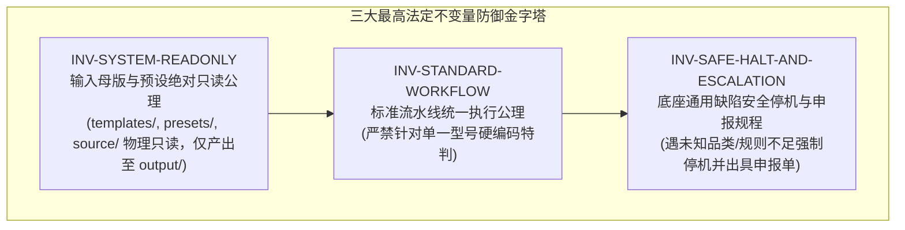
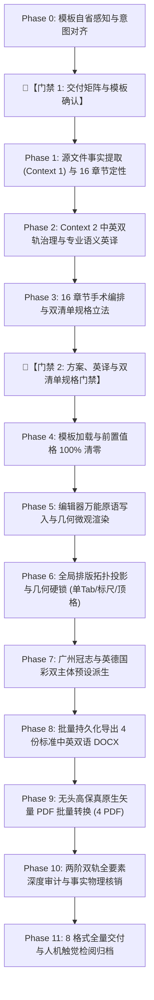

# MSDS Studio 受控工作流体系与 Agent 生产治理规范 (v8.0-PORTABLE)

> **版本**：v8.0-PORTABLE (便携单兵黑盒测试版)  
> **制定时间**：2026-11-16  
> **适用范围**：MSDS 文档处理、外部 Agent 覆写生产、黑盒稳定性与精度测试。  
> **核心使命**：为智能体赋予精确的感官（识别/下钻/透视/对账）与稳健的文档重塑能力，遵循“格式服从于原文”公理、“模板即拓扑边框样式基座”、“前置值格全量清零”机制，确立“哪一步、做什么、汇报什么”端到端 12 阶 SOP，依托底层排版几何硬锁（单Tab、自适应标尺、未编号标签齐平、多列顶格）与两阶双轨全要素深度审计，彻底终结历史型号特判与脆弱黑盒过拟合，打造 100% 工业级通用文档工作台。

---

## 一、 顶层架构与三大最高法定不变量 (Supreme Invariants)

全系统生命周期内，任何 Agent 必须无条件遵循以下三大最高法定不变量与工程公理：



### 1.1 核心架构三元归正：【识别感知 + 通用编辑器原语 + Agent 语义大脑】
- **确立工作流主干**：源文档零损耗化学事实感知 $\rightarrow$ Agent 语义大脑决策 $\rightarrow$ 模板受控操纵与覆写；
- **熟练运用编辑器全景能力**：预设应用 (`applyPreset`)、恢复本节 (`restoreSection`)、清空本节值 (`clearSectionValues`)、清空全模板值 (`clearTemplate`)、删列 (`deleteColumn`)、克隆增行 (`insertRow`)、删行 (`deleteRow`)、合并通栏 (`mergeCells`)、富文本与化学式下标 (`writeRichText`) 及激光垂线对齐 (`formatLaserTabs`)。

### 1.2 输入资产绝对只读公理 (`INV-SYSTEM-READONLY`)
- **受控只读目录**：`./templates/`（官方底模）、`./presets/`（企业预设字典）、`./source/`（原始输入文档）；
- **生产 Agent 权限边界**：执行生产与覆写任务时，Agent 对受控输入目录具有**绝对物理只读约束**；仅对指定的输出工作区（如 `./output/<MODEL>/`）拥有写入权限；
- **权限红线**：严禁任何 Agent 擅自修改、创建或删除输入目录下的底模或源文件。

### 1.3 版式与物理事实守恒公理
1. **格式服从于原文公理 (Format Follows Source Content Axiom)**：
   - 基于模板的格式与基于源文件的内容做匹配，格式服从于原文；
   - 若源文件某节仅有叙述性说明行，直接匹配到模板对应的说明行插槽，沿用模板排版；其余无关空白端点行清空或剪枝，绝不强塞无关假端点；
   - 若源文件包含细分结构化端点（如 LC50/LD50），则对应填入结构化值格插槽。绝不凭空捏造端点，绝不强行破坏模板几何规范。
2. **英文官方底模“历史脏数据”法定清零机制 (Pre-write Value Clearing Invariant)**：
   - 官方底模（尤其英文模板）内可能存在历史残留数据（如二乙二醇单丁醚、1306 mg/kg 等示范数据）；
   - 写入前必须先将待编辑章节的所有值格彻底清空，确保处于 100% 纯净空白插槽状态，再由 Agent 写入真实数据。
3. **Agent 大模型逐句专业语义英译与词典辅助校验 (LLM Contextual Translation Invariant)**：
   - 严禁依赖脆弱的机械文本替换；
   - 充分发挥 Agent 化学和毒理学专业语义理解优势，对源文档内容进行逐句专业英译，确保行文地道、术语符合 GHS/OECD 国际标准；
   - 英文产出物中中文字符数严格为 0。
4. **Section 2 零外生虚增最高公理 (`INV-ZERO-EXOGENOUS`)**：
   - 源文档未提及 GHS 象形图或信号词时，交付物**绝对严禁**凭空添加 `GHS象形图：无` 与 `信号词：无`（英文版亦严禁添加 `GHS pictograms: None` 与 `Signal word: None`）；
   - “没有”就是“没有”，不展示任何象形图与信号词标签行才是唯一合法表现。
5. **Section 2 阶梯排版几何公理 (`INV-S2-TYPOGRAPHY-HIERARCHY`)**：
   - 中文版：分类标题首行缩进 480 twips (24pt)，正文危害说明顶格 840 twips (42pt)；
   - 英文版：分类标题首行缩进 317 twips，正文说明缩进 677 twips；
   - 分类标题（如“易燃液体 类别3”）绝对保持普通字重（严禁加粗），正文首字严格垂直左对齐。
6. **母版页眉页脚样式原生继承公理 (`INV-TOPO-HF-INHERIT`)**：
   - 确立“模板即页眉页脚样式基座”公理：默认 100% 完整继承母版原生的页眉页脚样式、字号、字体、粗细与底纹；
   - 仅在原生插槽内填充动态文字并保留原有样式。
7. **序号与标签间隔单制表符公理 (`INV-SEQ-TAB-ALIGN`)**：
   - 序号与标签之间使用单个 `<w:tab/>` 节点，严禁序号后添加多余空格；
   - 依据章节内最大序号数字位数（$D_{max}$）动态自适应标尺（$D_{max} \le 3$ 为 420 dxa，$D_{max} \ge 4$ 自动升级为 560 dxa），消除硬编码特判。
8. **标签对齐与多行折行垂直悬挂公理 (`INV-LABEL-CONTINUATION-ALIGN`)**：
   - 固化悬挂缩进 `<w:ind w:left="420" w:hanging="420"/>`（或 560），折行第二行首字在 420/560 dxa 垂线垂直对齐（实测偏差 $\le 1\text{px}$）；
   - 未编号标签注入同基线 `w:left="420"`（无 hanging），首字与带序号标签 100% 齐平，消除锯齿；
   - 物理级清除 `w:firstLine`、`leftChars` 与 `w:numPr` 污染。
9. **多列顶格与单列通栏大纲树状层级二分公理 (`INV-VALUE-INDENT-DICHOTOMY`)**：
   - 多列表格（`cells.length > 1`）：填写值单元格清除 `w:ind`，注入 `jc="left"`，紧贴 108 dxa 单元格左边距顶格对齐，杜绝二次缩进；
   - 单列通栏表格（`cells.length === 1`，如 Section 2）：保留大纲树状层级缩进，防范措施条款向右缩进。

---

## 二、 基础资产与目录拓扑 (Assets & Directory Topology)

```text
MSDS_Studio_Agent_Test_Kit/
├── templates/
│   ├── 正式模板_MSDS_CN_冠志(1).docx      # 官方标准中文底模
│   └── 正式模板_MSDS_EN_冠志(1).docx      # 官方标准英文底模
├── presets/
│   └── company_presets.json              # 广州冠志与英德国彩中英双语企业预设
├── source/
│   └── PA-3655 msds_CN 冠志.docx         # 工业级真实测试源文档
├── output/                               # 交付输出目录 (生成 4 DOCX + 4 PDF)
└── README_FOR_AGENT.md                   # 智能体任务指引白皮书
```

### 2.1 底模选用映射与企业预设派生
- **中文冠志**：以 `./templates/正式模板_MSDS_CN_冠志(1).docx` 为基座，注入 `./presets/company_presets.json` 中 `Guanzhi_zh` 信息；
- **中文国彩**：以 `./templates/正式模板_MSDS_CN_冠志(1).docx` 为基座，注入 `./presets/company_presets.json` 中 `Guocai_zh` 信息；
- **英文冠志**：以 `./templates/正式模板_MSDS_EN_冠志(1).docx` 为基座，注入 `./presets/company_presets.json` 中 `Guanzhi_en` 信息；
- **英文国彩**：以 `./templates/正式模板_MSDS_EN_冠志(1).docx` 为基座，注入 `./presets/company_presets.json` 中 `Guocai_en` 信息。

---

## 三、 端到端 12 阶标准作业规程 SOP (12-Phase Mandatory Pipeline)



### 3.1 核心阶段作业明细

1. **Phase 0: 模板自省感知**：定位 `./templates/` 与 `./presets/`，确认底模与企业预设就绪。
2. **Phase 1: 源文件事实感知 (Context 1)**：
   - 提取源文档 16 章节原始化学事实、GHS 危害分类、CAS 组分明细、理化指标与毒理学数据；
   - 严格保证事实 100% 保真，绝不凭空丢弃或截断。
3. **Phase 2: Context 2 治理与专业英译**：
   - 大模型地道英译：对品名、分类、组分、危害说明、急救、理化及毒理进行专业英译；
   - 英文文档中绝对不能出现中文字符残留；
   - 度数符号规范化为 `°C`。
4. **Phase 3: 方案编排与双清单**：规划 16 章节手术策略，格式服从原文。
5. **Phase 4: 模板加载与前置值格清零**：清空底模中所有值格的历史示范数据，确保处于纯净插槽状态。
6. **Phase 5: 原语写入与几何微观渲染**：
   - Section 2 阶梯缩进渲染；
   - Section 3 成分表增删行与 CAS/百分比填入；
   - Section 8 暴露限值表写入；
   - Section 9 理化参数写入与化学分子式微观渲染。
7. **Phase 6: 全局排版拓扑投影与几何硬锁**：
   - 注入字阶（中文小四12pt/五号10.5pt，英文五号9.5pt/小四11pt）；
   - 序号后单个 `<w:tab/>`，420/560 dxa 自适应悬挂标尺；
   - 未编号标签首字基线绝对齐平；
   - 多列表格数值紧贴 108 dxa 顶格对齐。
8. **Phase 7: 双主体预设派生**：分别注入冠志与国彩企业元数据，更新页眉页脚（型号、公司名、修改日期）。
9. **Phase 8: 导出 4 份 DOCX 文档**：
   - `<Model> msds_CN 冠志.docx`
   - `<Model> msds_CN 国彩.docx`
   - `<Model> msds_EN Guanzhi.docx`
   - `<Model> msds_EN Guocai.docx`
10. **Phase 9: 原生高清矢量 PDF 转换 (4 份 PDF)**：将 4 份 DOCX 转换为 4 份矢量 PDF，确保排版无错位。
11. **Phase 10: 两阶双轨全景深度自审**：自检 8 份文件完整性、中文残留清零、Section 2 零虚增与对齐质量。
12. **Phase 11: 交付回传**：将 8 份交付物输出至 `./output/<Model>/`，提请回传终审。

---

## 四、 万能几何手术配方库 (Recipe Library A~H)

- **配方 A【三列转两列消除配方】**：删除冗余列，平摊宽度保持表格总宽守恒为 9795 dxa。
- **配方 B【通栏说明合并配方】**：横向合并单元格，首字左对齐，清除冗余空行。
- **配方 C【克隆增行配方】**：针对多组分（Section 3）克隆行，100% 继承边框、内边距与行高属性。
- **配方 D【冗余行精准剔除配方】**：删除无内容空白行，但**严禁删除父级分类题头**（如“8.1 控制参数：”）。
- **配方 E【富文本与化学式下标写入配方】**：化学分子式（如 $\text{H}_2\text{O}$、$\text{CO}_2$）以包含下标属性的 Run 节点写入。
- **配方 F【激光垂直对齐配方】**：Section 9 键值对冒号垂直对齐于 80.28pt 坐标。
- **配方 G【历史残留值格前置清零配方】**：写入真实数据前清空目标章节或全模板值格。
- **配方 H【单节母版几何恢复配方】**：操作失误或版式错乱时单节回退至模板初始结构。

---

## 五、 防御性故障自愈手册 (Troubleshooting)

1. **Section 2 危害说明加粗/缩进错乱**：严格检查 `INV-S2-TYPOGRAPHY-HIERARCHY`：分类标题普通字重，首行缩进 480/317 twips；正文首字垂直对齐 840/677 twips。
2. **多列表格数值出现内缩进锯齿**：清除数值单元格段落上的 `w:ind`，紧贴 108 dxa 单元格左边距顶格对齐。
3. **英文版中文残留**：大模型全面检查 16 章节，确保所有专业化学品名称、物理状态、毒理测试项与急救说明地道英译，中文字符归零。
4. **象形图凭空出现**：若源文档为非危险品或未提及象形图，交付物绝不可添加“GHS象形图：无”或“None”标签行。
