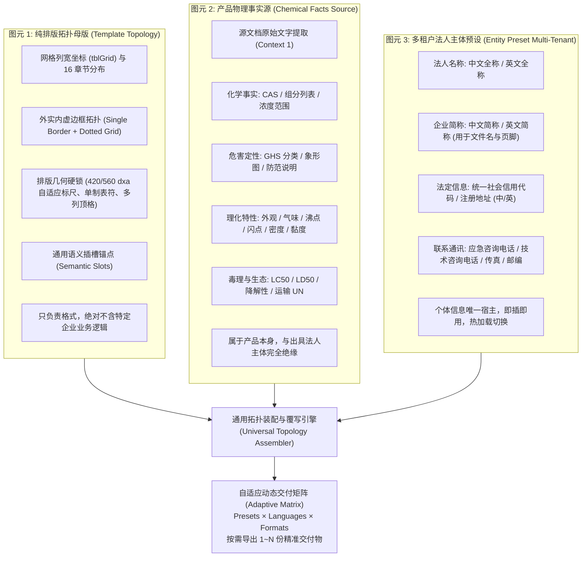
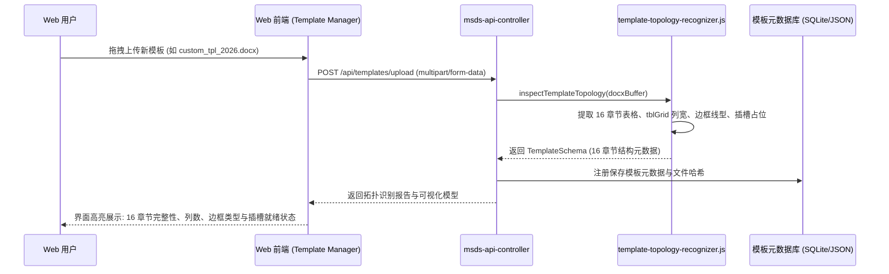
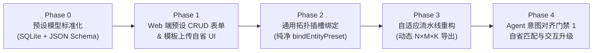

# MSDS Studio 通用拓扑引擎、动态预设治理与自适应交付矩阵架构规范
## (Universal Topology Engine, Dynamic Presets & Adaptive Deliverables Architecture Specification)

> **文档版本**：v9.0-ENTERPRISE-UNSLOP  
> **制定日期**：2026-11-16  
> **归档位置**：`F:\App Location\Guanzhi Tong\Skill\MSDS-Engine\体系交接文档\`  
> **面向对象**：MSDS-Engine 架构治理层、前端工程师、后端与引擎开发者、执行 Agent 与测试 Agent。  
> **核心使命**：彻底破除对特定企业主体（冠志/国彩）和特定固定底模的底层硬编码依赖，确立“模板纯化为排版拓扑”、“源文件为物理化学事实源”、“预设为多租户法人元数据”的三元正交解耦架构；全面支持 Web 端手动预设管理与模板拓扑自省、Agent 意图对齐门禁智能匹配、以及基于多主体 $\times$ 多语言 $\times$ 多格式的三维正交自适应交付矩阵。

---

## 一、 顶层架构：三元正交解耦公理 (The Triad Orthogonal Decoupling Axiom)

全系统生命周期内，系统底座、几何编辑器、数据流与审计中枢**SHALL**严格遵循以下三元正交解耦公理：



### 1.1 核心边界职责划分
1. **模板 (Template)**：
   - **唯一职责**：提供排版布局、边框规范、字体字号（Tokens）、自适应悬挂标尺及表格行列拓扑。
   - **绝对禁令**：底模中严禁硬编码特定企业的逻辑判断，不与任何具体法人绑定。底模只定义通用中文母版（如 `base_template_zh.docx`）与通用英文母版（如 `base_template_en.docx`）或用户上传的自定义母版。
2. **源文件 (Source)**：
   - **唯一职责**：提供客观产品事实。产品本身的理化性质、毒理结论与成分构成是物理客观事实，无论由哪家公司出具，产品事实恒定守恒。
3. **预设 (Presets)**：
   - **唯一职责**：法人主体信息的唯一载体。冠志、国彩只是两份具体的 JSON/数据库预设记录；新增任何第三方企业（如万华、巴斯夫、陶氏或任意客户），只需新增一份预设，系统底座源码 0 行修改。

---

## 二、 用户四大工业级核心需求详细落地规约 (Four Core Requirements)

---

### 2.1 需求 1：MSDS-Studio Web 端手动可视化预设管理 (Web UI Preset Manager)

#### 2.1.1 业务定位与交互场景
用户在 MSDS-Studio Web 页面中无需触碰任何配置文件，直接通过可视化表单新增、查看、编辑、复制、删除和切换企业预设，并可指定某个预设为系统默认。

#### 2.1.2 预设实体标准数据字典 (`CompanyPresetSchema`)
每个预设在系统底层统一序列化为标准 JSON 实体：
```json
{
  "id": "preset_guanzhi",
  "name": "广州冠志（官方标准）",
  "isBuiltin": true,
  "isDefault": true,
  "entity": {
    "name_zh": "广州冠志新材料科技有限公司",
    "name_en": "Guangzhou Guanzhi New Material Technology Co., Ltd.",
    "shortName_zh": "冠志",
    "shortName_en": "Guanzhi",
    "creditCode": "91440101MA59XXXXXX",
    "address_zh": "广州市萝岗区科学城掬泉路3号广州国际企业孵化器A区1106室",
    "address_en": "Room 1106, Area A, Guangzhou International Enterprise Incubator, No. 3 Juquan Road, Science City, Luogang District, Guangzhou",
    "postcode": "510663",
    "tel": "86-20-82567990",
    "fax": "86-20-32214789",
    "emergencyTel_zh": "86-20-82567990 (24小时化学品事故应急咨询)",
    "emergencyTel_en": "86-20-82567990 (24h Emergency Contact)",
    "email": "info@guanzhi.com",
    "website": "www.guanzhi.com"
  },
  "headerFooterRules": {
    "headerRightModel": "{{MODEL_CODE}}",
    "footerCenter": "{{COMPANY_NAME}}",
    "footerRightRevisionDate": "{{CURRENT_DATE}}"
  },
  "updatedAt": 1731735000000
}
```

#### 2.1.3 Web 前端与后端 REST API 契约
- `GET /api/presets`：获取全量可用预设列表（附带 `isDefault` 标识）；
- `GET /api/presets/:id`：获取特定预设详细字段；
- `POST /api/presets`：创建新预设（支持从现有预设一键“另存为”快速派生）；
- `PUT /api/presets/:id`：更新指定预设；
- `DELETE /api/presets/:id`：删除预设（内置预设禁止硬删除，仅允许禁用）；
- `POST /api/presets/:id/set-default`：将指定预设设为当前全局默认预设。

---

### 2.2 需求 2：MSDS-Studio Web 端手动更换模板与拓扑结构自动识别 (Dynamic Template Discovery)

#### 2.2.1 业务定位与交互场景
用户在 Web 端可以随时更换当前使用的 DOCX 模板，支持直接从本地拖拽上传新模板文件。系统后端在接收到模板后，**毫秒级自省解析** 16 章节的表格拓扑，并在前端界面渲染出可视化的拓扑大纲。

#### 2.2.2 自动拓扑识别引擎标准作业流水线


#### 2.2.3 模板拓扑元数据定义 (`TemplateTopologySchema`)
```typescript
interface TemplateTopologySchema {
  templateKey: string;
  name: string;
  language: 'zh' | 'en' | 'universal';
  isCustom: boolean;
  totalTables: number; // 严格校验 16 章节表格数量
  sections: {
    [sectionNumber: number]: {
      sectionTitle: string;
      tableIndex: number;
      rowCount: number;
      columnCount: number;
      colWidthsDxa: number[];
      borderStyle: {
        top: string;
        bottom: string;
        insideH: string;
        insideV: string;
      };
      identifiedSlots: Array<{
        slotName: string;
        rowIndex: number;
        cellIndex: number;
        role: 'LABEL' | 'VALUE' | 'FULL_WIDTH';
      }>;
    };
  };
  headerFooterSlots: {
    hasHeader: boolean;
    hasFooter: boolean;
    detectedPlaceholders: string[];
  };
}
```

---

### 2.3 需求 3：Agent 工作流动态感知与意图对齐门禁 (Gate 1 Dynamic Alignment)

#### 2.3.1 业务定位与交互准则
Agent 在启动文档覆写流水线时，**严禁静默默认选用冠志底模与冠志预设**。Agent 必须拥有完整的“感官”，在执行初始阶段主动感知系统环境，并向用户呈报交互确认门禁。

#### 2.3.2 Agent 意图感知三步法 (Agent Perception Protocol)
1. **第 1 步：环境与资产自省 (Environment Inventory)**：
   - 自动查询当前系统所有已启用的模板：`[通用中文模板, 通用英文模板, 自定义A模板...]`；
   - 自动查询当前所有可用企业预设：`[冠志(默认), 国彩, 万华化学, 客户X...]`；
2. **第 2 步：源文档特征推断与智能预匹配 (Heuristic Inference)**：
   - 扫描用户传入的源文件（如 `PA-3655 msds_CN 冠志.docx`）；
   - 根据源文件语言推荐匹配语言（含 `CN` 推荐中文模板，含 `EN` 推荐英文模板）；
   - 从源文档文本或型号中提取特征词（如检测到“国彩”优先推荐国彩预设；未检测到则推荐系统默认预设）；
3. **第 3 步：【法定门禁 1：意图、模板与预设确认门禁】主动交互**：
   - Agent **强制停机**，向用户呈报推荐方案与可选清单，格式严格如下：

```markdown
🚨【法定门禁 1: 生产意图、底模选用与企业预设确认门禁】

- **目标产品型号**：PA-3655
- **输入源文件**：source/PA-3655 msds_CN 冠志.docx
- **系统感知推荐方案**：
  • 推荐底模：[正式模板_MSDS_CN_通用.docx] (匹配源文档中文特征)
  • 推荐企业预设：[广州冠志新材料 (系统默认)]
  • 拟导出交付矩阵：[中文 Word + 中文 PDF (2 格式)]

- **全量可用选项清单**：
  • 可选底模库：1. 正式模板_MSDS_CN (通用) | 2. 正式模板_MSDS_EN (通用) | 3. 自定义模板_2026
  • 可选预设库：1. 广州冠志 (默认) | 2. 英德国彩 | 3. 新建企业预设...
  • 可选语言：[中文 / 英文 / 中英双语]
  • 可选格式：[Word (.docx) / PDF (.pdf) / 两者都要]

请确认：是否直接使用推荐方案？或指定您需要的底模、企业预设及输出格式组？
```

---

### 2.4 需求 4：自适应多格式交付矩阵 (Adaptive Output Matrix - 终结固定 8 格式)

#### 2.4.1 业务定位
彻底终结底层写死的“4 DOCX + 4 PDF = 8 格式”逻辑。现实业务中：
- 有时客户只要一份中文 Word 进行微调；
- 有时只需要给外商出具一份英文 PDF；
- 有时需要为 3 家 OEM 贴牌代工厂一次性出具 3 个品牌的中英全套文件（12 份文件）。

系统必须支持由**主体预设 $\times$ 语言 $\times$ 格式**三维自由组合的动态笛卡尔积。

#### 2.4.2 三维动态正交矩阵计算公式

$$\text{DeliverableCount} = N_{\text{presets}} \times N_{\text{languages}} \times N_{\text{formats}}$$

| 维度 (Dimension) | 选项集合 (Options) | 灵活取值 |
| :--- | :--- | :--- |
| **主体预设 (Presets)** | `{P_1, P_2, ..., P_n}` | 选 1 个、选 2 个（如冠志+国彩）或选 $N$ 个企业主体 |
| **语言维度 (Languages)** | `{'zh', 'en'}` | 选仅中文 (`zh`)、仅英文 (`en`) 或中英双语 (`zh + en`) |
| **文件格式 (Formats)** | `{'docx', 'pdf'}` | 选仅 Word (`docx`)、仅矢量 PDF (`pdf`) 或两者都要 (`both`) |

#### 2.4.3 常见业务场景矩阵对照表

| 业务场景 | 预设选择 ($N_P$) | 语言选择 ($N_L$) | 格式选择 ($N_F$) | 产出交付物总数 |
| :--- | :---: | :---: | :---: | :---: |
| **场景 A：日常快速单品审阅** | 1 (冠志) | 1 (仅中文) | 1 (仅 DOCX) | **1 份** |
| **场景 B：外贸客户合规出货** | 1 (冠志) | 1 (仅英文) | 1 (仅 PDF) | **1 份** |
| **场景 C：单主体标准存档** | 1 (冠志) | 2 (中英双语) | 2 (Word + PDF) | **4 份** (2 DOCX + 2 PDF) |
| **场景 D：传统冠志国彩双牌** | 2 (冠志 + 国彩) | 2 (中英双语) | 2 (Word + PDF) | **8 份** (4 DOCX + 4 PDF，向下兼容) |
| **场景 E：集团多品牌分发** | 3 (品牌A+B+C) | 2 (中英双语) | 2 (Word + PDF) | **12 份** (6 DOCX + 6 PDF) |

#### 2.4.4 文件名规范化模板引擎
产出文件的命名不再硬编码，统一由标准模板字符串解析器动态派生：
```text
格式模板: ${modelCode} msds_${langCode}_${preset.shortName}.${ext}

实例生成结果:
- PA-3655 msds_CN_冠志.docx
- PA-3655 msds_CN_冠志.pdf
- PA-3655 msds_EN_Guanzhi.docx
- PA-3655 msds_EN_Guanzhi.pdf
- PA-3655 msds_CN_万华.docx
- PA-3655 msds_EN_Wanhua.pdf
```

---

## 三、 通用拓扑编辑器原语重构 (Universal Editor Primitives)

为支撑上述动态架构，底层编辑器原语废止所有包含 `if (company === 'Guanzhi')` 的硬编码，升级为纯粹的**插槽注入原语**：

```javascript
/**
 * 通用企业主体预设插槽绑定原语 (Generic Entity Preset Slot Binding)
 * @param {WorkSession} session 当前正在编辑的 Word 文档会话
 * @param {CompanyPreset} preset 标准企业预设对象
 * @param {string} lang 语言 ('zh' | 'en')
 */
export function bindEntityPresetToSession(session, preset, lang = 'zh') {
  const isEn = lang === 'en';
  const name = isEn ? preset.entity.name_en : preset.entity.name_zh;
  const address = isEn ? preset.entity.address_en : preset.entity.address_zh;
  const shortName = isEn ? preset.entity.shortName_en : preset.entity.shortName_zh;
  const emergencyTel = isEn ? preset.entity.emergencyTel_en : preset.entity.emergencyTel_zh;

  // 1. 语义插槽绑定：Section 1 企业信息
  session.writeSectionSlot(1, 'COMPANY_NAME', name);
  session.writeSectionSlot(1, 'COMPANY_ADDRESS', address);
  session.writeSectionSlot(1, 'COMPANY_TEL', preset.entity.tel);
  session.writeSectionSlot(1, 'COMPANY_FAX', preset.entity.fax);
  session.writeSectionSlot(1, 'EMERGENCY_TEL', emergencyTel);

  // 2. 语义插槽绑定：Section 16 责任声明与落款
  session.writeSectionSlot(16, 'DISCLAIMER_SIGNATURE', name);

  // 3. 页眉与页脚动态绑定 (完全继承母版样式与 rPr)
  session.updateHeaderFooter({
    headerModel: session.modelCode,
    footerCompany: shortName || name,
    footerDate: new Date().toLocaleDateString('zh-CN')
  });
}
```

---

## 四、 实施落地工程路线图 (Implementation Roadmap)



1. **Phase 0：预设数据模型与存储标准化**
   - 固化 `CompanyPresetSchema`，补全 SQLite `presets` 表中中英双语、简称、应急电话等完整字段；
   - 预置默认的冠志与国彩数据作为初始种子（Seed Data）。
2. **Phase 1：Web 前端界面与 API 升级**
   - 在 MSDS-Studio Web 界面中增设独立的“企业主体预设管理面板 (Preset Modal)”；
   - 在模板切换区域支持直接上传 `.docx` 模板并显示拓扑自省结果卡片。
3. **Phase 2：拓扑编辑器原语纯化**
   - 重构 `template-editor.js` 与 `universal-editor-primitives.js`，移除所有对特定公司名的物理依赖；
   - 全面引入 `bindEntityPresetToSession` 插槽式装配。
4. **Phase 3：流水线自适应矩阵重构**
   - 重构 `pipeline-engine.js`，将 `executeEightDeliverablesPipeline` 升级为通用 `executeAdaptiveDeliverablesPipeline(sourcePath, options)`；
   - 支持通过参数自由传入 `presets: []`、`languages: []`、`formats: []`。
5. **Phase 4：Agent 生产治理规范 (SKILL.md) 与门禁 1 升级**
   - 更新系统技能规范 `msds-studio`，明确 Agent 在 Phase 0 与 Gate 1 中的自省、匹配推断与用户确认交互逻辑。

---

## 五、 永久封存与归档结论

本规范已作为 MSDS-Studio 工业级架构的最高权威基线文档沉淀至体系知识库：
- **物理归档路径**：`F:\App Location\Guanzhi Tong\Skill\MSDS-Engine\体系交接文档\MSDS_Studio_通用拓扑引擎与动态预设交付矩阵架构规范.md`
- **代码库承重墙保护**：未来一切对模板识别、企业预设与交付导出的演进，均必须无条件遵守本规范所确立的**三元正交解耦公理**与**自适应交付矩阵**原则。
