# Implementation Plan: MSDS-Studio 工业级受控生产工作流全面优化重构方案

## 一、 方案目标与背景说明 (Goal Description)

### 1.1 业务背景与问题痛点
在以往的 MSDS 自动化生产过程中，存在以下偏离系统设计的严重隐患：
1. **把工作流当成黑盒硬编码**：底层过度依赖针对具体型号的 ad-hoc 脚本或在流水线内部用正则表达式进行局部硬特判（如 `/噁唑啉/`、`/符合ADG准则/`），一旦遇到新产品或复杂的组分命名即发生漏译（如组分串联为 `噁唑啉改性丙烯酸聚合物水`、运输项残留中文）；
2. **脱离编辑器已有能力**：MSDS-Studio 的编辑器模块（`template-editor.js`、`universal-editor-primitives.js`、`docx-engine.js`）本已具备完整的标准化排版输出能力（Design Tokens 字阶、自适应 420/560 dxa 对齐标尺、表格边框、增删行/列、通栏合并与剪枝能力），但先前的流程未让 Agent 直接驾驭编辑器能力，而是试图死板硬套模板现有的行数与插槽；
3. **数据治理与输出层耦合**：源文件提取的事实未经过结构化治理即直接送入排版，导致底模历史示范数据残留、非危化品凭空生成“象形图：无/信号词：无”、温度缺失度数符号 `°C` 等问题频发；
4. **工序与审计未严格分阶**：缺乏明确的线性工序保障，且机械审计与 Agent 认知介入审计界限模糊。

### 1.2 方案核心目标
依据用户最高立法指示，**坚决停止任何针对特定型号的临时产出尝试**，全面重构并确立 MSDS-Studio 的通用受控架构，将生产流水线强制收敛为清晰、解耦、透明的 **7 阶标准受控作业流水线**：
1. **阶段 1：找到源文件 (Source Discovery)**；
2. **阶段 2：调用识别模块获取 Context1 (Source Recognition)**；
3. **阶段 3：检查与规范化治理形成 Context2 (Content Governance，内容必须 100% 来源于源文件)**；
4. **阶段 4：强制调用编辑器模块受控写入 (Editor Primitives Execution，前置清空 + 格式服从原文 + 万能原语)**；
5. **阶段 5：严格法定生产工序 (先做中文 Word $\rightarrow$ 再做英文 Word $\rightarrow$ 批量转 4 高清 PDF)**；
6. **阶段 6：两阶双轨全景深度审计 (159 项机械主审计退出码 0 + Agent 16 章节逐行逐句对照翻译与数值保真)**；
7. **阶段 7：自动镜像交付至用户目录并出具 1:1 物理核销清算矩阵**。

---

## 二、 架构设计与 7 阶流水线流转拓扑 (Architecture Design)

```mermaid
flowchart TD
    subgraph S1["阶段 1: 找到源文件 (Source Discovery)"]
        A["输入路径: sourceFilePath"] --> B["物理文件存在性与字节数校验 (> 0)"]
        B --> C["解析/锁定目标型号 modelCode 与事实指纹"]
    end

    subgraph S2["阶段 2: 零损耗识别获取 Context1 (Recognition)"]
        C --> D["调用 msds_recognize_source (recognition-engine.js)"]
        D --> E["生成客观未修饰原始数据资产 Context1 (16章节纯文本与原始表格)"]
    end

    subgraph S3["阶段 3: 检查与规范化治理形成 Context2 (Governance)"]
        E --> F["全局规范与局部规范核验 (G-01~G-40 & S1~S16)"]
        F --> G["GHS 事实保真清洗 (非危化品严禁虚增象形图/信号词)"]
        G --> H["化学与毒理学专业语义高保真英译 (OECD导则号, 组分, 危害项)"]
        H --> I["标点/度数符号/西文空格规范化 (°C, mm, min)"]
        I --> J["生成法定唯一生产数据源 Context2 (100%源自原文, 零捏造)"]
    end

    subgraph S4["阶段 4: 强制调用编辑器模块受控写入 (Editor Primitives)"]
        J --> K["加载官方干净母版: CN/EN x 冠志/国彩"]
        K --> L["前置清空机制: clearSectionValues / clearTemplateValues (消除脏残留)"]
        L --> M["万能几何原语调用: insertRow / deleteRow / deleteColumn / mergeCells"]
        M --> N["格式服从原文公理: 根据 Context2 动态重构行数, 剪枝空白假端点"]
        N --> O["写入 Context2 真实数据: writeCellValue / writeRichText / formatLaserTabs"]
        O --> P["底层排版拓扑自动投影: applyGlobalTypographyProjection (Tokens/420/560dxa)"]
    end

    subgraph S5["阶段 5: 严格法定生产工序 (Strict Production Order)"]
        P --> Q1["工序 5.1: 生成中文 Word (OS-8970 msds_CN 冠志.docx + 国彩.docx)"]
        Q1 --> Q2["工序 5.2: 生成英文 Word (OS-8970 msds_EN Guanzhi.docx + Guocai.docx)"]
        Q2 --> Q3["工序 5.3: 原生 Word/WPS 高保真导出 4 份高清 PDF (总耗时 <= 60s)"]
    end

    subgraph S6["阶段 6: 两阶双轨全景深度审计 (Two-Step Deep Audit)"]
        Q3 --> R1["第一阶: 159 项机械确定性中央主审计 (run_master_msds_audit.mjs)"]
        R1 --> R2["第一阶b: 双极双层法医级深度审计 (audit_bipolar_bilayer.mjs)"]
        R2 -- "真实退出码 0 (Failures: 0)" --> R3["第二阶: Agent 认知介入 16 章节逐行双语对照审验证伪"]
        R2 -- "非 0 报错拦截" --> ERR["熔断阻断交付并生成缺陷清单"]
    end

    subgraph S7["阶段 7: 自动镜像交付与正式清算 (Delivery & Synchronization)"]
        R3 --> S["自动镜像同步全量 8 份交付物至 E:\\冠志\\...\\待处理文件\\<modelCode>"]
        S --> T["出具 1:1 双向物理核销交付报告与 Git 知识沉淀"]
    end
```

---

## 三、 用户需要审阅的关键决策 (User Review Required)

> [!IMPORTANT]
> **关于工作流控制权与黑盒解耦的关键重构决策**：
> 1. **全面废除黑盒隐式匹配（`smart-matching.js` 中的脆弱正则）**：
>    此前在生成英文 Word 时，代码在底层尝试自动把中文 Word 中的文字“反向猜测”成英文，并在识别不到时 fallback 为中文或拼贴错误词组（例如把 `噁唑啉改性丙烯酸聚合物` 与 `水` 拼贴成 `噁唑啉改性丙烯酸聚合物水`）。
>    **重构策略**：将翻译与治理逻辑完全上浮至 **阶段 3（Context2 治理层）**。`Context2` 在进入编辑器前，必须已经是**完整、纯净、中英双语齐备、结构独立**的化学事实对象（包含中英文两套完全对应的 16 章节数据）。编辑器只负责机械式装配，不再包含任何半吊子的猜词逻辑！
> 2. **编辑器万能原语装配层独立化 (`editor-writer.js`)**：
>    新建专职模块 `web/src/editor-writer.js`，完全封装编辑器万能原语调用（清空 $\rightarrow$ 增行 $\rightarrow$ 删行 $\rightarrow$ 删列 $\rightarrow$ 合并 $\rightarrow$ 写值 $\rightarrow$ 投影字阶），使得 Agent 与流水线能清晰调用编辑器能力，真正落实“格式服从于原文”。
> 3. **生产工序线性硬锁**：
>    严格按照 ① 中文 Word $\rightarrow$ ② 英文 Word $\rightarrow$ ③ 批量转 PDF 执行，每一步都有明确产出物检验，上一步未就绪绝不进入下一步。

---

## 四、 关键技术细节与模块划分 (Proposed Changes)

### 4.1 新建：事实治理与双语标准化引擎 (`web/src/context-governor.js`) [NEW]
**职责**：纯数据流处理，承接 `Context1`，输出 `Context2`。绝对不涉及任何 Word DOM 或文件 IO。
- **输入**：`Context1`（由 `recognizeSourceDocx` 提取的原始事实对象）
- **处理逻辑**：
  1. **GHS 规范化**：
     - 若源文件非危，强制设置 `ghs.isHazardous = false`，清空分类、信号词与防范说明；
     - 强制确保**绝不生成**“象形图：无”或“信号词：无”字段；
  2. **中英双语深度翻译引擎**：
     - 构建通用化工词汇与短语词典（聚合物、树脂、水性乳液、溶剂、测试终点）；
     - 采用“词典查表 + 结构化语义翻译”双重保障，覆盖：
       - Section 1 品名、用途；
       - Section 2 危害描述与防范说明；
       - Section 3 组分列表（中文名、英文名、CAS号、浓度范围，严格拆分为独立元素数组，杜绝粘连）；
       - Section 4~8 急救、消防、应急、储存与防护措施；
       - Section 9 理化指标（外观、气味、pH、沸点、闪点、粘度、固含）；
       - Section 10 稳定性与反应性；
       - Section 11 毒理学测试（经口 LD50、吸入 LC50、经皮 LD50、刺激性等）；
       - Section 12 生态毒理学；
       - Section 13 废弃处置（英文段落纯左对齐内容）；
       - Section 14 运输信息（陆运、海运、空运、非危险货物标准英文陈述）；
       - Section 15 法规名录；
       - Section 16 其他信息；
  3. **度数符号与排版标点治理**：
     - 将所有温度数值（如 `100 C`、`100C`）统一治理为标准西文 `100 °C`；
     - 清除段末悬挂冒号与中文粘连标点；
- **输出**：`Context2`（包含 `cn` 与 `en` 双语独立分发分支的标准化化学事实对象）。

### 4.2 新建：编辑器能力装配执行器 (`web/src/editor-writer.js`) [NEW]
**职责**：纯编辑器原语操作层，直接调用 `template-editor.js` 与 `universal-editor-primitives.js`，将 `Context2` 装配至指定底模。
- **输入**：`Context2`（特定语言版本）、`templateKey`（如 `CN_Guanzhi`, `CN_Guocai`, `EN_Guanzhi`, `EN_Guocai`）、`outputPath`
- **执行步骤**：
  1. `createWorkSession(templateKey)`：加载纯净母版；
  2. `clearTemplateValues(session)`：**前置值格全面清零**，抹除底模历史示范残留数据；
  3. **16 章节原语装配**：
     - **Section 1 & Header/Footer**：写入产品型号、名称、生产企业、应急电话、版本修订日期；
     - **Section 2**：若非危，只保留“2.1 物质或混合物的分类：不属于危险品”，彻底清空或移除象形图与信号词单元格；
     - **Section 3**：根据 `Context2.components` 数组长度，利用 `insertRowIntoSession` 或 `deleteRowFromSession` 调整行数，写入组分名、CAS号、浓度（格式服从原文）；
     - **Section 4~8**：写入对应的急救、消防、泄漏、储存与防护指标；
     - **Section 9**：填入 14~23 项理化参数，调用 `formatSection9LaserTabs` 实现 80.28pt 激光垂线对齐；
     - **Section 10**：填入 6 大反应性条目；
     - **Section 11 & 12**：根据源文件是“结构化测试端点”还是“通栏叙述”，动态调用 `mergeCellsInSession`（形态 C）或分列值格（形态 A），绝不留空或捏造假端点；
     - **Section 13**：写入废弃处置说明，英文强制左对齐；
     - **Section 14**：写入陆海空非危说明（英文使用标准 IATA/IMDG/ADG 规范陈述）；
     - **Section 15 & 16**：写入法规与免责声明；
  4. `applyGlobalTypographyProjection`：全局投影标准 Design Tokens（宋体/Times New Roman、字号小四/五号、行间距、420/560 dxa 悬挂缩进）；
  5. `saveSession(session, outputPath)`：安全输出标准 DOCX。

### 4.3 升级：受控生产总调度引擎 (`web/src/production-orchestrator.js`) [MODIFY]
**职责**：组织 7 阶段流转，实现工业级流水线串联与异常熔断。
- **阶段 1**：物理源文件定位与存在性校验；
- **阶段 2**：调用 `recognizeSourceDocx` 提取 `Context1`；
- **阶段 3**：调用 `governContext(context1)` 生成 `Context2`；
- **阶段 4 & 5**：严格工序生产 8 格式交付物：
  1. `buildDocxViaEditor(context2.cn, 'CN_Guanzhi', ...)` $\rightarrow$ `OS-8970 msds_CN 冠志.docx`；
  2. `buildDocxViaEditor(context2.cn, 'CN_Guocai', ...)` $\rightarrow$ `OS-8970 msds_CN 国彩.docx`；
  3. `buildDocxViaEditor(context2.en, 'EN_Guanzhi', ...)` $\rightarrow$ `OS-8970 msds_EN Guanzhi.docx`；
  4. `buildDocxViaEditor(context2.en, 'EN_Guocai', ...)` $\rightarrow$ `OS-8970 msds_EN Guocai.docx`；
  5. `convertBatchDocxToPdf([...])` $\rightarrow$ 原生转译 4 份高清 PDF；
- **阶段 6**：两阶深度审计门禁：
  1. 第一阶：`runMasterMsdsAudit`（159 项主审计）+ `runBipolarBilayerAudit`（双极双层法医级审计），要求真实退出码 0；
  2. 第二阶：Agent 认知审计对账，输出 16 章节双语对照矩阵；
- **阶段 7**：交付与同步：
  - 自动镜像至 `E:\冠志\TDS MSDS (2)\待处理文件\<modelCode>\`；
  - 校验目标目录 8 份文件完整性与修改时间。

### 4.4 升级：命令行入口与 MCP 网关契约 [MODIFY]
- `web/scripts/produce_standard_deliverables.mjs`：对齐新架构参数与全链路日志；
- `web/src/mcp-server.js` 与 `web/scripts/msds_mcp_gateway.mjs`：暴露更新后的 7 阶流水线接口。

### 4.5 升级：全局技能文档 (`skills/msds-studio/SKILL.md`) [MODIFY]
- 永久写入 7 阶标准作业流程与各模块职责边界，作为跨会话最高法定规范。

---

## 五、 模块与文件变更清单 (Proposed Changes by File)

| 操作类型 | 文件物理路径 | 变更要点说明 |
| :--- | :--- | :--- |
| **[NEW]** | `web/src/context-governor.js` | 阶段 3 专用模块：`Context1` $\rightarrow$ `Context2` 治理、GHS非危清洗、标点纠偏、高保真双语化学翻译字典 |
| **[NEW]** | `web/src/editor-writer.js` | 阶段 4 专用模块：封装编辑器万能原语装配逻辑，前置清空、格式服从原文、动态行列重构与字阶投影 |
| **[MODIFY]** | `web/src/production-orchestrator.js` | 阶段 1~7 生产总调度：对接治理层与编辑器装配层，执行严格生产工序与双阶审计 |
| **[MODIFY]** | `web/scripts/produce_standard_deliverables.mjs` | CLI 统一生产命令：输出清晰的 7 阶分解指标与耗时报告 |
| **[MODIFY]** | `web/src/mcp-server.js` | 保持 MCP 工具契约 `msds_batch_export_eight` 与 `msds_audit_deliverables` 与新流水线完全同步 |
| **[MODIFY]** | `C:\Users\Administrator\.gemini\config\skills\msds-studio\SKILL.md` | 全局技能文档升级至 v7.0-ENTERPRISE 7 阶受控工作流规范 |

---

## 六、 验证与验收方案 (Verification Plan)

### 6.1 自动化质量门禁验证 (Automated Verification)
在用户审批本方案并授权动工后，将执行以下严格的机械验证：
1. **接口契约验证**：
   - 运行 `node web/scripts/produce_standard_deliverables.mjs --help`，确认参数完备且退出码为 0；
   - 运行 `node web/scripts/msds_mcp_gateway.mjs --list-tools`，确认 MCP 工具清单与 JSON-RPC 握手正常；
2. **端到端纯逻辑单元测试**：
   - 对 `context-governor.js` 编写单元断言测试，验证：
     - 非危险品输入时 `ghs.isHazardous === false` 且不包含任何“无”字样；
     - 包含 `噁唑啉改性丙烯酸聚合物` 与 `水` 时，输出独立的两个英文化学组分 `Oxazoline-modified acrylic polymer` (40±1%) 与 `Water` (60±1%)，且组分名绝对零粘连；
     - 运输条款输出标准西文短语 `Not classified as dangerous goods for transport`；
     - 温度字符串中的 `100 C` 准确纠正为 `100 °C`；
3. **编辑器原语装配测试**：
   - 测试 `editor-writer.js` 前置清零机制，确认官方英文底模历史残留数据（如二乙二醇单丁醚）被 100% 抹除；
   - 确认生成的 DOCX 经 `applyGlobalTypographyProjection` 后，边框符合内外框标准、悬挂缩进符合 420/560 dxa；
4. **两阶双轨审计验收（终审充要条件）**：
   - 运行 `runMasterMsdsAudit`：159 项主审计通过率必须为 **100%**（退出码 0，Failures: 0）；
   - 运行 `runBipolarBilayerAudit`：双极双层全景法医级审计通过率必须为 **100%**（退出码 0，Failures: 0）；
   - 英文版 Gate 4 纯净度：中文字符数严格为 **0**。

### 6.2 人机协同与 VS Code 检阅验证 (Manual / Interactive Verification)
1. **VS Code 原生 Diff 审核**：所有代码变更与新增文件必须通过 `vscode-review`（`review_diff_in_vscode`）逐一拉起 VS Code 双栏差异视图，由用户亲自审核确认；
2. **交付目录物理核销**：用户检查 `E:\冠志\TDS MSDS (2)\待处理文件\<modelCode>\` 目录，确认 4 份 DOCX + 4 份 PDF 完整存在、生成时间最新且排版精美。
