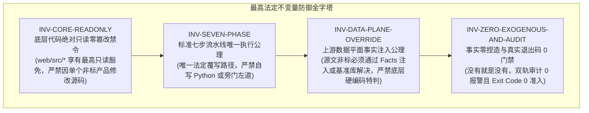
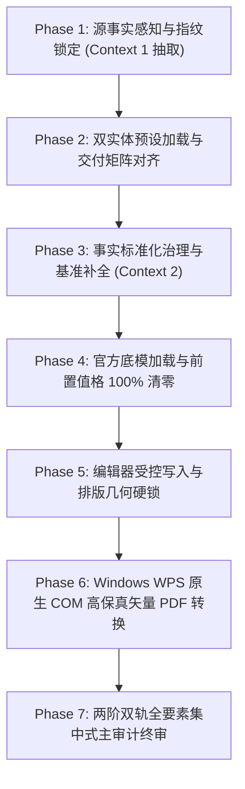

# MSDS Studio 工业级受控工作流体系与 Agent 生产治理规范 (v9.0-ENTERPRISE)

> **版本**：v9.0-ENTERPRISE (工业级受控生产版)  
> **制定时间**：2026-11-19  
> **适用范围**：MSDS 文档处理、多 Agent 覆写生产、工业级自动化流水线。  
> **最高立法准则**：
> 1. **以标准 7 步流水线 (7-Phase Pipeline) 为全系统唯一覆写产出路径**；
> 2. **工作流调用期间严禁修改任何源码（`web/src/*` / `web/scripts/*`）——遇不可解失败必须直接报错退出（Exit Code ≠ 0），严禁为强行达成任务而改源码**；
> 3. **严禁产出调用 `MSDS-Engine` 的临时脚本（`.mjs`/`.js`/`.py`/`.ps1`/`.sh`）**；
> 4. **Agent 唯二职责**：① **调用标准工作流，完成内容填写（JSON），提交产出**；② **介入审计（非机械语义/视觉人工级审计）**。

---

## 一、 顶层架构与最高法定四大不变量 (Supreme Invariants)

全系统生命周期内，任何 Agent 必须无条件遵循以下四大最高法定不变量与工程公理：

### 1.1 底层代码绝对只读零篡改禁令 (`INV-CORE-READONLY` - 核心高压线)
- **绝对禁令**：**严禁任何 Agent 在调用执行覆写产出任务时，一旦遇到数据解析不准、标签不匹配或审计报警，就擅自去修改系统底层源码 (`web/src/*`)！**
- **严禁局部硬编码特判**：严禁针对特定测试产品在底层引擎中增加 `if (model === 'PA-XXXX')` 或修改通用正则；这会破坏已有 92 个产品的通用性并引入不可控的回归缺陷；
- **正确治理路径**：源文档非标或缺失参数，必须且仅能在**上游数据平面**（通过调用端传入 `facts`、`section9Overrides`、企业预设或完善 `msds-db.js` 同品类基准库）进行结构化配置，底层执行引擎保持 100% 封闭与稳定。

### 1.2 标准七步流水线唯一执行公理 (`INV-SEVEN-PHASE`)
- 所有 MSDS 生产任务，**必须且仅能通过标准七步流水线执行**（调用 `run_standard_production.mjs` 或 `executeEightDeliverablesPipeline`）；
- **严禁使用 `python-docx` 破坏样式，严禁调用 `soffice.com --headless` 进行暴力硬转！**

### 1.3 格式服从于原文与事实第一公理
- **格式服从于原文**：基于模板的格式与基于源文件的内容做匹配，格式服从于原文；
- **零外生虚增最高公理 (`INV-ZERO-EXOGENOUS`)**：源文档未提及 GHS 象形图或信号词时，交付物**绝对严禁**凭空添加 `GHS象形图：无` 与 `信号词：无`（英文版严禁添加 `None`）；
- **英文官方底模“历史脏数据”法定清零机制 (`INV-PRE-WRITE-CLEARING`)**：写入前必须先将待编辑章节的所有值格彻底清空，确保处于 100% 纯净空白插槽状态。

---

## 二、 标准七步作业规程 (7-Phase Mandatory Pipeline)

### Phase 1: 源事实感知与指纹锁定 (Source Discovery & Context 1)
- **底层承载模块**：【识别模块】(`web/src/recognition-engine.js` / `recognizeSourceDocx`)；
- **规程要求**：
  1. 深度解析物理源文档 (DOC/DOCX)，锁定 16 章节原始化学事实指纹 (Fact Fingerprint)，严禁截断；
  2. 提取危险性定性（危险 vs 非危）、GHS 分类、H 说明、P 说明、组分 CAS 及理化数值；
  3. 严格遵循“没有就是没有”公理，源文档无载明则不凭空虚增。

### Phase 2: 双实体预设加载与意图对齐 (Company Presets Loading)
- **底层承载模块**：【预设模块】([company_presets.json](file:///F:/App%20Location/Guanzhi%20Tong/Skill/MSDS-Engine/%E4%BD%93%E7%B3%BB%E4%BA%A4%E6%8E%A5%E6%96%87%E6%A1%A3/MSDS_Studio_Agent_Test_Kit/presets/company_presets.json))；
- **规程要求**：
  1. 装载广州冠志（Guanzhi）与英德国彩（Guocai）法定企业预设；
  2. 隔离注册地址、电话（广州 020 vs 清远英德 0763）、传真与邮编；
  3. 确立 8 格式标准交付矩阵（4 DOCX + 4 PDF）。

### Phase 3: 先中文治理、后英文逐句翻译与映射数据库沉淀 (Context 2 Two-Stage + TM)
- **底层承载模块**：【规范治理引擎】(`context-governor.js`) + 【持久化映射数据库】(`web/src/translation-memory.json`) + 【Agent 逐句英译】；
- **双阶作业规程**：
  1. **Stage 3A（先做好中文分类与内容处理）**：先执行 Context 2 治理，完成 16 章节角色重分类、多行多列拆分（`S3/S8/S14`）、通栏合并（`colSpan=2`）、S1.1 CN 中文名规范与 S3→S2 迁移，同时自动命中 `translation-memory.json`，并将未命中的新句子导出为 `<MODEL>_untranslated.json`；
  2. **Stage 3B（再做英文逐句翻译与自动沉淀）**：Agent 读取 `<MODEL>_untranslated.json` 逐句翻译所有新句子后，通过 `--translations=<MODEL>_untranslated.json` 回填；校验通过 **0 中文残留 + 数字/CAS 100% 守恒** 后，系统自动将新译文沉淀写入 `translation-memory.json` 供后续永久复用；
  3. **单位与符号标准化**：度数统一为西文半角 `°C`（根除全角 `℃`），冒号统一为西文半角带空格 `": "`。

### Phase 4: 官方底模加载与前置值格清零 (Template Loading & Wiping)
- **底层承载模块**：【OpenXML 底座】([templates/](file:///F:/App%20Location/Guanzhi%20Tong/Skill/MSDS-Engine/%E4%BD%93%E7%B3%BB%E4%BA%A4%E6%8E%A5%E6%96%87%E6%A1%A3/MSDS_Studio_Agent_Test_Kit/templates/))；
- **规程要求**：
  1. 加载官方受控基准模板（保留外框实线、内框虚线、单通栏纯净框架）；
  2. 100% 清零历史脏数据（如二乙二醇丁醚、DMAc、示范数据等），确保待写入单元格纯净空白；
  3. 完整继承页眉页脚母版样式与动态 PAGE / NUMPAGES 域代码。

### Phase 5: 编辑器受控写入与排版几何硬锁 (Universal Editor & Micro-Typography)
- **底层承载模块**：【编辑覆写模块】(`web/src/pipeline-engine.js` + `universal-editor-primitives.js`)；
- **规程要求**：
  1. **字阶体系**：中文 10.5pt (21 sz) 宋体 / 英文 9.5pt (19 sz) Arial；标签加粗、数值常规体严格解耦；
  2. **单 Tab 与自适应标尺 (`INV-SEQ-TAB-ALIGN`)**：序号后单个 `<w:tab/>`，动态自适应 420/560 dxa 标尺，未编号标签同基线 420 dxa 齐平对齐；
  3. **Section 2 纯净大通栏 (`INV-S2-TYPOGRAPHY-HIERARCHY`)**：
     - 重构为单单元格通栏 (`gridSpan="2"`)，上下 160 dxa 呼吸留白；
     - 分类标题（CN: 480 twips, EN: 317 twips）、正文说明（CN: 840 twips, EN: 677 twips）；
     - 首行数据行 `top=single, bottom=none`，中间数据行 `top=none, bottom=none`，彻底消灭内部虚线横向分割线；
  4. **Section 13 四行骨架**：法规依据、欧盟 EWC 代码、处理方法长文本纯左对齐；
  5. **多列顶格左对齐**：多列表格值单元格清除 `w:ind`，强制贴紧单元格左边距纯左对齐 (`jc="left"`)。

### Phase 6: Windows WPS 原生 COM 高保真矢量 PDF 转换 (Native Vector PDF)
- **底层承载模块**：【PDF 转换模块】(`web/src/pdf-converter.js`)；
- **规程要求**：
  1. 调用系统级 Windows COM 自动化通道驱动 `WPS.Application`；
  2. 依托本地 Windows TrueType 字体度量与排版引擎，将 4 份 DOCX 转译为**严格 5 页**的矢量 PDF；
  3. Word 与 PDF 1:1 像素级复刻，边框、字距与页码绝对重合。

### Phase 7: 两阶双轨全要素集中式主审计终审 (Two-Step Deep Master Audit)
- **底层承载模块**：【两阶双轨审计模块】(`audit_bipolar_bilayer.mjs` + `run_master_msds_audit.mjs`)；
- **规程要求**：
  1. **第一阶·机械确定性审计**：165 项双极双层全要素法医断言 + 170 项集中式中央主审计，验证 PDF 物理字号 9.5pt 与 Section 9 标签 80.28pt 垂直对齐；
  2. **第二阶·智能体语义保真审计**：16 章节双语逐句逐槽位 1:1 对账，核销“英文版零中文残留 (Gate 4)”与“测试条件零丢失”；
  3. **退出码 0 门禁**：真实控制台退出码 0 (`Exit Code 0`) 作为唯一合格发布判定。

---

## 三、 底层四大模块标准映射与调用手册

| 流水线阶段 | 核心任务 | 承载源码文件 | 绝对禁令与红线 |
| :--- | :--- | :--- | :--- |
| **Phase 1** | 源事实感知 Context 1 | `web/src/recognition-engine.js` | 严禁凭空捏造不存在的象形图或信号词。 |
| **Phase 2 & 3** | 意图对齐、治理 Context 2 | `web/src/context-governor.js` `web/src/msds-db.js` | **严禁修改源码！** 非标字段必须通过 `facts` 参数注入。 |
| **Phase 4 & 5** | 模板清零与受控覆写 | `web/src/pipeline-engine.js` `web/src/universal-editor-primitives.js` | 严禁使用 `python-docx` 破坏段落属性 `<w:pPr>`。 |
| **Phase 6** | 矢量 PDF 转换 | `web/src/pdf-converter.js` | **严禁调用 `soffice.com --headless`**，必须使用 Windows WPS COM。 |
| **Phase 7** | 两阶双轨深度审计 | `web/scripts/audit_bipolar_bilayer.mjs` `web/scripts/run_master_msds_audit.mjs` | 严禁弱化断言逃避检查，必须退出码 0 真实通过。 |
