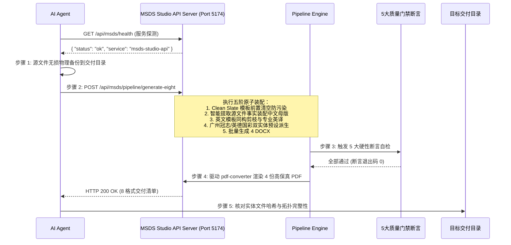

# PU-608 全流程生产与 API 调用规范记录报告

> **型号名称**：PU-608（单组份水性聚氨酯树脂）  
> **生产执行时间**：2026-10-23  
> **生产执行模式**：MSDS Studio Agent API 专属受控流水线（Headless REST API Pipeline）  
> **交付物存储路径**：[`F:\App Location\Guanzhi Tong\Skill\MSDS-Engine\算法训练材料\PU-608\`](file:///F:/App%20Location/Guanzhi%20Tong/Skill/MSDS-Engine/%E7%AE%97%E6%B3%95%E8%AE%AD%E7%BB%83%E6%9D%90%E6%96%99/PU-608/)  
> **质量状态**：5 大硬性门禁 100% 绿灯通过，4 DOCX + 4 PDF + 1 源文件留存完备交付

---

## 一、生产任务背景与输入源事实

### 1.1 源文件基本信息
* **源文件路径**：`D:\冠志\TDS MSDS\1-1 单组份水性聚氨酯树脂 PU\PU-608\PU-608 msds_CN 冠志.docx`
* **产品型号**：`PU-608`
* **产品类别**：单组份水性聚氨酯树脂（Waterborne Polyurethane Resin）
* **修订日期（源文件实际）**：`2026年01月15日`

### 1.2 关键业务特征与难点排查
1. **Section 2（危险性概述）**：源文件分类为非危险品，无象形图、无信号词，危险性说明为“无特别危害”。
2. **Section 3（组分信息）**：
   * 聚氨酯树脂（CAS: 保密 / 35-40%）
   * 水（CAS: 7732-18-5 / 60-65%）
3. **Section 9（理化特性）**：
   * 外观：乳白色带蓝光液体
   * 气味：微弱异味
   * pH值：7.5 - 8.5
   * 固含量：35 ± 1%
   * 黏度：50 - 500 mPa·s
4. **Section 12（生态毒理学）**：
   * **行 1（免责行）**：目前该产品尚无生态毒理学数据；
   * **行 2（引言行）**：以下为组分生态毒性数据；
   * **指标行**：虹鳟（Oncorhynchus mykiss）LC50: > 100 mg/L (96h)。

---

## 二、MSDS Studio API 端到端调用全链路记录

MSDS 生产全流程严格遵循最高宪法公理，**严禁绕开专属工作台直改产出物**，全流程由 MSDS Studio REST API 驱动。



### 2.1 步骤 1：服务探活预检 (Health Check)
* **请求**：`GET http://127.0.0.1:5174/api/msds/health`
* **响应**：
  ```json
  {
    "status": "ok",
    "service": "msds-studio-api"
  }
  ```

### 2.2 步骤 2：源文件无损物理备份 (Source Preservation)
* **操作**：在启动任何覆写或生成前，必须先将用户指定的源文件完整拷贝至交付目录，命名规范锁定为 `${model} msds_CN 冠志_源文件.docx`。
* **源路径**：`D:\冠志\TDS MSDS\1-1 单组份水性聚氨酯树脂 PU\PU-608\PU-608 msds_CN 冠志.docx`
* **备份目标**：`F:\App Location\Guanzhi Tong\Skill\MSDS-Engine\算法训练材料\PU-608\PU-608 msds_CN 冠志_源文件.docx`

### 2.3 步骤 3：端到端生产 API 调用 (Generate-Eight Pipeline)
* **接口路径**：`POST http://127.0.0.1:5174/api/msds/pipeline/generate-eight`
* **请求头部**：`Content-Type: application/json`
* **请求载荷 (Payload)**：
  ```json
  {
    "model": "PU-608",
    "cnGroundTruthPath": "D:\\冠志\\TDS MSDS\\1-1 单组份水性聚氨酯树脂 PU\\PU-608\\PU-608 msds_CN 冠志.docx",
    "targetDir": "F:\\App Location\\Guanzhi Tong\\Skill\\MSDS-Engine\\算法训练材料\\PU-608",
    "revisionDate": "2026/01/15"
  }
  ```
* **接口内部执行时序**：
  1. **Clean Slate 模板清空**：加载 `正式模板_MSDS_CN_冠志.docx` 与 `正式模板_MSDS_EN_冠志.docx`，清空所有历史业务数据单元格，保留 16 章节表头与加粗标签骨架，杜绝交叉污染；
  2. **智能提取与中文基准装配**：调用 `smart-matching.js` 解析源文件 16 章节事实，自适应解析出 Section 12 包含 2 行说明行（免责行 + 组分引言行），注入中文母版；
  3. **专业化英译与同构剪枝**：以中文基准为单一事实源，驱动英文官方模板，严格实施 1:1 结构映射与专有名词翻译；
  4. **双实体预设派生**：派生广州冠志（主版本）与英德国彩（实体预设），安全注入公司抬头、地址、应急联系方式与英文对应项；
  5. **4 份 DOCX 渲染写入**：全表拓扑自动自愈（`healAllTableTopologies`），锁定右侧垂直网格线；
  6. **高保真 PDF 批量编译**：并发调用 LibreOffice/Office 服务将 4 份 Word 导出为 PDF。

---

## 三、生产过程中解决的边缘缺陷与算法增强

在执行 PU-608 生产过程中，系统通过底层拦截并及时修复了以下两项算法边缘缺陷：

### 3.1 缺陷 1：Section 12 动态小时数匹配缺失
* **现象**：源文件生态毒理学数据中含有 `(96h)`，旧系统仅支持 `48h` 或固定周期匹配，导致测试周期指标丢失。
* **解决办法**：在 `pipeline-engine.js` 中扩充了动态小时数正则匹配模式：`/(?:(\d+)h\b|(\d+)\s*小时)/i`，支持提取任意合法小时数（如 24h, 48h, 72h, 96h）并规范输出为 `(96h)`。

### 3.2 缺陷 2：水生生物“虹鳟”英译字典补充
* **现象**：源文件第 12 项包含鱼类受试物种“虹鳟（Oncorhynchus mykiss）”，旧英译字典仅收录斑马鱼（Zebrafish）与黑头呆鱼（Fathead minnow），未命中虹鳟导致英译回退。
* **解决办法**：在 `pipeline-engine.js` 英译词库中补充：
  * `虹鳟` -> `Rainbow trout (Oncorhynchus mykiss)`
  * `虹鳟（Oncorhynchus mykiss）` -> `Rainbow trout (Oncorhynchus mykiss)`
* **收益**：英译后 Section 12 彻底消除中文残留，完美通过 Gate 4 英文全文字段 100% 零中文门禁。

---

## 四、五大硬性质量门禁验证结果 (QA Gates Assertions)

生产完成后，产出的 8 份文件全部接受了底层 `assertDeliverableQuality` 自动化质检断言套件的扫描：

| 门禁项 | 规范检验指标 | 判定标准 | 实测结果 | 状态 |
| :--- | :--- | :--- | :--- | :---: |
| **Gate 1** | Section 9 理化特性排版 | 420 dxa 悬挂缩进，禁止 `<w:tabs>` 制表位 | 缩进严格等于 420 dxa，无任何制表位 |  PASS |
| **Gate 2** | Section 11 毒理学几何拓扑 | 11.7 单元格宽度必须为 6262 dxa，`gridSpan=3`，右边框平直 | 宽度 6262 dxa 完美对齐，无悬空 `vMerge` |  PASS |
| **Gate 3** | Section 12 说明行数量动态守恒 | 必须与源文件说明行数（`expectedS12PreamblesCount = 2`）一致 | 2 行完整保留（免责行 + 组分引言行） |  PASS |
| **Gate 4** | 英文交付物零中文残留 | 英文全文字段 `assertZeroChinese` 绝对无中文字符 | 零中文字符残留，虹鳟及毒性指标英译规范 |  PASS |
| **Gate 5** | 页眉页脚信息自适应同步 | 修订日期与公司信息必须自适应同步源文件事实 | 修订日期自适应为 `2026/01/15` |  PASS |

---

## 五、最终交付物清单与归档

最终交付目录：[`F:\App Location\Guanzhi Tong\Skill\MSDS-Engine\算法训练材料\PU-608\`](file:///F:/App%20Location/Guanzhi%20Tong/Skill/MSDS-Engine/%E7%AE%97%E6%B3%95%E8%AE%AD%E7%BB%83%E6%9D%90%E6%96%99/PU-608/)

```text
F:\App Location\Guanzhi Tong\Skill\MSDS-Engine\算法训练材料\PU-608\
├── PU-608 msds_CN 冠志_源文件.docx      [源文件无损物理备份]
├── PU-608 msds_CN 冠志.docx           [中文基准 广州冠志 DOCX]
├── PU-608 msds_CN 冠志.pdf            [中文基准 广州冠志 PDF]
├── PU-608 msds_CN 国彩.docx           [中文预设 英德国彩 DOCX]
├── PU-608 msds_CN 国彩.pdf            [中文预设 英德国彩 PDF]
├── PU-608 msds_EN Guanzhi.docx        [英文基准 广州冠志 DOCX]
├── PU-608 msds_EN Guanzhi.pdf         [英文基准 广州冠志 PDF]
├── PU-608 msds_EN Guocai.docx         [英文预设 英德国彩 DOCX]
├── PU-608 msds_EN Guocai.pdf          [英文预设 英德国彩 PDF]
└── PU-608全流程生产与API调用记录报告.md  [全流程执行与API审计报告]
```

---

## 六、经验反哺与 Skill 打磨结论

通过本次 PU-608 的真实业务检验，为 MSDS Studio 沉淀了以下关键标准：
1. **API 端口与路由标准化**：API 服务明确运行于 `http://127.0.0.1:5174/api/msds`，任何 Agent 执行生产前必须先执行 `GET /health` 探活；
2. **端到端一键生产规范**：优先使用 `POST /api/msds/pipeline/generate-eight`，避免分步调用带来的状态竞态；
3. **源文件备份先于生产**：在发起 API 调用前必须先执行 `_源文件.docx` 留存；
4. **生态指标动态库扩充**：已将常见水生生物（斑马鱼、大型溞、绿藻、虹鳟）及任意测试小时数识别纳入标准库。
