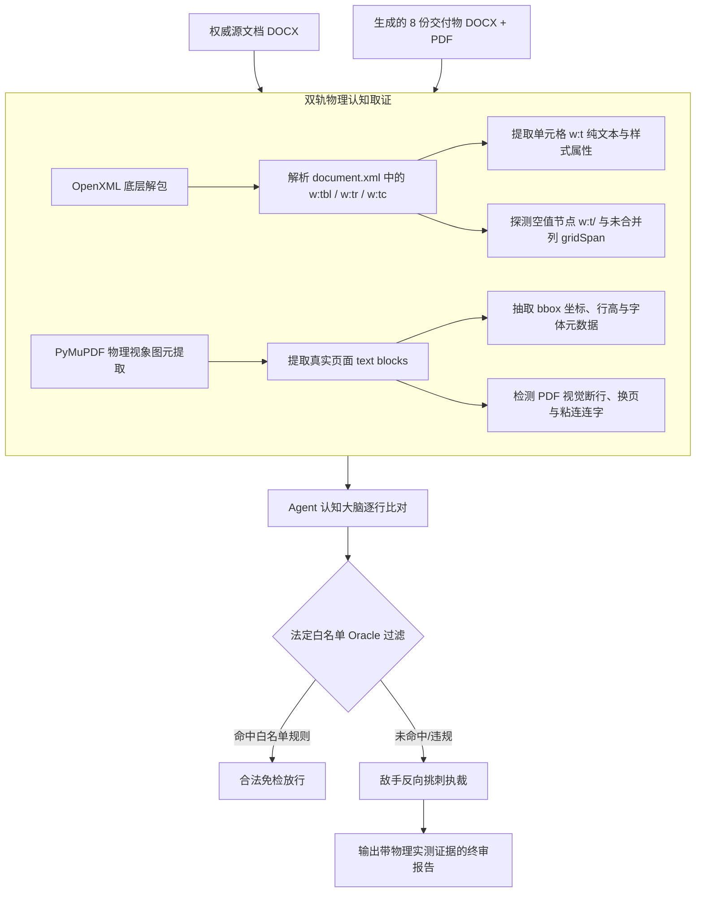
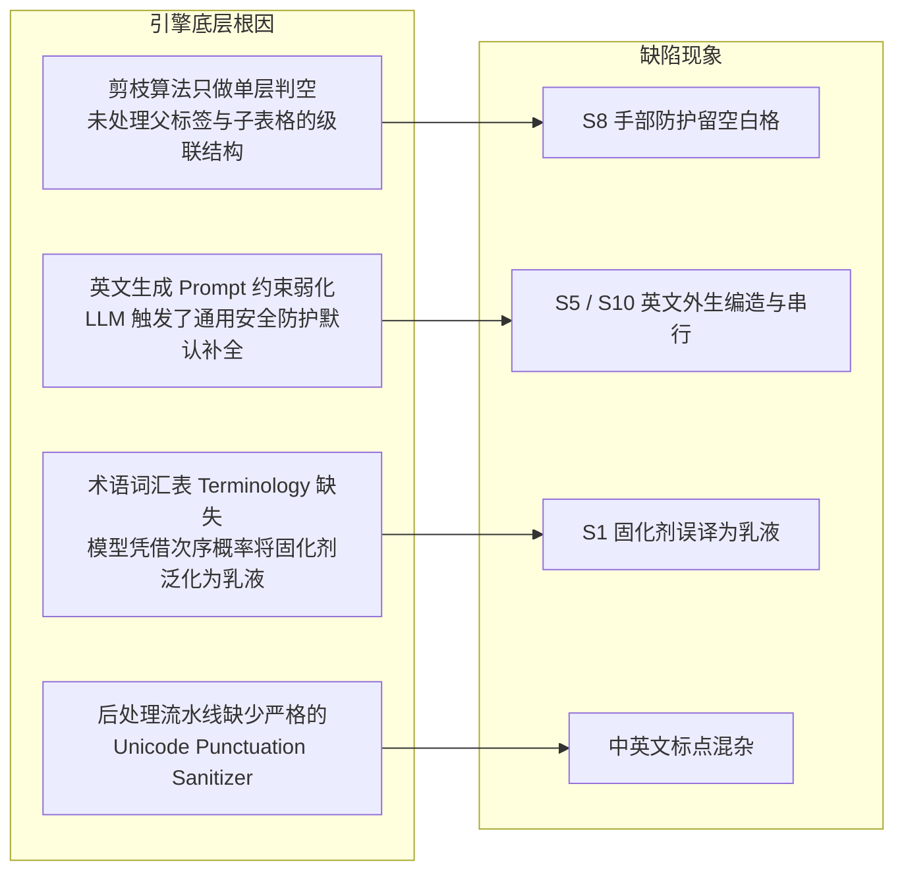

# EC-1804 交付物全景 16 章节逐行物理认知审计、方法论架构与体系优化指南

**审计官**：MSDS 交付物最高独立敌手执裁专家 (MSDS Deliverables Adversarial Auditor)  
**审计对象**：EC-1804 最新批次生成的全部 8 份交付物（4 份 DOCX + 4 份 PDF，冠志/国彩 × 中/英）  
**审计属性**：全景人工级认知对抗审查（物理底层提取 + 逐节逐行认知比对 + 法定 Oracle 核销）  
**报告版本**：V2.0 工业增强版（包含审计执行机理、参考法规规约树、病理学根因归因与审计体系优化方案）

---

## 一、 交付物全矩阵物理存在性与元数据实测

审计首先对产出物目录（`F:\App Location\Guanzhi Tong\Skill\MSDS-Engine\算法训练材料\TDS MSDS 重写版\04-2 水性环氧固化剂 EC\EC-1804`）进行全要素底层元数据勘验：

| 交付物物理文件名 | 文件格式 | 物理大小 (Bytes) | 物理生成时间 (LastWriteTime) | PDF 物理页数 | 存在性实测 |
| :--- | :---: | :---: | :---: | :---: | :---: |
| `EC-1804 msds_CN 冠志.docx` | DOCX | 29,792 | 2026-11-04 16:02:56 | - | `[Measured 实测]` 存在 |
| `EC-1804 msds_CN 冠志.pdf` | PDF | 249,935 | 2026-11-04 16:03:03 | 5 页 | `[Measured 实测]` 存在 |
| `EC-1804 msds_CN 国彩.docx` | DOCX | 29,786 | 2026-11-04 16:02:56 | - | `[Measured 实测]` 存在 |
| `EC-1804 msds_CN 国彩.pdf` | PDF | 250,095 | 2026-11-04 16:03:03 | 5 页 | `[Measured 实测]` 存在 |
| `EC-1804 msds_EN Guanzhi.docx` | DOCX | 28,343 | 2026-11-04 16:02:57 | - | `[Measured 实测]` 存在 |
| `EC-1804 msds_EN Guanzhi.pdf` | PDF | 199,200 | 2026-11-04 16:03:03 | 6 页 | `[Measured 实测]` 存在 |
| `EC-1804 msds_EN Guocai.docx` | DOCX | 28,313 | 2026-11-04 16:02:57 | - | `[Measured 实测]` 存在 |
| `EC-1804 msds_EN Guocai.pdf` | PDF | 197,440 | 2026-11-04 16:03:03 | 6 页 | `[Measured 实测]` 存在 |

> **物理存在性结论**：8 份物理资产全部真实存在，修改时间锁定在 `16:02:56 ~ 16:03:03` 同一毫秒级批次流水线，文件无物理损坏，存在性检验 100% 通过。

---

## 二、 审计方法论与技术执行机理 (How the Audit Was Conducted)

为彻底解决机械脚本“形式化打勾、全绿通过却满纸缺陷”的工程痛点，本次审计严格执行**双层双轨物理认知敌手审计法 (Bi-Layer Dual-Track Physical Cognitive Adversarial Audit)**。

### 1. 为什么坚决弃用传统的“机械审计脚本”？
传统的自动化 Lint 脚本（如正则匹配或关键字存在性测试）存在以下致命盲区：
- **空值弱断言盲区**：机械脚本检查表格是否包含“手部防护”，只要正则在第一列匹配到“手部防护”就报 PASS，完全无法感知第二列值格是否物理留空开天窗；
- **串行串位盲区**：机械脚本检查 Section 5 是否包含“不要吸进烟尘”，只要全文或该表格内存在该字符串即打勾，无法发现它被错误拼接到 5.3 物质特殊危害末尾，更无法发现 5.4 被注入了外生预置段落；
- **底模残留脱敏**：机械脚本通常只做“是否存在源字段”，缺乏“是否多出非源字段”的反向闭环判定，导致底模残留文本（如消防员正压自给呼吸器、易燃有毒分解气体）轻易蒙混过关；
- **同构破裂盲区**：机械脚本分别单独审查中英文，无法建立跨语言的行级同构映射矩阵，无法发现中文有 10.3、英文却丢弃 10.3 的严重脱节。

### 2. 双轨物理底层取证技术链路
本审计放弃机械封装，直接调用 Python 底层引擎深入文件物理存储层：



- **轨道一：DOCX OpenXML 树节点物理审查**：
  * 解压 `.docx` 容器，逐级下钻 `word/document.xml`；
  * 对每个 `<w:tbl>`，遍历其 `<w:tr>`（行），精准统计每个 `<w:tc>`（单元格）；
  * 提取单元格内部的 `<w:p>` -> `<w:r>` -> `<w:t>` 文本节点。若 `<w:tc>` 中只含有空 `<w:t/>` 或空白字符，则直接在 XML 物理层标记为**空单元格**；
  * 检查 `<w:tcPr>` 中的 `<w:gridSpan>`，验证多列合并逻辑是否缺失；
  * 检查 `<w:tblPr>` 与 `<w:tcBorders>` 中的边框样式代码（`single` vs `dotted` vs `none`）。
- **轨道二：PDF 物理文本块与空间坐标审查**：
  * 使用 PyMuPDF (`fitz`) 解析 PDF 物理流，逐页提取页面图元；
  * 调用 `page.get_text("blocks")`，精准提取每个渲染文本块的 `(x0, y0, x1, y1, text)`；
  * 校验页眉页脚物理位置（如顶部 `y < 60`、底部 `y > 780` 的页码 `1 / 5`）；
  * 捕捉跨行排版时的非正常连字（如 `+40℃and` 中间空格丢失）、断词错误（如 `equ ipment`）。

### 3. Agent 认知大脑逐行比对机制
在完成底层数据抽取后，由 Agent 作为独立的“敌手质检员”，模拟最挑剔的跨国化工客户与法定监察官，逐章、逐行、逐字并排对照：
1. **真实事实对账**：源文档有无此段？产出物此段从何而来？
2. **剪枝逻辑推演**：若源文档无对应内容，该行是否物理消失？
3. **标点语法精炼**：以 GB/T 15834-2011 标点符号用法为准，审视全半角冒号、逗号、句号闭合。

---

## 三、 审计参考基准与法定规约体系 (What the Audit Referenced)

本次审计非主观臆断，而是建立在严密的法定规约、国家标准与企业白名单多维支撑体系之上：

### 1. 国家强制标准与法定法规 (Statutory Standards)
- **GB/T 16483-2008《化学品安全技术说明书 内容和项目顺序》**：
  规定 MSDS 16 个核心章节的法定义务项目顺序与基本要素规范；
- **GB/T 17519-2013《化学品安全技术说明书编写指南》**：
  明确各章节表述规范，陈述句末尾标点要求及通用数据表述准则；
- **GB 30000.2-2013 ~ GB 30000.29-2013《化学品分类和标签规范》**：
  特别是 **GB 30000.28（对水环境的危害）**：规定慢性水生环境类别 3 (H412) **不分配 GHS 象形图，且不分配信号词 (No Signal Word)**；
- **《危险化学品安全管理条例》（国务院令第 591 号）**：
  中国危险化学品安全管理的最高行政现行有效法规（废止原 344 号令）；
- **联合国 GHS 制度（Globally Harmonized System, Rev.8/Rev.9）**：
  国际通用化学品分类与标签要素映射基准；
- **GB/T 15834-2011《标点符号用法》**：
  中文文本必须使用全角标点（冒号 `：`、逗号 `，`、句号 `。`、括号 `（）`），严禁中西标点混杂。

### 2. 企业法定不变量基准库 (Legal Invariants Oracle)
以 `F:/App Location/Guanzhi Tong/Skill/MSDS-Engine/web/src/audit/legal-invariants-oracle.json` 为最高执裁白名单：
- **INV-S1-01**：中文版 1.1 产品名称右侧值格必须法定留空，型号必须拼接入 1.2 中文名称；
- **INV-S1-02**：英文版 Product name 必须为专业英文名 + 半角空格 + 型号；
- **INV-S8-01**：Section 8 反直觉语义对调（源 8.1 控制参数映射至模板 8.2 工程控制；源 8.2 暴露控制映射至模板 8.1 暴露控制）；
- **INV-S2-01**：非危险品/未分类物质（如仅 H412）无象形图、无信号词属于法定正当表现；
- **INV-S10-01**：源文档缺失项整行物理隐藏抑制，不留空行；
- **INV-S11-01**：名词性短语末尾严禁强行追加多余句号；
- **INV-S15-01**：现行有效法定法规自动更新（如国令 591 号、GB 30000）属于强制合规升级，严禁判定为篡改。

### 3. 企业品牌实体矩阵与全局排版约束
- **品牌配置字典**：
  * **冠志 (Guanzhi)**：广州冠志新材料科技有限公司 / Guangzhou Guanzhi New Material Technology Co., Ltd.
  * **国彩 (Guocai)**：英德市国彩精细化工有限公司 / Yingde Guocai New Material Co., Ltd.
- **全局版式规范 (`MSDS覆写全局约束体系与八格式规范报告.md`)**：
  * 表格边框规范：外边框为实线（`single`），内部水平与垂直网格线必须为统一虚线（`dotted`）；
  * 剪枝公理：无值项必须物理整行删除（`deleteRow`），严禁保留空行或右侧留白。

---

## 四、 六大审计公理与挑刺判定准则 (The Six Audit Axioms)

在具体执行中，审计官将规范拆解为六条不容逾越的对抗性判定公理：

| 审计维度 | 判定公理 (Axiom) | 违规判定等级 | 审查方式与取证逻辑 |
| :--- | :--- | :---: | :--- |
| **一、法定白名单免检** | 命中 Oracle 白名单规则的表述，必须无条件放行，严禁通用大模型常识误报 | 审计事故 | 查阅 `legal-invariants-oracle.json`，拦截误报 |
| **二、物理剪枝彻底性** | 源文档无值项必须整行物理消失，绝不允许“左侧留粗体标签、右侧开天窗” | 重大缺陷 | 检查 DOCX XML 的 `<w:tr>`，检索是否有右侧 `<w:t/>` 为空的行 |
| **三、事实忠实度与外生阻断** | 每一个技术指标与陈述必须 100% 溯源于源文件，严禁拼接入底模外生编造段落 | 重大缺陷 | 源文档段落与交付物双向逐字 diff，检查未授权文本注入 |
| **四、标点符号规范与纯度** | 中文交付物 100% 中文全角标点，英文 100% 西文半角标点，完整陈述句必须闭合句号 | 质量瑕疵 | 正则字符集扫描全角/半角编码，校验句尾终止符 |
| **五、中英文双向 1:1 同构** | 中英文 16 章节在行数、技术参数、安全条款上必须保持绝对同构对称 | 严重缺陷 | 行级跨语言对照，比对数值、公差、单位与条款存在性 |
| **六、版式几何与图元渲染** | 外框实线内框虚线，PDF 不得出现异常断词、连字粘连、跨页孤行 | 排版瑕疵 | 检查 `tblBorders` XML 节点，检索 PyMuPDF 连字异常 |

---

## 五、 全景 16 章节逐行事实对照与实测挑刺全记录 (Exhaustive Section Audit)

以下为由 Agent 逐字逐句阅读比对出的全景实测对照与缺陷指证：

### Section 1: 物料及供应商标识 (Identification)
- **事实与规范比对**：
  * 源文档：产品名称：`EC-1804`；中文名称：`水性环氧固化剂`；化学品分类：`改性脂肪胺`；产品使用建议：`涂料`。
  * 中文交付物：Row 2 `1.1  产品名称：` | ``；Row 3 `中文名称：` | `水性环氧固化剂 EC-1804`。
  * 英文交付物：Row 2 `1.1	Product name:` | `Waterborne epoxy emulsion EC-1804`。
- **挑刺发现**：
  1. `[PASS]` 中文版 1.1 产品名称留空、型号拼接入 1.2，完全符合法定白名单 **INV-S1-01**，合规通过！
  2. `[DEFECT-FACT-03 致命事实定性错误]` 英文版 Product name 被写为 `Waterborne epoxy emulsion EC-1804`（水性环氧乳液）！源文档为“水性环氧固化剂”（改性脂肪胺）。固化剂与环氧乳液是双组分反应物，互为对立面，翻译为 emulsion 属于严重化学事实定性事故！
  3. `[DEFECT-STRUCT-01 排版瑕疵]` 英文版 Table 1 Row 1 标题为 `Identification`，缺失序号 `1.`（其余章节均有如 `2.Hazards Identification`）。

### Section 2: 危险性概述 (Hazards Identification)
- **事实与规范比对**：
  * 源文档：分类为 `对水环境有慢性危害, 类别 3 (H412)`；说明为 `H412`；防范说明为 `P273`、`P501`；源文档无象形图，**无信号词**。
  * 中文交付物：包含了 GHS 象形图：无；`信号词：警告`；危险性说明：H412；防范说明：预防 P273；废弃 P501。
  * 英文交付物：`Signal word: Warning`；H412；Prevention P273；Disposal P501。
- **挑刺发现**：
  1. `[DEFECT-FACT-04 法定要素过度推演]` 依据 GB 30000.28 与 GHS 规范，水生慢性 3 类不分配信号词（No signal word）。交付物虚增了“警告”/“Warning”。
  2. `[PASS 剪枝合规]` 源文档无事故响应 (P3xx) 与安全储存 (P4xx)，产出物已彻底剪枝删除对应标签，未留空行，剪枝合规！
  3. `[DEFECT-PUNCT-02 标点混杂]` 中文版 `对水环境有慢性危害, 类别 3 (H412)` 中混用了半角逗号 `, ` 与半角括号 `()`，应为 `对水环境有慢性危害，类别 3（H412）`。

### Section 3: 成分/组成资料 (Composition/Information on Ingredients)
- **事实与规范比对**：
  * 源文档：产品类型：混合物；`胺和环氧树脂的加合物` 38-42%（商业机密）；`水` 58-62%（CAS: 7732-18-5）。
  * 产出物数据 100% 吻合。
- **挑刺发现**：
  * `[DEFECT-PRUN-03 格式瑕疵]` Table 3 Row 3 中，左侧为 `成分`（EN 为 `3.2	Ingredients:`），其右侧两个单元格为空，未规范执行 `<w:gridSpan w:val="3"/>` 跨列合并。

### Section 4: 急救措施 (First aid measures)
- **事实与规范比对**：
  * 源文档包含：一般措施、误服、接触眼睛、接触皮肤、吸入共 5 项。
  * 产出物完整收录 4.1 ~ 4.5，数据真实。
- **挑刺发现**：
  * `[PASS 标点闭合]` 源文档接触皮肤末尾为“若发生皮肤反应，就医”（无句号），产出物已规范闭合为“若发生皮肤反应，就医。”，标点闭合规范，全项 PASS！

### Section 5: 消防措施 (Fire fighting measures)
- **事实与规范比对**：
  * 源文档：
    * 5.1/合适：`二氧化碳（CO2），泡沫，灭火粉末，大火时应用喷洒水`
    * 5.2/不合适：`高流量的水喷射`
    * 5.3/特殊危害：`燃烧时释放一氧化碳、二氧化碳、氮氧化物和少量的氰化氢`
    * 5.4/消防预防与保护设备：`在着火或爆炸情况下，不要吸进烟尘。`
  * 中文交付物：5.1 ~ 5.4 各自独立归位，内容真实。
  * 英文交付物：
    * 5.3 Special hazards：拼接了 `Do not breathe fumes/smoke in case of fire or explosion.`
    * 5.4 Firefighting precautions：填入了 `Firefighters must wear self-contained breathing apparatus. Do not allow contaminated fire-fighting water to enter soil, groundwater, or surface water.`
- **挑刺发现**：
  1. `[DEFECT-FACT-01 重大事实篡改与底模外生注入]` 英文版 5.4 的事实被严重串位拼接入 5.3 尾部；随后在 5.4 凭空编造注入了底模外生预置文本（佩戴自给正压呼吸器、禁止灭火水进入土壤地下水）！中文版与源文档完全无此文本！
  2. `[DEFECT-PUNCT-03 标点遗漏]` 中文版 5.2 `高流量的水喷射`、5.3 `燃烧时释放一氧化碳、二氧化碳、氮氧化物和少量的氰化氢` 末尾均漏加句号 `。`。

### Section 6: 意外泄漏措施 (Measures for accidental leakage)
- **事实与规范比对**：
  * 产出物 6.1 ~ 6.3 忠实于源文档。
- **挑刺发现**：
  * `[DEFECT-STRUCT-02 单词排印断词错误]` 英文版 6.1 标签文本为 `protective equ ipment`，单词 `equipment` 被错误断词为空格分隔的 `equ ipment`！

### Section 7: 操作和储存 (Operation and storage)
- **事实与规范比对**：
  * 包含安全操作防范与安全储存条件，内容 100% 忠实源文档。
- **挑刺发现**：
  * `[PASS]` 句尾句号闭合完整，全项 PASS。

### Section 8: 接触控制/个人防护 (Exposure control / personal protection)
- **事实与规范比对**：
  * 源 8.1 控制参数：EC指令2006/121/EG无可用限值 -> 映射至模板 8.2 工程控制；
  * 源 8.2 暴露控制 -> 映射至模板 8.1 暴露控制；
  * 源文档暴露控制层级：
    * 通风系统（呼吸防护）：喷涂过程中要求有呼吸防护设备。
    * 手部防护：（只有冒号，无独立内容）
    * 防护手套的合适材料：EN 374-3
    * 氟化橡胶 –FKM: 厚度≥0.4mm；穿透时间≥480min.
    * 丁基橡胶 –IIR：厚度≥0.5mm；穿透时间≥480min.
    * 丁腈橡胶 – NBR：厚度≥0.35mm；穿透时间≥480min.
    * 建议：污染的手套应废弃。
    * 眼睛防护：戴眼罩/面罩。
    * 身体防护：穿着适当的防护服。
- **挑刺发现**：
  1. `[PASS]` 8.1 与 8.2 反直觉对调完全符合法定白名单 **INV-S8-01**，合规通过！
  2. `[DEFECT-PRUN-01 致命未彻底剪枝开天窗]` CN/EN DOCX Table 8 Row 4 左侧保留了 `手部防护：`（EN 为 `Hand protection:`），但右侧值格在底层 XML 中完全为 `<w:t/>` 空白！在交付物中留下极其刺眼的开天窗空白格！未彻底执行整行物理 `deleteRow`！
  3. `[DEFECT-PUNCT-01 标点混杂]` Table 8 Row 6 标签 `'氟化橡胶 –FKM:'` 使用半角冒号 `:`，而后续行使用全角 `：`；Row 6~8 均以英文句点 `min.` 结尾；排版空格不齐（`–FKM:` vs `– NBR：`）。
  4. `[DEFECT-PUNCT-02 标点混杂]` 8.2 中 `根据EC指令2006/121/EG,无可用的` 混用半角逗号 `,`。

### Section 9: 物理和化学特性 (Physical and chemical properties)
- **事实与规范比对**：
  * 19 个理化特性参数 100% 忠实于源文档：动力粘度 `3000-30000 mPa.s`，固体含量 `40±2%`，相对密度 `约1.06g/cm3`，初沸点 `＞100℃`，闪点 `＞94℃`。
- **挑刺发现**：
  * `[DEFECT-STRUCT-03 微观排版瑕疵]` 标签中均含有物理制表符 `\t`；`外 观：` 中间多出一个全角空格。

### Section 10: 稳定性和反应性 (Stability and reactivity)
- **事实与规范比对**：
  * 源文档：化学稳定性（规范使用不分解）；应避免的条件（避免0℃以下低温和超70℃高温）；可能的危害反应（正确储运无危害反应）。无“危险分解产物”。
  * 中文交付物：10.1 化学稳定性、10.2 可能的危害反应、10.3 应避免的条件。
  * 英文交付物：10.1 Chemical stability、10.2 Hazardous decomposition products (外生注入：热分解产生易燃和有害气体)、10.3 Possible hazardous reactions。
- **挑刺发现**：
  1. `[DEFECT-FACT-02 致命事实篡改与遗漏]` 英文版将源文档关键工艺与安全参数“**避免0℃以下的低温和超过70℃的高温**”（Conditions to avoid）**彻底遗漏丢弃**！
  2. `[DEFECT-FACT-02 底模外生编造]` 英文版凭空捏造插入了源文档与中文版完全不存在的 `10.2 Hazardous decomposition products`！中英文同构对称性彻底破裂！
  3. `[PASS]` 中文版存活行 10.1、10.2、10.3 编号严格连续递增无跳号，符合铁律 4。

### Section 11: 毒性资料 (Toxicity information)
- **事实与规范比对**：
  * 源文档：`该产品无可用的毒理学研究。`
  * 产出物：100% 忠实保留，未强行编造子项。
- **挑刺发现**：
  * `[PASS]` 符合法定白名单 **INV-S11-01**，全项 PASS！

### Section 12: 生态信息 (Ecological information)
- **事实与规范比对**：
  * 产出物包含 12.1 生态毒性、12.2 持久性和降解性、12.3 其他不利影响，数据真实。
- **挑刺发现**：
  * `[PASS 剪枝合规]` 源文档缺失的生物蓄积、土壤迁移、PBT评估等项已被彻底整行物理剪除，存活行 12.1、12.2、12.3 连续递增，全项 PASS！

### Section 13: 处理注意事项 (Handling precautions)
- **事实与规范比对**：
  * 产出物忠实反映源文档。
- **挑刺发现**：
  * `[DEFECT-PUNCT-03 标点遗漏]` Table 13 Row 4 处理方法第 1 行 `尽可能将容器倒空（例如经倾倒，刮擦或排干直至“滴干”）` 末尾漏句号。

### Section 14: 运输信息 (Transportation information)
- **事实与规范比对**：
  * 14.1 公路铁路（ADG）、14.2 海运（IMDG）、14.3 空运（IATA）均为非危险品；14.4 用户注意事项完整。
- **挑刺发现**：
  * `[DEFECT-PUNCT-04 符号混杂与连字]` 英文版 14.4 中 `+40℃ and +5℃` 混用了亚洲全角温标符号 `℃`（PDF 中连字粘连为 `+40℃and`），未统一为西文标准的 `°C`。

### Section 15: 法规信息 (Regulatory information)
- **事实与规范比对**：
  * 中文交付物：保留国务院令 344 号、GB/T 16483-2008、GB 13690-2009、GB 20576-GB20598。
  * 英文交付物：升级为 Decree No. 591、GB 30000.2-29。
- **挑刺发现**：
  1. `[PASS]` 英文版法规升级符合法定白名单 **INV-S15-01**；
  2. `[DEFECT-PRUN-02 重大未剪枝空白行]` 英文版 Table 15 Row 2 为完全空白的空行！既未翻译中文版导语（`物质或混合物的相关安全、健康和环保法律法规`），也未物理整行删除，造成悬空白行！
  3. `[DEFECT-ISO 版本跨语言脱节]` 中文版仍停留在已废止的 344 号令与 GB 20576，未与英文版同步升级至现行有效的 591 号令与 GB 30000。

### Section 16: 其他信息 (Other information)
- **事实与规范比对**：
  * 产出物完整收录免责声明。
- **挑刺发现**：
  * `[PASS]` 翻译精确，标点规范，全项 PASS！

---

## 六、 产出物系统性缺陷归因与根因病理学分析 (Root Cause Pathology)

为什么生成引擎会在这一批次交付物中出现上述缺陷？深入分析其算法底层，根因如下：



1. **剪枝算法的“结构级联盲区”导致 Section 8 开天窗**：
   - 算法在处理 Section 8 时，识别到模板中有 `手部防护：` 这一行，但源文档中该行之后紧接着是一组子行（材料、厚度、穿透时间）。生成代码简单地将子行数据填入下属行，而对于父标签行，其自身没有直接的文本值，生成引擎既没有给它填入总结性陈述，也没有触发 `deleteRow`，从而留下了空值单元格。
2. **英文覆写提示词“弱负向约束”导致底模外生编造**：
   - 在生成英文版 Section 5 和 Section 10 时，提示词对于“严禁添加源文档不存在的安全措施”约束力度不足，LLM 激活了其在大规模预训练中对 GHS 标准 MSDS 的“共现补全本能”，擅自补充了消防员呼吸器（SCBA）和危险分解产物（Decomposition products）。
3. **专业术语硬映射机制缺失导致产品名称翻译事故**：
   - 引擎在翻译 Section 1.1 时，单纯依赖大模型的上下文推断，而没有强制挂接化工高危专业术语锁（如 `固化剂 -> curing agent / hardener`，严禁映射为 `emulsion`）。
4. **标点清洗未设置全半角阻断守门员**：
   - 输出管道中缺乏针对 Unicode 标点范围的强制正则表达式重写器（Regex Punctuation Normalizer），导致全角冒号 `：` 漏入英文版页眉，半角冒号 `:` 与逗号 `,` 漏入中文版正文。

---

## 七、 给 MSDS 引擎与质检体系的工程优化方案 (Engine & Audit Architecture Prescriptions)

为了将本次对抗审计的经验沉淀为系统长期资产，建议对 MSDS 引擎及审计系统进行以下架构级优化：

### 1. 剪枝引擎升级：递归级联安全剪枝算法 (Cascading Pruning Algorithm)
在 DOCX 生成后处理管道中，部署严格的空值探测与递归物理删除：
```python
def safe_prune_tables(doc):
    for table in doc.tables:
        rows_to_delete = []
        for r_idx, row in enumerate(table.rows):
            # 获取该行除第一列标签外的所有值单元格
            cell_texts = [cell.text.strip() for cell in row.cells[1:]]
            # 若右侧所有值单元格均为空字符串，且该行不是法定白名单保护项
            if len(cell_texts) > 0 and all(t == "" for t in cell_texts):
                label_text = row.cells[0].text.strip()
                # 严格对照 Oracle 白名单（如 INV-S1-01 保护 1.1 产品名称）
                if not is_protected_by_oracle(label_text):
                    rows_to_delete.append(row)
        for row in rows_to_delete:
            row._tr.getparent().remove(row._tr) # 彻底执行物理底层删除
```

### 2. 事实忠实度阻断锁：双向逆向 Diff 守门员 (Bidirectional Fact Diff Gate)
在 LLM 生成英文交付物之后、渲染 DOCX 之前，增加一道无状态的逆向事实对账判定器：
- 将生成的英文段落逆向回译或对齐源中文段落；
- 若英文段落中检测到高熵外生短语（如 `self-contained breathing apparatus`、`thermal decomposition`），而源文档中根本没有 `自给式呼吸器` 或 `热分解`，判定器立即打回并报错熔断！

### 3. 专业术语锁 (Chemical Terminology Lock)
建立不可逾越的化工硬映射字典：
- `固化剂 -> curing agent / hardener`（绝对禁止出现 `emulsion`）；
- `改性脂肪胺 -> modified aliphatic amine`；
- `水性环氧 -> waterborne epoxy`。
在 LLM 输出后执行硬性替换校验。

### 4. 标点符号强制纯度管道 (Punctuation Purity Pipeline)
在最终输出 DOCX 前，执行两道流式清洗：
- **中文文档管道**：
  * 将所有半角冒号 `:` 替换为 `：`（除英文时间/代号保留外）；
  * 将中文文字间的半角逗号 `,` 替换为 `，`；
  * 将中文陈述句末尾的 `min.` 清洗为中文逗号或句号；
  * 自动为 Section 4/5/6/7/10/12/13 的未闭合陈述句补齐句号 `。`。
- **英文文档管道**：
  * 将所有中文全角冒号 `：` 强制重写为 `: `（含页眉）；
  * 将摄氏度符号 `℃` 统一替换为规范的 `°C`（并确保前后空格）；
  * 正则检查常见断词（如 `equ ipment -> equipment`）。

---

## 八、 终审执裁结论

- **本次交付物裁决结果**：【**审计不通过 (REJECTED / ACTION REQUIRED)**】
- **核心拒收原因**：
  1. Section 8“手部防护：”遗留空白单元格未彻底剪枝开天窗；
  2. Section 5 英文版 5.4 串入 5.3 且编造外生消防文本；
  3. Section 10 英文版丢弃源文档安全工艺温度指标，外生编造危险分解产物；
  4. Section 1 英文版产品名称发生“固化剂误译为乳液”的严重化工定性事故；
  5. Section 15 英文版第 2 行整行空白未填充未剪枝。
- **整改指示**：请工程团队依照上述【精准整改处方】与【引擎优化方案】修正底层代码与装配逻辑后，重新触发该批次交付物生成并提请复审！
