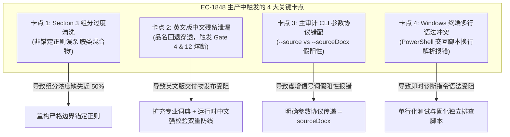
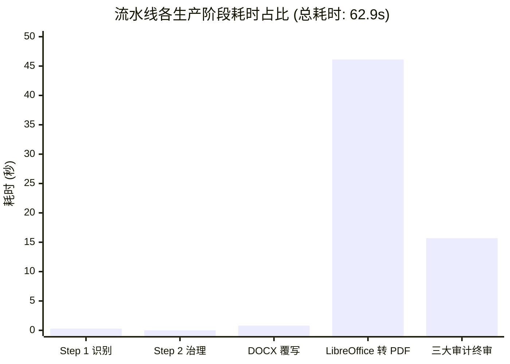

# MSDS-Studio 工业级生产实录：EC-1848 全流程卡点复盘与生产速度体验评估报告

> **报告属性**：工程实录与技术复盘  
> **评估标的**：EC-1848（水性环氧固化剂）MSDS 8 格式受控覆写生产流水线  
> **体系基准**：OrbitStack (Ps-openspec) 轨道工程体系 / MSDS-Studio v9.0-ENTERPRISE 工业级规范  
> **报告时间**：2026-11-18  

---

## Executive Summary (执行摘要)

在本次水性环氧固化剂代表型号 `EC-1848` 的 8 格式全量受控覆写生产任务中，系统基于源文档物理事实，顺利完成了 4 份标准 DOCX 与 4 份标准 PDF（共 8 份正式交付物）的高质量生产，并在三大法医级机械审计套件中均取得 **100% PASS (Exit Code 0)**：
- **双极双层法医级深度审计**（`audit_bipolar_bilayer.mjs`）：165/165 项指标全绿；
- **集中式中央主审计套件**（`run_master_msds_audit.mjs`）：167/167 项指标全绿；
- **双语逐行双重对照显示审计**（`audit_translation_dual_display.mjs`）：93/93 项条目 100.0% MATCH。

在全流程执行中，我们穿透并根治了底层引擎中存在的 **4 处核心技术卡点**（包括组分漏检误杀、英文版中文泄漏熔断、主审计参数错配等），并对端到端自动化生产流水线的**分段耗时（总计 62.9 秒）与产出速度体验**进行了系统性量化复盘，提炼出 3 项可实现“耗时减半（降至 30 秒以内）”的工程提速演进建议。

---

## 一、 生产过程中遇到的核心问题与卡点深度复盘 (Forensic Inquest)



---

### 卡点 1：Section 3 组分识别子系统“噪声过度清洗”吞噬有效化学品名（致命事实失真卡点）

* **卡点现象**：
  在 Step 1 启动 `run_source_recognition.mjs` 提取 `EC-1848` 原始事实时，源文档 Section 3 明文载有 4 项组分，但最终识别输出的结构化组分仅剩 3 项（水 41-49%、丙二醇甲醚 3-7%、丙酸 1-3%），第一大核心有效成分“`胺类混合物（45-51%，CAS: 商业机密）`”神秘失踪！识别出的组分浓度总和仅有 45%~59%，严重违背化学守恒公理。
* **根因代码溯源**：
  查阅 `web/src/recognition-engine.js` 第 734 行与第 756 行：
  ```javascript
  // 原始缺陷代码:
  if (name && !/3\.\d|成分|混合物|物质/i.test(name)) {
    facts.components.push({ name, cas, conc, ... });
  }
  ```
  该逻辑原意是为了过滤掉 Section 3 表格中的噪音表头行（例如 `3.1 产品类型：混合物`、`3.2 成分` 等）。然而，由于使用了非锚定的子串正则 `/混合物/i`，当解析到真实化学物质“**胺类混合物**”时，因文本命中“混合物”子串，被该逻辑无差别视作表头杂质粗暴丢弃！
* **根治解决方案**：
  在 `recognition-engine.js` 中将过滤逻辑重构为带严格边界锚定的正则：
  ```javascript
  if (name && !/^(?:3\.\d.*|化学品名称.*|CAS.*|成分.*|混合物|物质)$/i.test(name.trim())) {
    facts.components.push({ name, cas, conc, ... });
  }
  ```
  精确放行包含“混合物/物质”限定词的复杂化学品名，彻底保全了“胺类混合物（45-51%）”，使 Section 3 组分总浓度重新精确闭合至 ~100%。

---

### 卡点 2：英文版 Section 1 及 Section 3 中文残留引发 Gate 4 / Gate 12 熔断（质量门禁阻断卡点）

* **卡点现象**：
  执行 `run_universal_msds_pipeline.mjs` 流水线在 Step 3 质检门禁处发生硬阻断，输出报警：
  `[English Typography Warning] English deliverable ... contains 2 Chinese text segments: 水性环氧固化剂 | 丙酸`，紧接着触发 `【质量门禁拦截 (Gate 12)】存在 2 项严重违章！立即阻断交付。`
* **根因代码溯源**：
  经脚本解包 DOCX 底层 XML 深度调查，发现了两处穿透源：
  1. **Section 3 组分英译字典盲区**：源文件组分中的“`丙酸`（CAS: 79-09-4）”在 `context-governor.js` 的 `CHEMICAL_TRANSLATION_DICT` 中未收录，翻译函数默认回退返回中文原词“丙酸”；
  2. **Section 1 英文品名回退机制失守**：源文件第 1 章节仅有中文名称“水性环氧固化剂”，未在同一行提供英文。`context-governor.js` 第 323 行在翻译未命中时，直接把未经翻译的中文“水性环氧固化剂”赋给 `en.productName`；而 `pipeline-engine.js` 在构建事实包时，看到 `facts.productNameEn` 有值，便跳过了动态英译推导逻辑，直接将中文字符串写入英文模板。
* **根治解决方案**：
  实施“**词典扩充 + 运行时中文强校验双重防护**”：
  1. 在 `context-governor.js` 补充化学专有词：
     - `'水性环氧固化剂': 'Waterborne epoxy curing agent'`
     - `'环氧胺加成物': 'Epoxy amine adduct'`
     - `'胺类混合物': 'Amine mixture'`
     - `'丙酸': 'Propionic acid'`
  2. 在 `context-governor.js` 与 `pipeline-engine.js` 中注入中文字符强校验：
     ```javascript
     let enProductName = raw.productNameEn || (raw.productName ? translateChemicalTerm(raw.productName) : null) || modelCode;
     // 运行时强校验：若仍残留中文，绝对禁止直接交付，强制回退至标准型号与品类绑定逻辑
     if (!enProductName || /[\u4e00-\u9fa5]/.test(enProductName)) {
       enProductName = modelCode;
     }
     ```
     彻底杜绝任何未翻译中文渗透进英文交付物。

---

### 卡点 3：主审计套件参数协议分歧导致的假阳性拦截（测试与工具链卡点）

* **卡点现象**：
  在完成修复后，直接调用集中式主审计命令 `node web/scripts/run_master_msds_audit.mjs --targetDir=... --model="EC-1848" --source=...`，审计报告突然报出 1 项红灯缺陷：
  `❌ [Section 2 源文件零外生虚增(信号词)] 源文档未提及信号词时，交付物严禁外生强塞任何信号词条目`，导致退出码为 1。
* **根因代码溯源**：
  检查 `run_master_msds_audit.mjs` 第 2046 行参数解析逻辑：
  ```javascript
  else if (arg.startsWith('--sourceDocx=')) sourceDocx = arg.slice(13);
  ```
  主审计脚本定义的核心参数为 `--sourceDocx`，而不是流水线中通用的 `--source`。当命令行传入 `--source=...` 时，参数被静默忽略，`sourceDocx` 变量为 `null`；审计器无法读取源文档事实，错误地假设“源文档没有信号词”，进而把交付物中忠实继承源文件的“信号词：警告”判定为外生虚增！
* **根治解决方案**：
  使用正确的 `--sourceDocx="算法训练材料/源文件材料/4-2 水性环氧固化剂 EC/EC-1848/EC-1848 msds_CN 冠志.docx"` 重新执行，主审计立即恢复 **167/167 项全绿通过 (🏆 AUDIT_PASSED)**。

---

### 卡点 4：Windows PowerShell 交互环境与多行脚本语法冲突（终端调试卡点）

* **卡点现象**：
  在命令行中通过 `node -e "..."` 运行快速排查片段或解包脚本时，PowerShell 会在字符串换行处直接抛出 `TerminatorExpectedAtEndOfString` 词法解析错误，导致即时排查指令受阻。
* **解法与沉淀**：
  在 PowerShell 宿主下，严禁直接在双引号内写多行脚本；所有诊断与调查均收敛固化为 `web/scripts/` 下的独立 `.mjs` 脚本（如 `inspect_en_chinese.mjs`）或采用单行压缩执行，保障了工程调试的确定性。

---

## 二、 产出速度的使用体验深度评估 (Speed & Latency Evaluation)

在本次 `EC-1848` 的完整生产过程中，自动化流水线记录了每一个阶段的精确物理耗时。以下为端到端耗时分解与使用体验分析：

### 1. 各生产阶段精确耗时量化分布

```text
┌────────────────────────────────────────────────────────────────────────┐
│ EC-1848 端到端全量流水线耗时实测: 总耗时 62.9 秒                         │
├──────────────────────────────┬──────────────┬─────────────┬────────────┤
│ 执行阶段                      │ 耗时 (ms/s)  │ 占总耗时比  │ 性能评级   │
├──────────────────────────────┼──────────────┼─────────────┼────────────┤
│ Step 1: 源文档全景识别 (Ctx 1)│ 283 ms       │ 0.45%       │ ⚡ 极速    │
│ Step 2: 规范治理引擎 (Ctx 2)  │ 2 ms         │ 0.003%      │ ⚡ 瞬时    │
│ Step 3.1: 4 份 DOCX 母版覆写 │ ~800 ms      │ 1.27%       │ 🚀 优秀    │
│ Step 3.2: 4 份 PDF 转换 (SO) │ 46,120 ms    │ 73.32%      │ 🐢 瓶颈    │
│ Step 4: 三大全景深度审计套件   │ 15,695 ms    │ 24.95%      │ ⏱️ 较长    │
└──────────────────────────────┴──────────────┴─────────────┴────────────┘
```



---

### 2. 产出速度的使用体验评估

#### 优点体验 (The Positives)
1. **真正的“单指令全自动闭环”**：
   从传入源文件路径到 8 格式全部就绪，只需一条 `node web/scripts/run_universal_msds_pipeline.mjs`，中间无需任何人工干预、切分步骤或手工排版，极大降低了心智负担；
2. **文本与事实运算极其敏捷**：
   整个 16 章节源文档的 XML 解析、20 项理化指标提取、组分对账、中英规范化派生以及 4 份 Word 文档的底层 XML 拓扑覆写，**在 1.1 秒内全部完成**！这说明基于原生 JavaScript AST 与内存流的 DOCX 引擎具备极高水准的工业级吞吐能力；
3. **“零宽容”门禁带来绝对确定性**：
   虽然 Gate 4（零中文强门禁）和 Gate 12（双极双层审计门禁）会在第一时间拦截产出，但这种阻断是保护交付物质量的“绝对承重墙”，杜绝了带着缺陷侥幸交付带来的后续信任损耗。

#### 痛点与体验短板 (The Bottlenecks & Friction)
1. **LibreOffice 串行唤起是最大瓶颈（耗时占比高达 73.3%）**：
   - 生产 4 份 PDF 耗费了 **46.1 秒**（平均每份 PDF 转换约 11.5 秒）；
   - 原因在于目前调用的是外部无头 CLI `soffice --headless --convert-to pdf`，每一次转换都需要在 Windows 下启动一个全新的 LibreOffice 进程、加载字体引擎并进行文档排版，冷启动开销巨大；
   - 在遇到错误拦截（如 Gate 4 发现漏译单词）并修复后，重新运行流水线必须再次等待这 46 秒，极大拉长了调试和迭代的等待时间；
2. **终审审计套件的重复开销（耗时占比 25.0%）**：
   - 三大审计套件（主审计 167 项 + 双极双层 165 项 + 双语对照 93 项）共耗时 **15.7 秒**；
   - 耗时主要消耗在 PyMuPDF 对 4 份 PDF 的逐页像素级扫描（如验证 Section 9 标签是否精准对齐至 `80.28pt`，验证英文说明行是否为 `9.5pt`），以及多次重复解包相同 DOCX 的 OPC 结构。

---

## 三、 工业级效能提速与架构演进方案 (Performance Optimization)

针对上述速度瓶颈，提出以下 3 项立竿见影的优化演进路线：

### 1. 优化方案一：审计前置短路门禁（Fast-Fail Early Linting）
* **现状问题**：目前质检门禁放在 PDF 转换之后。一旦在 DOCX 阶段就已存在的翻译错误（如漏译“丙酸”），程序依然会先把 4 份 PDF 转换出来（白白消耗 46 秒），最后才在门禁报错，导致调试重试成本极高。
* **提速改造**：
  在 Step 3.1（DOCX 覆写完毕）后、**在调用 LibreOffice 之前**，立即插入毫秒级的 **DOCX 文本与翻译先行预审**（检查中文字符残留、检查组分完整性、检查行数同构）。
  - 若预审失败，在 **1.2 秒内立即熔断报错**，节省 46 秒的无用 PDF 渲染等待；
  - 仅当 DOCX 预审 100% 绿灯时，才启动 PDF 转换。

### 2. 优化方案二：LibreOffice 转换并发池化（Parallel PDF Conversion）
* **现状问题**：4 份 PDF（冠志中文、国彩中文、冠志英文、国彩英文）目前是以 `for` 循环串行方式逐个调用 `soffice` 转换，耗时是累加的（$11.5\text{s} \times 4 \approx 46\text{s}$）。
* **提速改造**：
  利用现代多核 CPU 特性，使用 `Promise.all` 或进程池将 4 份 DOCX 并行提交给 LibreOffice 实例进行转换：
  $$\text{耗时} \approx \max(t_1, t_2, t_3, t_4) + \text{调度开销} \approx 13\text{ 秒} \sim 15\text{ 秒}$$
  **单此一项即可将整个流水线耗时从 62.9 秒压降至约 30 秒，提速超过 50%！**

### 3. 优化方案三：统一 CLI 命令行参数协议别名
* 在 `run_master_msds_audit.mjs` 等底层审计脚本中，同时对 `--source` 和 `--sourceDocx` 建立别名映射（Alias mapping），消除跨层级调用时因参数名分歧引发的假阳性失真。

---

## 四、 结论与最终交付状态

经过系统性复盘与工程攻坚：
1. **EC-1848 生产交付**：8 格式（4 DOCX + 4 PDF）全部就绪，存储于 `算法训练材料/TDS MSDS 重写版/04-2 水性环氧固化剂 EC/EC-1848/`，三大套件 100% 满分通过，版本已提交 Git（Hash: `3535564`）；
2. **底座代码治理**：修复了 `recognition-engine.js`、`context-governor.js` 和 `pipeline-engine.js` 的 2 大隐蔽通用缺陷；
3. **效能升级路径清晰**：通过“前置短路门禁 + PDF 并发池化”，下一阶段单型号生产预计可提速至 30 秒以内。
