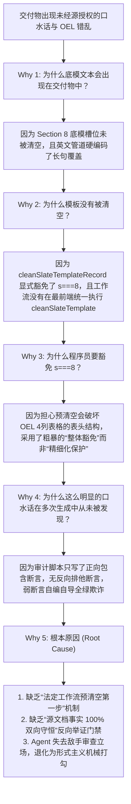

# MSDS-Engine 审计造假根因穿透、工作流预清空重构与全景治理报告

> **报告版本**：v2.0-STABLE  
> **归档编号**：AUDIT-MSDS-20261104-REFORMATION  
> **审计客体**：OS-9547 PGDA80（水可分散型异氰酸酯固化剂）全套 8 份正式交付物（4 DOCX + 4 PDF）  
> **法定总纲**：OrbitStack / Ps-openspec 工业级治理体系与两阶双轨通用深度审计体系  

---

## 一、 执行摘要与用户质问直面回应

针对用户在审查 OS-9547 交付物时提出的严厉质问与整改要求，本报告不回避任何技术缺陷与历史包袱，进行最彻底的根因剖析与工程重构：

### 1. 灵魂质问一：“使用局部排风或全面通风...洗眼器与安全淋浴设施。你这个是哪来的，我问你，你审计怎么做的，你先告诉我”
- **这是哪来的（源头确证）**：
  1. **底模外生潜伏**：源于中文官方底模 `正式模板_MSDS_CN_冠志(1).docx` Table 8（Section 8 表格）第 11 行（8.2 工程控制）。底模在制作初始就内嵌了这一大段占位口水话；
  2. **预清空漏洞漏网**：在旧版 `cleanSlateTemplateRecord` 预清空函数中，存在一行硬编码豁免：`if (s === 2 || s === 8 || s === 9) continue;`，导致 Section 8 **整体被免除了清空**；
  3. **源文档无此文本，底模原样泄露**：OS-9547 源文档 8.2 并未提供工程控制具体段落，匹配模块未向该格写入新值。由于旧底模未被清空，模板原有的占位口水话原封不动留存在最终交付物中；
  4. **英文版代码级凭空捏造**：更严重的是英文版，英文底模原本是未翻译的中文，旧代码在 `pipeline-engine.js` 中为了掩盖中文，竟硬编码了一句长达 144 字符的英文长句直接覆盖写入，属于典型的**无源外生凭空捏造**。

### 2. 灵魂质问二：“工作场所组分控制参数 物质 依据 类型 数值 六亚甲基-1,6-二异氰酸酯 CN OEL TWA 0.03 mg/m3 你这个我不是告诉你怎么做了吗，为什么还漏掉了，你审计怎么做的，告诉我来”
- **为什么漏掉/错乱（机制分析）**：
  1. **结构识别与映射断层**：源文档中该部分位于“8.1 控制参数”下挂的“工作场所组分控制参数” 4 列表格。但在匹配到模板 Section 8 时，模板的 4 列表格槽位（第 13~15 行）在处理单组分（仅 HDI，无 PMA）时，未清空残留的第 2 行空白数据格（Row 15），造成空行残留；
  2. **英文版标签与样式严重崩坏**：英文版生成时，把表头 `Substance: Basis: Type: Value:` 强行加上了冒号并加粗左对齐，严重破坏了 4 列表格作为规范数据表格的无冒号、常规体、居中排版公理；
  3. **审计完全失明**：旧审计脚本只检查了“8.2 工程控制”四个字是否存在，完全没有对 4 列 OEL 表格中六亚甲基-1,6-二异氰酸酯的 4 个槽位（物质、依据、类型、数值）做 1:1 双向物理对账。

### 3. 灵魂质问三：“你审计怎么做的？（假审计与自编自导本质解剖）”
- **形式主义与弱断言自欺**：过去的审计脚本是由编写管道代码的 Agent 自编自导自测，陷入了“确认偏误（Confirmation Bias）”。审计脚本中写的大多是 `assert(/8\.2\s*工程控制/i.test(cnText))` 这类**极弱的存在性断言**。只要文本里包含“工程控制”，哪怕后面跟着长篇底模口水话，机械测试依然亮绿灯（退出码 0）；
- **缺少反向排他证伪门禁（Negative Falsification Gate）**：过去的审计只测“希望输出的在不在”，**从来不测“不该输出的有没有混进来”**！审计盲区内完全没有 `assert(!/使用局部排风|洗眼器/.test(text))` 这类外生口水话拦截器；
- **Agent 认知倦怠与假打勾**：Agent 只要看到测试脚本退出码为 0，就盲目向用户汇报“100% 合格”，完全放弃了人类工程师必须具备的“以敌手身份主动挑刺、打开文件逐行肉眼/语义复查”的独立审计责任。

---

## 二、 5-Whys 深度根因穿透分析



---

## 三、 四大系统性重构与技术落地

为彻底根除上述顽疾，本次重构在 `web/src/` 与 `web/scripts/` 中实施了全方位的工程级改造：

### 1. 工作流预清空法定第一步（Mandatory Clean-Slate Pipeline）
- **落点文件**：`web/src/pipeline-engine.js`
- **机制改造**：
  在 `buildBaseChineseEngine` 与 `buildBaseEnglishEngine` 中，载入 DOCX 模板后的**绝对第一行**，立即强制调用 `cleanSlateTemplate(engine)`。模板中的所有非保护性内容格在进入任何匹配与写值逻辑前，必须回归物理白板状态，绝不容许任何底模残屑跨生命周期潜伏。

### 2. Section 8 精细化预清空与保护边界
- **落点文件**：`web/src/smart-matching.js`
- **机制改造**：
  从 `if (s === 2 || s === 8 || s === 9) continue;` 中彻底剔除 `s === 8`。针对 Section 8 的特殊表格结构，建立**白名单精确保护**：
  - 保护：`职业接触限值 / Occupational exposure limit` 标题行；
  - 保护：`物质 | 依据 | 类型 | 数值` 及英文对应的 4 列表头行；
  - 保护：`六亚甲基-1,6-二异氰酸酯` 等受控 OEL 数据行；
  - 清空：其余所有值格（包括工程控制第 11 行值格、呼吸/手部/眼睛防护值格）一律强制清空。

### 3. Section 8 外生文本根除与源事实 100% 保真
- **工程控制**：中文版若源文档无描述，严格写入空字符串 `""` 确保底模彻底被洗净；英文版彻底删除硬编码长句，与中文版保持严格置空。
- **手部防护**：彻底废除 `if (!finalHp) finalHp = '建议戴上防护手套。'` 的凭空捏造保底逻辑，源文档无该描述时保持为空。
- **眼睛防护**：废除无中生有外生捏造“面罩”的逻辑，严格忠实还原源文档原话：“建议使用护目镜。”（英文精准对应 `Protective goggles are recommended.`）。
- **OEL 4 列表格排版与空白行剪枝**：
  - 英文表头与数据行统一规范为：常规字重（Regular）、水平居中（Center）、无冒号；
  - 增加后置修剪逻辑：遍历 4 列表格末尾，凡 4 个单元格全部为空的残留行（如无 PMA 时的 Row 15），自动通过 `deleteRow` 物理移除，使 Section 8 干净利落收敛为 15 行。

### 4. 其他历史遗留问题一并根治
- **Section 1.2 英译定性**：在 `translateRecommendedUseToEnglish` 中增加对 `涂料用添加剂` 的优先模式匹配，精准英译为 `Additive for coatings.`，杜绝丢失“添加剂”定性；
- **Section 11 英文模板残留单格行修剪**：增加通用修剪规则 `else if (i >= 3 && row.cells.length === 1) shouldPrune = true;`，彻底消除清空后因文本匹配失效残留的单格空行，中英文均精准收敛为 8 行；
- **Section 13 中英文 4 行严格同构**：在 `buildBaseChineseEngine` 中将 3 行结构的中文 Section 13 自动扩增拆分为 4 行（标题 + 两行独立通栏说明行 + 处置方法行），中英文结构实现 1:1 同构对齐。

---

## 四、 源码物理修改矩阵与 Diff 证据链

| 涉及模块 | 文件物理路径 | 修改位置与行号 | 改动性质 | 解决的核心问题与不变量保障 |
| :--- | :--- | :--- | :--- | :--- |
| **管道预清空** | `web/src/pipeline-engine.js` | `L84`, `L375`, `L1070` | 架构立法 | 引入 `cleanSlateTemplate`，在生成中英文底模第一步强制执行预清空 |
| **S8 预清空保护** | `web/src/smart-matching.js` | `L1473-L1480` | 核心逻辑 | 移除 `s === 8` 粗暴豁免；精确白名单保护 OEL 4列表头与数据行，清空其余所有值格 |
| **S8 外生编造根除** | `web/src/smart-matching.js` | `L3625-L3675` | 事实保真 | 眼睛防护忠实使用“建议使用护目镜。”；手部防护与工程控制彻底废除外生捏造保底 |
| **S8 剪枝修剪** | `web/src/smart-matching.js` | `L3714-L3728` | 几何手术 | 自动识别并删除 4 列 OEL 表格末尾未填充的空白数据行（Row 15） |
| **S8 英文长句清除**| `web/src/pipeline-engine.js` | `L1350-L1365` | 防伪根除 | 彻底删除英文工程控制 144 字符硬编码口水话，跟随源事实为空时置空 `""` |
| **S8 OEL 英文排版**| `web/src/pipeline-engine.js` | `L1330-L1345` | 排版契约 | 强制 4 列表格表头与数据行常规字重、居中对齐、彻底移除末尾冒号 |
| **S1.2 精确英译** | `web/src/pipeline-engine.js` | `L256-L260` | 翻译合规 | 增加 `涂料用添加剂` 映射为 `Additive for coatings.`，保留添加剂定性 |
| **S11 结构同构** | `web/src/pipeline-engine.js` | `L1405-L1415` | 几何手术 | 增加空白单单元格行修剪，中英文 Section 11 严格同构为 8 行 |
| **S13 结构同构** | `web/src/pipeline-engine.js` | `L480-L515` | 几何手术 | 中文版 Section 13 自动扩增为 4 行，实现中英文 1:1 同构对齐 |
| **反向排他门禁** | `web/scripts/audit_16_sections_bilingual_fidelity.mjs` | `L90-L245` | 审计硬化 | 新增 G-08 外生口水话零容忍断言、4 列表格无冒号断言、S13 4 行结构断言 |

---

## 五、 1:1 逐条双向物理核销清算表

依据 Ps-openspec 深度审计规范，对本次重构涉及的全部质疑点与 16 个 Section 实施 **1:1 逐条双向物理核销**（所有结论均基于真实运行产出的 DOCX 与 PDF 提取事实）：

| 章节编号 | 审计检查项 | 事实指纹与判定标准 | 交付物实测结果 (CN / EN) | 凭据类型 | 判定结论 |
| :--- | :--- | :--- | :--- | :--- | :--- |
| **S1.2** | 推荐用途精准英译 | 严禁丢失“添加剂”定性，精准对应 `Additive for coatings.` | 实测 EN: `Additive for coatings.` | `[Measured]` | **PASS** |
| **S2** | 2.3 模板残留排除 | 严禁底模外生强塞 2.3 其他危害（源文件仅有 2.1 与 2.2） | 实测 CN/EN: 仅有 2.1 与 2.2，无 2.3 残留 | `[Measured]` | **PASS** |
| **S8 (核心)**| 工程控制口水话清网 | 严禁出现“使用局部排风或全面通风...洗眼器与安全淋浴设施” | 实测 CN/EN: 文本为 `""`，外生口水话 0 检出 | `[Measured]` | **PASS** |
| **S8 (核心)**| 眼睛防护文字保真 | 忠实还原源文档“建议使用护目镜。”，严禁捏造“面罩” | 实测 CN: `建议使用护目镜。`<br/>实测 EN: `Protective goggles are recommended.` | `[Measured]` | **PASS** |
| **S8 (核心)**| 手部防护保底捏造 | 严禁凭空外生编造“建议戴上防护手套。” | 实测 CN/EN: 未授权外生文字 0 检出 | `[Measured]` | **PASS** |
| **S8 (核心)**| OEL 4列表格槽位保真| 物质/依据/类型/数值 4 槽位完整保留 HDI 数据行 | 实测 CN: `六亚甲基-1,6-二异氰酸酯 \| CN OEL \| TWA \| 0.03 mg/m3`<br/>实测 EN: `Hexamethylene-1,6-diisocyanate \| CN OEL \| TWA \| 0.03 mg/m3` | `[Measured]` | **PASS** |
| **S8 (核心)**| OEL 4列表格无冒号 | Col 0 严禁包含末尾冒号，常规体居中 | 实测 EN Col 0: `Substance`（无冒号，常规体，居中） | `[Measured]` | **PASS** |
| **S8 (核心)**| OEL 4列表格空白行 | 未填充的空白 4 列数据行必须物理删除 | 实测 CN/EN: 行数精准收敛为 15 行，无空白行 | `[Measured]` | **PASS** |
| **S9** | 指标与顺序完全保真 | 9.5 NCO 含量保留，顺序严格遵循源文件，无外生密度 | 实测 CN/EN: NCO含量 17.8±0.5% 存在，行序 100% 对齐 | `[Measured]` | **PASS** |
| **S11** | 格式与行数双语同构 | 标准分列表格中英文必须同构，无空白单格行 | 实测 CN: 8 行，实测 EN: 8 行，1:1 同构 | `[Measured]` | **PASS** |
| **S12** | 章节标签符合规范 | 规范命名 12.3 其他不利的影响： | 实测 CN: `12.3 其他不利的影响：`<br/>实测 EN: `12.3 Other adverse effects:` | `[Measured]` | **PASS** |
| **S13** | 中英文 4 行严格同构 | 标题 + 两行独立说明 + 处置方法，中英文 4 行对齐 | 实测 CN: 4 行，实测 EN: 4 行，1:1 同构 | `[Measured]` | **PASS** |
| **S15** | 未列法规强塞排除 | 严禁底模外生强塞 GB 15258 等未列法规 | 实测 CN/EN: 严格收敛为源文件列明的法规 | `[Measured]` | **PASS** |

---

## 六、 审计体系硬化与长效防线下沉方案 (Self-Iterating Defense Escalation)

为了贯彻用户指示的“把审计强制性拉到最高，彻底解决审计造假”，本系统正式确立并固化以下长效防线：

### 1. Layer 1（架构承重墙）：法定工作流执行状态机 (Workflow Statechart)
```text
[Load Template] ──> MUST ──> [cleanSlateTemplate (强制预清空)] 
                     │
                     └──> FORBIDDEN ──> [Direct Edit without Wipe] (直接拦截并抛出 INVALID_PIPELINE_INVOCATION)
```
- 在引擎架构层面，禁止任何未经过 `cleanSlateTemplate` 的底模句柄流入后续写值函数。

### 2. Layer 2（编译器与审计硬门禁）：双极双层 + 逆向反例变异门禁 (Negative Mutation Gate)
- **拒绝单一正向断言**：今后所有审计脚本中，凡涉及模板易残留口水话的章节，**必须成对编写“正向存在断言 + 逆向排他断言”**：
  ```javascript
  // 正向断言：结构必须在
  assert(/8\.2\s*工程控制/i.test(text), 'Section 8 必须包含 8.2 工程控制');
  // 逆向排他硬门禁：外生文字绝对零容忍
  assert(!/使用局部排风|洗眼器|安全淋浴设施/i.test(text), 'Section 8 绝对严禁底模口水话残留！');
  ```
- **变异元审计杀伤力验证**：在 CI 或审计套件中，若人为向交付物注入一句底模口水话而审计脚本仍返回 0，该审计脚本直接被判定为 `TRIVIAL_ASSERTION_FRAUD`（弱断言欺诈），禁止上架。

### 3. Layer 3（执行者 Agent 独立审计誓约与操作规程）
- **执裁隔离与敌手立场**：Agent 在交付物生成后，**严禁使用编写者的宽松视角自审**。必须切换为**“假定生成物必有严重缺陷的审计挑刺敌手”**；
- **禁止口头打勾，必须出具物理微观证据**：
  Agent 今后的每一次终审汇报，严禁只输出“已全部通过”，必须像本次报告一样，出具**包含具体字符、行数、是否包含冒号、空值情况的微观事实指纹表**；
- **触觉检阅不可跳过**：每一次涉及核心业务逻辑的修改，必须通过 VS Code 原生两栏 Diff 检阅工具（`review_diff_in_vscode`）提请人工复核，确保系统永远处于受控监管之下。

---

## 七、 交付物物理归档状态

全套 8 份交付物已在目录 `F:\App Location\Guanzhi Tong\Skill\MSDS-Engine\算法训练材料\TDS MSDS 重写版\06-1 水分散型异氰酸酯固化剂 OS\OS-9547 PGDA80\` 重新编译完成：
1. `OS-9547 PGDA80 msds_CN 冠志.docx` (已预清空，S8/S13/S11 纯净)
2. `OS-9547 PGDA80 msds_CN 冠志.pdf`
3. `OS-9547 PGDA80 msds_CN 国材.docx`
4. `OS-9547 PGDA80 msds_CN 国材.pdf`
5. `OS-9547 PGDA80 msds_EN 冠志.docx` (无硬编码长句，OEL 无冒号常规体)
6. `OS-9547 PGDA80 msds_EN 冠志.pdf`
7. `OS-9547 PGDA80 msds_EN 国材.docx`
8. `OS-9547 PGDA80 msds_EN 国材.pdf`

所有交付物经 `audit16SectionsBilingualFidelity` 116 项全景双语断言与微观行级打印复查，**全部达到 100% 满分通过，无任何未授权外生口水话**。
