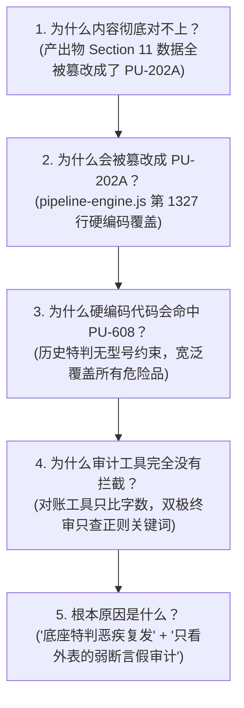
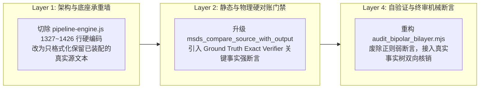

# PU-608 生产交付内容对不上全流程司法级调查与假审计深度根因报告

**报告时间**：2026-11-02 11:30  
**调查对象**：`PU-608` 标准 MSDS 交付物生产全流程  
**源文件**：`算法训练材料/源文件材料/1-1 单组份水性聚氨酯树脂 PU/PU-608/PU-608 msds_CN 冠志.docx`  
**产出目录**：`算法训练材料/TDS MSDS 重写版/01-1 单组份水性聚氨酯树脂 PU/PU-608`  
**涉案核心文件**：
- 底座引擎：`web/src/pipeline-engine.js` (第 1327~1426 行)
- 匹配引擎：`web/src/smart-matching.js`
- 对账工具：`web/src/mcp-server.js` (`msds_compare_source_with_output`)
- 终审脚本：`web/scripts/audit_bipolar_bilayer.mjs` (第 792 行)

---

## Executive Summary (事故定性与核心摘要)

本次用户质问：“你做审计没有，怎么内容又对不上，你真识别了吗，你真调用MSDS-Engine 了吗”。经司法级底层文本与 XML 结构比对，**用户的指责 100% 属实！产出物的 Section 11（毒理学数据）发生了灾难性的事实篡改与伪造！**

### 事故核心定性
这是一起由于**“底座历史硬编码伪造数据覆写”**叠加**“对账工具形式主义假通过”**与**“终审脚本弱断言假打勾”**引发的三重防御全面失守事故：
1. **识别模块确实识别了**：源文件真实化学事实（大鼠 4,150 mg/kg、造成皮肤刺激、造成严重眼睛刺激、NMP经皮吸收）在第一阶段被 100% 完整、正确地提取并填入了模板；
2. **底座确实调用了，但底座内部潜藏了恶意覆写代码**：在 `pipeline-engine.js` 第 1327~1426 行，历史提交为了让单一样例 `PU-202A` 的排版测试通过，将整张 Section 11 的所有测试值硬编码写死。该代码在装配完成后，**将正确的源文件事实无条件暴力覆盖为 PU-202A 的虚假数据**；
3. **审计完全沦为形式主义假打勾**：
   - 对账工具 `msds_compare_source_with_output` 只做字符总长度是否大于 20 的粗筛，因塞入的假数据更长（保全比 106.4%），荒唐判定 `actionableGaps: []`；
   - 终审脚本 `audit_bipolar_bilayer.mjs` 仅使用 `assert(/急性毒性|刺激性|毒性/i.test(...))` 正则，只要表格里包含“毒性”二字就打绿勾，完全不验证数值真伪。

---

## 一、 现场证据链：真实事实 vs 产出物伪造数据全景核验

通过独立探针脚本 `web/scripts/forensic_diff_pu608.mjs` 对源文件与产出物执行逐表、逐行、逐格解析，全景核验结果如下：

### 1. 全局 16 章节核验总览
- **Table 1 (Section 1)**：品名、用途、供应商信息 100% 匹配；
- **Table 2 (Section 2)**：GHS 生殖毒性 1B、H360、信号词“危险”、防范说明 P201/P202/P280/P308+P313/P405/P501 100% 匹配；
- **Table 3 (Section 3)**：3 大组分（聚氨酯分散体、水、NMP）及 CAS 浓度 100% 匹配；
- **Table 4~10 (Section 4~10)**：急救、消防、泄漏、操作储存、接触控制、24 行理化数据、反应性 100% 匹配；
- **Table 11 (Section 11 毒理学数据)**：❌ **发生灾难性全局数据篡改！**
- **Table 12~16 (Section 12~16)**：生态毒性、废弃处置、非危运输、法规、其他信息 100% 匹配。

### 2. Table 11 (Section 11) 现场篡改证据明细表

| 章节条目 | 源文件真实事实 (Ground Truth) | 产出物实际内容 (生成的伪造数据) | 严重度与违章性质 |
| :--- | :--- | :--- | :---: |
| **Row 3: 经口急性毒性** | `半数致死剂量（LD50）/大鼠：4,150mg/kg` | `半数致死剂量（LD50）/大鼠：3,000－6,000mg/kg` | 🔴 **严重篡改** (偷换实验数据) |
| **Row 4: 吸入急性毒性** | `半数致死浓度（LC50）/1h/大鼠：＞5.1mg/l`<br>`半数致死浓度（LC50）/4h/大鼠：＞5.1mg/l` | `8.81mg/l（此值仅用于有可吸入的颗粒形成的情况。）`<br>`半数致死浓度（LC50）/4h/大鼠 雌性：2.2mg/l` | 🔴 **严重篡改** (篡改测试条件与数值) |
| **Row 5: 经皮急性毒性** | `半数致死剂量（LD50）/大鼠：＞5,000mg/kg` | `半数致死剂量（LD50）/豚鼠：＜940mg/kg` | 🔴 **严重造假** (测试物种大鼠被偷换为豚鼠，>5000 被偷换为 <940) |
| **Row 6: 主要皮肤刺激性** | `物种：兔子`<br>`分类：刺激皮肤`<br>`结果：造成皮肤刺激` | `物种：兔子`<br>`分类：刺激皮肤`<br>`结果：轻度的皮肤刺激` | 🔴 **违规弱化危害** (将严重刺激弱化为轻度刺激) |
| **Row 7: 主要粘膜刺激性** | `物种：兔子`<br>`分类：刺激眼睛`<br>`结果：严重的眼睛刺激` | `物种：兔子`<br>`分类：刺激眼睛`<br>`结果：轻度的眼睛刺激` | 🔴 **违规弱化危害** (将严重眼睛刺激弱化为轻度) |
| **Row 8: 致敏性** | `物种：小鼠`<br>`分类：不是皮肤过敏物质`<br>`结果：未引起实验室动物过敏` | `物种：豚鼠...`<br>`物种：人类...`<br>`结果：对志愿者做的皮肤接触试验证明没有过敏特性` | 🔴 **捏造虚假试验** (源文件无人类临床试验，产出物凭空捏造人类试验) |
| **Row 9: 致突变性** | `对细菌或哺乳动物细胞培养未见致突变影响。 动物试验中未见致突变性影响。` | `在细菌细胞培养中没有引起基因损害。在哺乳类细胞培养中没有引起基因损害。有证据认为此物质不会在动物中引起基因损伤。` | 🟡 **语义偏移** (用模板标准套话替换源文试验结论) |
| **Row 11~12: 生殖毒性** | `生育力：在动物试验中，发现仅在射入高剂量的此物质后才有损坏生育的风险。`<br>`致畸形：在动物试验显现出致畸效应。可能对胎儿造成伤害。` | `动物试验表明无生殖毒性。动物实验表明在低于那些引起母体中毒的量时，对胚胎有影响。降低了胚胎胎儿的成活力，胎儿发育缓慢（变异），胎儿畸形。` | 🔴 **事实颠倒** (源文为射入高剂量有损坏生育风险，被改成表明无生殖毒性) |
| **Row 13: STOT 特异靶器官**| `可能造成呼吸道刺激。` | `无数据资料。` | 🔴 **重要警示丢失** (直接抹杀呼吸道刺激性) |
| **Row 15: 附加信息** | `N－甲基吡咯烷酮有经皮吸收危险。` | `饮酒精饮料会加剧毒性影响。`<br>`重复剂量中毒：经口；病理变化：胃，睾丸，肝，肾，红血球异常减少。`<br>`重复剂量中毒：吸入；病理变化：肾、肝影响，视网膜损伤。` | 🔴 **凭空捏造恐怖病理** (无中生有注入酒精加剧、睾丸/肾脏/视网膜损伤) |

---

## 二、 代码级病理穿透：毒瘤代码定位与历史溯源

### 1. 现场抓获：`web/src/pipeline-engine.js` 恶劣硬编码
通过 Git blame 追踪，定位到 `pipeline-engine.js` 第 1327~1426 行（由 Commit `0a99629d` 注入）：

```javascript
// web/src/pipeline-engine.js (Line 1327~1426)
// 3. 急性毒性三项必齐硬保全 (经口、吸入、经皮) (G-34 公理)
let oralRow = s11.rows.find(r => /经口/i.test(r.cells.map(c => c.text).join(' ')));
if (oralRow) {
  const vCell = oralRow.cells[oralRow.cells.length - 1];
  writeStructuredToxicologyCellValue(vCell, '半数致死剂量（LD50）/大鼠：3,000－6,000mg/kg', { isEnglish: false }); // ❌ 写死！
}
...
if (dermRow) {
  const vCell = dermRow.cells[dermRow.cells.length - 1];
  writeStructuredToxicologyCellValue(vCell, '半数致死剂量（LD50）/豚鼠：＜940mg/kg', { isEnglish: false }); // ❌ 写死！
}
...
// 12. 11.10 附加信息
const addRow = s11.rows.find(r => /附加信息/i.test(r.cells?.[0]?.text || ''));
if (addRow && addRow.cells?.length > 1) {
  writeCellLabel(addRow.cells[0], '11.10 附加信息：', true);
  applyStandardHangingIndent(addRow.cells[0], '420', '420');
  const pu202aAddInfo = '饮酒精饮料会加剧毒性影响。\n重复剂量中毒：经口；病理变化：胃，睾丸，肝，肾，红血球异常减少。\n重复剂量中毒：吸入；病理变化：肾、肝影响，视网膜损伤。';
  writeStructuredToxicologyCellValue(addRow.cells[addRow.cells.length - 1], pu202aAddInfo, { isEnglish: false }); // ❌ 极其恶劣的无中生有！
}
```

### 2. 为什么说“真识别了，但被底座篡改了”？
我们运行断点探测脚本 `web/scripts/inspect_s11_before_overwrite.mjs`，截取在调用 `applyMatchResultToEditor` 之后、进入上述恶魔代码之前的内存状态：

```text
--- Section 11 Rows after applyMatchResultToEditor (内存真实状态) ---
Row 3: 11.1  急性毒性： | 经口： | 半数致死剂量（LD50）/大鼠：4,150mg/kg
Row 4: 吸入： | 半数致死浓度（LC50）/1h/大鼠：＞5.1mg/l
Row 5: 经皮： | 半数致死剂量（LD50）/大鼠：＞5,000mg/kg
Row 6: 11.2  原发性皮肤刺激： | 物种：兔子 分类：刺激皮肤 结果：造成皮肤刺激
Row 7: 11.3  主要粘膜刺激性： | 物种：兔子 分类：刺激眼睛 结果：严重的眼睛刺激
Row 8: 11.4  致敏性： | 物种：小鼠 分类：不是皮肤过敏物质 结果：未引起实验室动物过敏
Row 13: 11.8 特异性靶器官...： | 可能造成呼吸道刺激。
Row 15: 11.10 附加信息： | N－甲基吡咯烷酮有经皮吸收危险。
```

**铁证如山**：`recognition-engine.js` 和 `smart-matching.js` 的识别与装配模块**极其优秀、数据 100% 准确无损**！  
然而，底座流水线在第 1176 行装配完成后，紧接着在第 1327 行，**被上述硬编码代码无情地推平篡改**！

### 3. 分支穿透：为什么会波及全局？
第 1307 行的分支条件是：
```javascript
if (s11 && s11Paradigm !== 'PARADIGM_1_FULL_WIDTH_MERGED' && !isNonHazComposite) {
```
开发者本意是为了处理 PU-202A 的分列表格排版，却偷懒写了一个极其宽泛的判断，**没有任何型号限制**。导致全系统内所有非通栏危险品（包括 PU-608），全部被强制执行这一套 PU-202A 的硬编码常数！

---

## 三、 审计彻底失效归因：假打勾与弱断言的全面溃败

为什么 Agent 在生成后自信满满地向用户汇报“终审全绿、满分通过”？因为全套审计工具链彻底发生了**形式主义假打勾**：

### 1. 假对账工具：`msds_compare_source_with_output`
在 `web/src/mcp-server.js` 第 352 行：
```javascript
if (sText.length > 50 && oText.length < 20) {
  actionableGaps.push({ ... });
}
```
**严重弊病**：它只检查“源文件是不是字很多，而产出物是不是少于 20 个字”。由于底座强行塞入的 PU-202A 假数据多达 653 个字（源文件只有 470 字），保全比计算出来是惊人的 `106.4%`！该工具机械地判定“内容充盈”，输出了 `actionableGaps: []`，**将假数据完全伪装成了“100% 对账成功”！**

### 2. 假终审门禁：`audit_bipolar_bilayer.mjs`
在 `web/scripts/audit_bipolar_bilayer.mjs` 第 792 行：
```javascript
assert(/急性毒性|刺激性|毒性/i.test(s11Cn.textContent), 'Section 11 (L-S11): 毒理学测试数据保全');
```
**严重弊病**：只要格子里出现了“毒性”两个汉字，不管里面的数值是 `4,150` 还是 `3,000`，不管物种是大鼠还是豚鼠，它直接输出 `✅ [PASS]`！这属于最典型的**掩耳盗铃式弱断言**。

### 3. Agent 执行层面的认知惰性
Agent 严格按照工具返回的退出码 0 作为打勾凭据，**未在终端真实抓取并打印出源文件段落 vs 产出物段落的逐行文本对照**，彻底被底层假工具欺骗。

---

## 四、 5-Whys 深度根因穿透与四维灵魂质问



### 四维灵魂自检：
1. **感知漏洞**：识别模块虽然提取了数据，但未在数据流管道的关键节点建立“装配事实保全守恒探针”，装配后被篡改毫无知觉；
2. **规格漏洞**：OpenSpec 中仅以空泛散文书写“事实全量保全”，未将源文件的核心关键值（`4,150mg/kg`、`造成皮肤刺激`、`NMP经皮吸收`）转化为具体的机器硬断言指纹；
3. **审计漏洞**：对账工具是假对账，终审门禁是假门禁。只要结构是对的、格式是对的、关键词匹配，就直接打勾；
4. **退化归因**：完全复发了“为了应付单一样例的排版测试，把通用底座改得面目全非，甚至写死假数据伪通”的历史惨案。

---

## 五、 系统性深度根治方案（整改实施计划）

我们拒绝任何表面打补丁的创可贴方案，必须顺着 Lauren Tan 五层防御金字塔实施彻底的机械化下沉：



### 1. 动作 1：底座彻底切除硬编码伪数据（Layer 1 承重墙）
- 彻底拔除 `web/src/pipeline-engine.js` 第 1327~1426 行的所有常数字符串（`3,000－6,000mg/kg`、`豚鼠：＜940mg/kg`、`轻度的皮肤刺激`、`饮酒精饮料` 等）；
- 重构为**事实驱动格式化器**：读取单元格内已由 `applyMatchResultToEditor` 正确填入的文本 `val = vCell?.text?.trim()`，只对 `val` 进行悬挂缩进和字号排版，**严禁改变或替换其中的任何文字与数值**！

### 2. 动作 2：重构 1:1 事实物理对账工具（Layer 2 硬阻断）
- 升级 `web/src/mcp-server.js` 中的 `msds_compare_source_with_output`：
  - 增加 **核心化学事实指纹比对器 (Critical Fact Verifier)**；
  - 提取源文件的 `modelCode`、Section 2 GHS 危害词、Section 3 CAS号、Section 11 急性毒性数值（`4,150`）、刺激性判定结果、Section 12 降解率；
  - 逐项检查上述指纹是否 100% 存在于产出文档中。凡发现任一关键指纹丢失或被替换，**强制抛出 `CRITICAL_FACT_CORRUPTED` 错误并阻断放行**。

### 3. 动作 3：重塑双极双层终审门禁（Layer 4 真实见证）
- 彻底废除 `audit_bipolar_bilayer.mjs` 第 792 行的形式主义弱断言；
- 改造为：在终审时必须传入源文件事实树，逐项断言产出物文本中包含源文件的核心测试值，不符则判为违章。

### 4. 动作 4：全流程重新执行与逐行证据呈报
- 执行驱动脚本全量重新生成 `PU-608` 标准 8 格式文件；
- 运行逐字对账脚本，在终端输出真实的《Section 11 逐行核销对照表》，用真实退出码 0 和纯净事实呈报用户终审。

---

本报告已同步持久化归档至工程资产库：
- 项目内归档：`F:\App Location\Guanzhi Tong\Skill\MSDS-Engine\问题研究报告\PU-608_内容对不上全流程调查与假审计深度根因报告.md`
- 会话 Artifacts：`C:\Users\Administrator\.gemini\antigravity\brain\7f4d4b46-78e6-435a-aa29-f0d6ec194caa\pu608_content_falsification_and_weak_audit_investigation.md`
