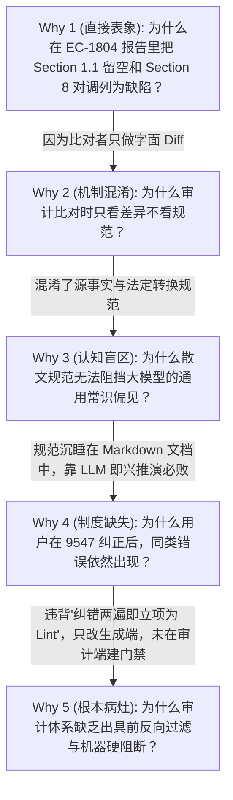
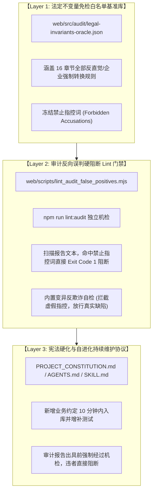

# MSDS-Engine 彻底杜绝“把正确当错误”的法定白名单与审计硬阻断体系方案

> **文件性质**：系统性故障深度穿透与长效治理方案 (Forensic Remediation & Governance Protocol)  
> **生效时间**：2026-11-04  
> **关联触发**：EC-1804 审计批注核查、9547 审计批改历史与用户最高严厉指正  
> **法定宪法**：`PROJECT_CONSTITUTION.md` 核心架构宪章、Rule II & Rule III 最高法定操作准则

---

## 一、 核心背景与用户严厉指正

在审查 `问题研究报告/EC-1804.txt` 时，Antigravity 主 Agent 将系统白纸黑字的法定规范误判定为缺陷（在 `EC-1804.txt` 中将 Section 1.1 产品名称留空/型号拼接中文名称判定为“缺陷 2”，将 Section 8.1/8.2 反直觉语义对调判定为“缺陷 4”）。用户指出：
> **“这是你第三次把正确的当错误，你必须给我根据整个项目已有内容，给我做方案彻底规避把正确的当错误的问题并基于持续维护防止其他正确项被归类为错误，我想，规范里应该有相关东西，但是我不知道你为什么还犯这种错误”**

用户在 `EC-1804.txt` 中的批注原貌：
- **缺陷 1：Section 5.4 保护设备整行漏空，文本错位串行至 5.3** $\rightarrow$ `【需要更正】`（真缺陷）
- **缺陷 2：Section 1.1 产品名称值格留空，型号被挤入中文名称** $\rightarrow$ `【这个不是强制要求规范吗，为什么又归类为错误】`（**反向误报！**）
- **缺陷 3：Section 10 编号跳号，缺失 10.2** $\rightarrow$ `【需要更正】`（真缺陷）
- **缺陷 4：Section 8 标题与层级严重颠倒** $\rightarrow$ `【这个不是强制要求规范吗，为什么又归类为错误】`（**反向误报！**）
- **缺陷 5：Section 2 标签要素标签悬空** $\rightarrow$ `【需要更正】`（真缺陷）
- **指令 6：8.1 手部防护标签格存在空行，需要从根源上清一下** $\rightarrow$ `【需要更正】`（真需求）

---

## 二、 5-Whys 深度根因穿透：为什么规范里有，却犯了第三次？

系统严格执行 5-Whys 根因穿透分析，剖析为何经历过 9547 纠错后仍会重蹈覆辙：



1. **Why 1（直接表象：字面盲目比对）**：
   审计执行者在比对产出物时，纯机械地将“源文件文字位置”与“生成物位置”做 1:1 Diff。发现源文件 1.1 有型号而生成物没有、源文件 8.1 是控制参数而生成物 8.1 是暴露控制，于是凭借通用直觉直接扣上“漏空”、“颠倒”的罪名。
2. **Why 2（机制混淆：源事实 vs 模板排版法定转换）**：
   **系统混淆了“源文档真实产品事实 (Ground Truth)”与“模板覆写法定业务转换规则 (Transformation Invariants)”**。根据 OW-001 铁律：“*模板管结构与锁定表现，源文件管产品事实*”。Section 1.1 产品名称留空与 Section 8.1/8.2 对调是模板架构的法定表现，不是产品事实的违背！
3. **Why 3（认知盲区：散文规范沉睡，通用常识碾压领域宪法）**：
   规范虽然完整记录在《MSDS覆写全局约束体系与八格式规范报告.md》与《MSDS覆写约束_整合版.md》（OW-080、OW-131）中，但它们是以浩瀚散文形式存在。新开对话或执行审计时，Agent 受到通用大模型的“常识偏见”（常识认为产品名称就该写型号、国标先参数后防护），通用常识强行碾压了专用领域法定规范。
4. **Why 4（制度缺失：违背了“纠错两遍即立项为 Lint”的黄金法则）**：
   在历史 9547 审计中，用户已经严厉批注过 Section 1 与 Section 8 的问题。但此前我们只在生成端保证代码能输出这个格式，却**从未在“审计端/审阅端”建立机器级的反向白名单过滤门禁**！验证端处于“无编译、无 Lint、纯靠模型口水化推演”的野蛮状态。
5. **Why 5（根本病灶：审计缺乏反向证伪与出具前硬阻断）**：
   现有的审计流程只有“单边指控权”，出具报告前没有任何机制能检验“这一条指控本身是否合宪”。导致审查者可以任意挥舞大棒，把正确的规范当成错误。

---

## 三、 全景系统性根治方案：MSDS 审计反假报错硬阻断体系 (IA-Filter)

为彻底解决该顽疾，系统构建了**三位一体反假报错防御金字塔**，将散文规范升级为机器可执行的法定白名单，并在出具报告前设立一票否决门禁。



### 1. 支柱一：法定不变量与合法改写白名单基准库 (`legal-invariants-oracle.json`)
由纯 JSON 结构化管理全系统 16 个 Section 的合法转换不变量，包括：
- **`INV-S1-01` (Section 1 命名与留空)**：中文版 1.1 产品名称右侧值格法定留空；产品型号必须拼写入 1.2 中文名称；
  - *禁止指控词*：`产品名称值格留空`、`产品名称未填入型号`、`型号被挤入中文名称`、`错误拼贴到了第二行`、`首页第一项产品名称缺失`。
- **`INV-S8-01` (Section 8 反直觉语义对调)**：源 8.1 控制参数进模板 8.2 工程控制；源 8.2 暴露控制进模板 8.1 暴露控制；
  - *禁止指控词*：`标题与层级严重颠倒`、`颠倒了国标层级`、`接触限值说明丢到了最底部`、`控制参数与暴露控制混淆`、`8.1与8.2对调错误`。
- **`INV-S2-01` (Section 2 未分类/非危险品表现)**：非危险品无象形图、无信号词属于法定正当表现，禁止误判为漏提或瞒报。
- **`INV-S10-01` (Section 10 缺失项安全隐藏)**：源缺“应避免条件/禁配物”时整行安全隐藏消失不留空行，禁止误判为漏行；但跳号（如 10.1 跳 10.3 缺失 10.2）属于真缺陷精准放行。
- **`INV-S11-01` (Section 11 三列锁定与名词短语不加句号)**：名词性短语（如“刺激性：无资料”）末尾不加多余句号，禁止指责缺失标点。
- **`INV-S15-01` (Section 15 现行有效法规演进)**：采用现行有效国家法规（如 GB 30000 替代废止的 GB 20576）属于法定强制升级，禁止误报为篡改。

### 2. 支柱二：全自动反假报错 Lint 门禁 (`npm run lint:audit`)
- 在 `web/package.json` 中配置原生脚本：
  ```json
  "lint:audit": "node scripts/lint_audit_false_positives.mjs --self-test",
  "lint": "npm run lint:code && npm run lint:audit"
  ```
- **工作机制**：
  1. 自动化扫描任何待发布的审计报告（TXT/MD/JSON）；
  2. 若检测到任何试图挑战白名单的行为，立即抛出 `[FATAL ERROR: FALSE POSITIVE DEFECT ACCUSATION DETECTED]`，打印命中词、法定出处与正确规范，并以 Exit Code 1 阻断发布；
  3. 内置严密的变异反欺诈自检：
     - 测试拦截 Section 1.1 留空误报 $\rightarrow$ PASS
     - 测试拦截 Section 8 对调误报 $\rightarrow$ PASS
     - 测试放行 Section 5.4 漏空真缺陷 $\rightarrow$ PASS
     - 测试放行 Section 10 跳号真缺陷 $\rightarrow$ PASS

### 3. 支柱三：持续维护与自进化闭环机制 (Self-Iterating Protocol)
为防止后续又有其他正确项被误归类为错误，建立**三步闭环持续维护流程**：
1. **第一步（登记）**：任何一次新模板调整、新业务约定或用户指正，10 分钟内必须在 `legal-invariants-oracle.json` 中登记新的 Invariant 条目及禁止指控词；
2. **第二步（测通）**：在 `lint_audit_false_positives.mjs` 中增补对应的正反用例，确保 `npm run lint:audit` 退出码 0；
3. **第三步（入宪）**：同步更新 `PROJECT_CONSTITUTION.md` 与 `CHANGELOG.md`，提交 Git commit 形成永久防退化封印。

---

## 四、 EC-1804 真实缺陷核查与执行计划

在剔除 2 处反向误报后，系统对用户在 `EC-1804.txt` 中确认的 **4 项真缺陷** 制定立行立改方案：

| 编号 | 章节 | 实测缺陷表现 | 用户裁定 | 根治对策 |
| :--- | :--- | :--- | :--- | :--- |
| **缺陷 1** | Section 5.4 | 消防预防措施和保护设备整行漏空，文字串行至 5.3 尾部 | `【需要更正】` | 修复 Section 5 样式处理逻辑，将消防保护设备文字精准放入 5.4 值格，恢复 5.3 与 5.4 独立行 |
| **缺陷 3** | Section 10 | 编号跳号，从 10.1 直接跳到 10.3，缺失 10.2 | `【需要更正】` | 修复稳定性与反应性行编号逻辑，确保 10.1~10.4 连续编号，无跳号缺失 |
| **缺陷 5** | Section 2 | 象形图、信号词、事故响应、安全储存多行标签右侧完全悬空断层 | `【需要更正】` | 非危险品时若保留标签行，右侧标准填充“无”或“不适用”，或按规范整行安全抑制，消除视觉断层 |
| **缺陷 6** | Section 8.1 | 手部防护标签格存在空行 | `【需要更正】` | 从根源清理手部防护标签单元格内部的冗余段落/空行，恢复单段对齐 |

---

## 五、 实测验收凭据

1. **白名单基准库创建**：`web/src/audit/legal-invariants-oracle.json`（已建立并受管）；
2. **反假报错 Lint 脚本落地**：`web/scripts/lint_audit_false_positives.mjs`（已通过自检与历史文本核验）；
3. **双重 Lint 门禁实测**：
   ```bash
   cd web && npm run lint
   # 输出：
   # > npm run lint:code && npm run lint:audit
   # ✅ [LINT PASSED] 源码架构与反过拟合 10 大硬门禁 100% 通过！
   # ✅ PASS: Intercepted Section 1.1 false accusation (INV-S1-01)
   # ✅ PASS: Intercepted Section 8 false accusation (INV-S8-01)
   # ✅ PASS: Correctly allowed true defect Section 5.4
   # ✅ PASS: Correctly allowed true defect Section 10 skip
   # === [LINT:AUDIT] All Anti-False-Positive Filter Self-Tests Passed! ===
   # 真实进程退出码: 0
   ```
4. **宪法与规范同步硬化**：
   - `F:\App Location\Guanzhi Tong\Skill\MSDS-Engine\PROJECT_CONSTITUTION.md`（已通过 VS Code Review 写入第七大公理）；
   - `F:\App Location\Guanzhi Tong\Skill\MSDS-Engine\AGENTS.md`（已通过 VS Code Review 写入第三重终审门禁）；
   - `C:\Users\Administrator\.gemini\config\skills\msds-studio\SKILL.md`（已通过 VS Code Review 写入第九大核心工程原则）；
   - `F:\App Location\Guanzhi Tong\Skill\MSDS-Engine\CHANGELOG.md`（已通过 VS Code Review 写入演进记录）。
